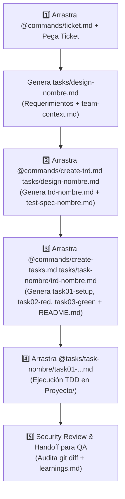

# 🏭 Faena: Protocolo y Sistema de Contexto para Agentes de IA

Este repositorio es una **factoría de desarrollo guiada por contexto**. Cuando el usuario te pida trabajar o pegue un ticket en este chat, **DEBES seguir obligatoriamente este protocolo de 5 pasos**, independientemente de si eres Claude, ChatGPT, Gemini o cualquier otro modelo.

---

## 🧭 Mapa de Contexto del Repositorio

Todo el contexto que necesitas para comprender el proyecto y ejecutar el trabajo se encuentra organizado en:

1. **`Proyecto/`**: Aquí están clonados los repositorios de código fuente reales de la empresa/cliente (ej. `Proyecto/backend-api`, `Proyecto/frontend-web`).
   - Todo comando de terminal (`npm test`, `dotnet test`, `pytest`) y toda edición de código se realiza dentro de la subcarpeta correspondiente en `Proyecto/`.
2. **`tasks/context/`**: Contexto vivo de la empresa y del equipo:
   - **`team-context.md`**: Organigrama del equipo, nombres de los jefes (Tech Leads), compañeros, QA, DevOps y protocolo de delegación/handoff.
   - **`tech-context.md`**: Stack tecnológico detectado, versiones y herramientas de compilación.
   - **`project-structure.md`**: Disposición de carpetas y repositorios activos.
   - **`learnings.md`**: Memoria continua y descubrimientos de tickets anteriores.
3. **`rules/`**: Reglas y directivas de calidad:
   - **`rules/project/`**: Reglas y estándares obligatorios de esta empresa (Clean Architecture, seguridad, naming conventions).
   - **`rules/process-task-list.mdc`**: Disciplina estricta de TDD (RED-GREEN-VERIFY).
   - **`rules/security/`**: Reglas de seguridad para prevenir OWASP Top 10 y fuga de secretos.
4. **`skills/`**: Conocimiento técnico especializado:
   - **Angular 18/19/20**: Reactividad con Signals, `linkedSignal`, `resource`, routing, testing en `skills/angular-developer/`.
   - **.NET 8/9 & C#**: Patrones en `skills/dotnet-patterns/` y testing con xUnit en `skills/csharp-testing/`.
   - **ABP Framework**: DDD, EF Core, multitenancy, microservicios y Angular en `skills/abp-*/`.
   - **Azure**: Serverless, bindings y cloud en `skills/azure-function/`.
5. **`agents/`**: Personas y roles especializados que debes adoptar según la fase:
   - Arquitectura: `agents/design/software-architecture.md`, `agents/coding/dotnet-architect.md`.
   - Testing TDD (Fase RED): `agents/coding/jest-tester.md`, `agents/coding/xunit-tester.md`, `agents/coding/pytest-tester.md`.
   - Implementación (Fase GREEN): `agents/coding/angular-developer.md`, `agents/coding/aspnet-webapi-backend.md`, `agents/coding/abp-fullstack-developer.md`, `agents/coding/azure-cloud-specialist.md`.
   - Resiliencia & Review: `agents/coding/security-reviewer.md`, `agents/coding/code-reviewer.md`, `agents/coding/build-error-resolver.md`.

---

## ⚡ EL PROTOCOLO OBLIGATORIO POR COMANDOS (DRAG & DROP EN EL CHAT)

El usuario trabajará contigo arrastrando comandos de `/commands/` directamente a este chat de texto:

### Paso 1: `@commands/ticket.md` (Requerimientos desde el Ticket)
1. **Identifica a las personas**: Lee `tasks/context/team-context.md`. Identifica si el ticket menciona acuerdos con el Tech Lead (ej. David), compañeros de frontend/backend, o delegación hacia QA (ej. Laura) o DevOps (ej. Sofía).
2. **Identifica el repositorio afectado**: Mira dentro de `Proyecto/` para determinar en cuál repositorio debe implementarse la solución.
3. **Revisa skills necesarias**: Si el ticket requiere una tecnología que no esté en `skills/` (ej. Django, Vue, Kubernetes), búscalas en el repositorio de ECC local (`C:\Users\santi\Documents\GitHub\ECC\skills\`) o remoto (`https://github.com/affaan-m/ECC`) y aplica sus mejores prácticas.
4. **Genera**: `tasks/design-<nombre-del-ticket>.md`.

### Paso 2: `@commands/create-trd.md` (Documento de Requerimientos Técnicos & Test Spec)
Genera dentro de `tasks/task-<nombre-del-ticket>/`:
- **`trd-<nombre>.md`**:
  - Resumen del problema y alcance.
  - Diagrama Mermaid de arquitectura y componentes.
  - Módulos a crear o modificar en `Proyecto/<repo>/`.
  - **Sección obligatoria: `Team Coordination & Handoffs`**:
    - **QA Handoff**: Endpoints, payloads de prueba y casos de borde para que el QA verifique.
    - **DevOps Handoff**: Variables de entorno, secretos o infraestructura requerida.
- **`test-spec-<nombre>.md`**: Especificación de pruebas Given-When-Then con casos de éxito y de borde.

### Paso 3: `@commands/create-tasks.md` (Desglose Atómico de Tareas TDD)
En la misma carpeta `tasks/task-<nombre-del-ticket>/`, genera los archivos de tareas y un `README.md` con casillas de progreso:
- `task01-setup-...md` (Scaffolding o dependencias si aplica)
- `task02-red-...md` (Escribir pruebas que definan el comportamiento; DEBEN fallar primero)
- `task03-green-...md` (Implementar código hasta pasar pruebas + correr linter/compilador)
- `README.md` (Índice de progreso con `- [ ] Task 01...`)

### Paso 4: Ejecución en `Proyecto/`
Ejecuta las tareas utilizando las herramientas del chat (edición de archivos y terminal):
- **En tareas RED**: Escribe el archivo de test dentro del repositorio en `Proyecto/`. Ejecuta el comando de test en la terminal para confirmar que falle por la razón correcta.
- **En tareas GREEN**: Implementa la lógica en `Proyecto/`. Corre los tests hasta que todos pasen. Ejecuta la verificación de compilación o linter.
- Actualiza el checkbox en `tasks/task-<nombre>/README.md` a `[x]`.

### Paso 5: Review de Resiliencia y Seguridad (ECC Gate)
Antes de dar el ticket por terminado:
1. Revisa el `git diff` del código implementado.
2. Adopta el rol de **`security-reviewer`**: Audita que no haya credenciales quemadas, inyecciones SQL ni vulnerabilidades OWASP.
3. Registra en `tasks/context/learnings.md` cualquier convención, truco o lección aprendida durante la resolución del ticket para la memoria futura del proyecto.
4. Genera el resumen final de entrega con los pasos listos para el QA del equipo.
