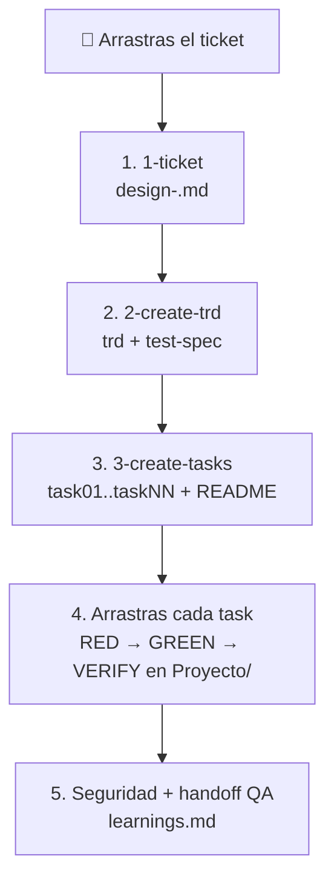

# 🏭 Faena — Harness de contexto para desarrollo asistido por IA

> Pega el ticket en el chat y el asistente trabaja con el contexto real de tu empresa: quién decide qué, qué stack hay, qué reglas no se rompen y qué tests deben pasar.
> Un repositorio que convierte Cursor, Claude Code, Gemini, OpenCode o cualquier agente que lea `AGENTS.md` en un ingeniero que conoce la organización y respeta la disciplina del equipo.

---

## ⚡ Inicio rápido (5 minutos)

```bash
git clone https://github.com/tu-usuario/Faena.git Mi-Empresa
cd Mi-Empresa
git clone git@github.com:empresa/backend-api.git Proyecto/backend-api   # uno o varios repos del cliente

# Windows
.\scripts\validate-faena.ps1
# macOS / Linux
pwsh ./scripts/validate-faena.ps1
```

1. Rellena `tasks/context/team-context.md` (organigrama **e** identidad Git corporativa).
2. Opcional: `git config core.hooksPath .githooks` para validar en cada commit.
3. Arrastra `@commands/1-ticket.md` al chat y pega el ticket.

Si la validación sale en verde (`OK: harness integro.`) y tu agente abre `PROTOCOL.md`, ya está funcionando.

---

## 🎯 Qué es Faena

Un **harness de contexto**: el código del cliente vive en `Proyecto/`, y todo lo demás es el contexto que el modelo necesita para trabajar como alguien del equipo.

- **Un protocolo, cinco adaptadores.** La política (invariantes, flujo, comandos) vive en [`PROTOCOL.md`](PROTOCOL.md). `AGENTS.md`, `CLAUDE.md`, `GEMINI.md`, `OPENCODE.md` y `.cursorrules` son archivos de ~20 líneas que apuntan ahí y añaden notas del host. Si el flujo cambia, se edita un solo archivo.
- **Aislamiento multi-cliente.** Un clon de Faena por empresa; los repos del cliente dentro de `Proyecto/`, que está en `.gitignore`. El cliente conserva sus ramas, remotos y reglas; Faena nunca los mezcla.
- **TDD estricto.** Cada ticket se descompone en tests que fallan primero (**RED**), implementación mínima (**GREEN**) y gates de calidad (**VERIFY**). El detalle operativo está en [`rules/process-task-list.md`](rules/process-task-list.md).
- **Conocimiento por dominio.** 29 skills en [`skills/`](skills/), indexadas por un catálogo generado: el agente abre la que corresponde antes de escribir código.
- **Memoria entre tickets.** Convenciones, trampas y decisiones se acumulan en `tasks/context/learnings.md`, no en la cabeza de quien resolvió el ticket anterior.
- **Review de seguridad y handoff.** Antes de cerrar, el agente audita el `git diff`, verifica la identidad Git corporativa y entrega el paquete de pruebas para QA.

## 🚫 Qué NO es

- **No es un runtime ni un agente autónomo.** No hay servidor, SDK propio ni proceso en segundo plano: el motor es el modelo que ya usas, en tu editor o en el chat.
- **No ejecuta trabajo por su cuenta.** Los comandos los arrastra una persona; el agente no inicia tickets solo.
- **No reemplaza** tu CI/CD, tu linter ni a tu QA. Los gates vienen del repo del cliente.
- **No necesita Docker, base de datos ni dependencias.** Los dos scripts de `scripts/` son mantenimiento del harness, no parte del flujo de un ticket.

---

## ✅ Requisitos

| Necesitas | Detalle |
| :--- | :--- |
| **git** | 2.30 o superior |
| **Shell** | PowerShell 5.1+ (Windows) o `pwsh`/bash (macOS, Linux). Solo para validar y regenerar el catálogo. |
| **Un host de IA** | Cualquiera de la tabla de abajo. |
| **Docker** | Solo si el repositorio del cliente lo pide. Faena no lo usa. |

### Hosts soportados

| Host | Archivo que lee | Cómo recibe el protocolo |
| :--- | :--- | :--- |
| Cursor | `.cursorrules` (+ `AGENTS.md`) | automático |
| Claude Code | `CLAUDE.md` (+ `AGENTS.md`) | automático |
| Gemini CLI / Antigravity | `GEMINI.md` | automático |
| OpenCode / Ollama local | `OPENCODE.md` | automático |
| Codex, DeepSeek Harness y otros agentes | `AGENTS.md` | automático |
| ChatGPT, Windsurf, Copilot (web o sin soporte de reglas) | — | **pega el contenido de `PROTOCOL.md`** al inicio del chat |

---

## 🛠️ Setup en 5 minutos

### 1. Clonar Faena y los repos del cliente

```bash
git clone https://github.com/tu-usuario/Faena.git Mi-Empresa
cd Mi-Empresa
git clone git@github.com:empresa/backend-api.git Proyecto/backend-api
git clone git@github.com:empresa/frontend-web.git Proyecto/frontend-web
```

No hace falta registrar los repos en ningún archivo: el agente los detecta listando `Proyecto/` en disco.

### 2. Rellenar `tasks/context/team-context.md` (obligatorio)

Es el único archivo que **debes** escribir a mano. Contiene:

- **Equipo**: Tech Lead, Product Owner, QA y DevOps, y cuándo escalar a cada uno.
- **Identidad Git corporativa**: `user.name` y `user.email` que deben usarse en los repos de `Proyecto/`.

Sin el bloque de identidad, el protocolo no puede verificar los commits y el agente te lo reclamará. Faena **nunca** debe commitear código del cliente con una cuenta personal.

### 3. Bootstrapear el resto del contexto

Arrastra al chat:

```markdown
@commands/create-context.md
```

Analiza `Proyecto/`, detecta stack, gestores de paquetes y comandos reales de test, y rellena `tech-context.md`, `project-structure.md`, `progress.md` y `system-patterns.md`.

`team-context.md` y `learnings.md` **nunca** se sobrescriben: son del equipo humano.

### 4. Validar la instalación

```powershell
.\scripts\validate-faena.ps1
```

Seis chequeos: ubicación y metadata de skills, catálogo al día, ausencia de `.mdc` sueltos, adaptadores apuntando a `PROTOCOL.md` y referencias de rutas existentes. Sale con código 1 si algo está roto, así que sirve igual en local que en CI.

Opcional pero recomendado:

```bash
git config core.hooksPath .githooks   # valida antes de cada commit
```

### 5. Elegir host y empezar

Abre el repo con tu editor y arrastra el primer comando. Nada más.

---

## 🎫 Anatomía de un ticket

Todos los artefactos de un ticket viven juntos en `tasks/task-<nombre>/`:

| Archivo | Qué contiene |
| :--- | :--- |
| `design-<nombre>.md` | Alcance, criterios de aceptación, personas y handoffs iniciales |
| `trd-<nombre>.md` | Arquitectura, módulos afectados, *Team Coordination & Handoffs* (QA y DevOps) |
| `test-spec-<nombre>.md` | Escenarios Given-When-Then, casos de éxito y de borde |
| `task01-setup-*.md` | Scaffolding o dependencias, si aplica |
| `taskNN-red-*.md` | El test que debe fallar primero |
| `taskNN-green-*.md` | Implementación + gates de calidad |
| `README.md` | Índice de progreso con checkboxes y la sección **Quality Gates** del repo |

El TRD es la fuente de las tareas: el agente no agrega, reordena ni renombra tareas por iniciativa propia.

---

## 🔄 El flujo de 5 pasos



| Paso | Arrastra | Resultado |
| :--- | :--- | :--- |
| 1 | `@commands/1-ticket.md` + el ticket | `design-<nombre>.md` |
| 2 | `@commands/2-create-trd.md tasks/task-<nombre>/design-<nombre>.md` | `trd-<nombre>.md` + `test-spec-<nombre>.md` |
| 3 | `@commands/3-create-tasks.md tasks/task-<nombre>/trd-<nombre>.md` | archivos de tarea + `README.md` |
| 4 | `@tasks/task-<nombre>/taskNN-*.md` | código y tests en `Proyecto/<repo>/` |
| 5 | (cierre) | auditoría del diff + handoff para QA |

En el **paso 4** el agente escribe el test, lo ejecuta y demuestra que falla por la razón correcta antes de implementar. Si el test pasa de inmediato, el test está mal, no el requisito.

Opcionales que no forman parte del camino crítico: `commands/1b-design.md` (diseño colaborativo), `commands/1c-decompose.md` (parte specs grandes en fases), `commands/4-update-context.md` (sincroniza contexto al cerrar). La lista completa está en [`PROTOCOL.md`](PROTOCOL.md) §4.

---

## 🚨 Invariantes que más duelen si se ignoran

1. **`Proyecto/**` está en `.gitignore`.** Nunca concluyas que está vacío a partir de `git status`: lista el disco o lee `tasks/context/project-structure.md`. Los agentes que filtran por gitignore mienten sobre esta carpeta.
2. **Identidad Git corporativa antes de cada commit.** `git config --local user.email` debe coincidir con `tasks/context/team-context.md`. Nunca la cuenta personal.
3. **Ningún código de producción sin un test que falle primero.** Y está prohibido debilitar o saltar tests para obtener verde.
4. **No inventar convenciones.** Si `rules/project/` está vacío, el agente lo dice; no supone estándares que el repo no define.

El resto está en [`PROTOCOL.md`](PROTOCOL.md) §2.

---

## 📁 Estructura del repositorio

```
Faena/
├── Proyecto/                   # 📁 Código del cliente (ignorado por el git de Faena)
│   └── <repo>/                 # Uno o varios repos clonados aquí
│
├── tasks/
│   ├── context/                # Contexto vivo (6 archivos)
│   │   ├── team-context.md     # Equipo, roles e identidad Git corporativa
│   │   ├── tech-context.md     # Stack, versiones y comandos reales
│   │   ├── project-structure.md# Repos clonados y disposición de carpetas
│   │   ├── system-patterns.md  # Patrones arquitectónicos observados
│   │   ├── progress.md         # Estado y foco actual
│   │   └── learnings.md        # Memoria continua entre tickets
│   ├── tickets/                # Tickets guardados como referencia
│   └── task-<nombre>/          # Todos los artefactos de un ticket, juntos
│
├── rules/                      # 📏 Reglas y disciplina
│   ├── project/                # Estándares de la empresa (máxima prioridad)
│   ├── security/               # OWASP, secretos, checklist de commit
│   ├── skills-routing.md       # Obliga a leer la skill del dominio
│   ├── process-task-list.md    # Disciplina TDD RED → GREEN → VERIFY
│   └── <stack>.md              # Reglas técnicas (angular, dotnet, abp, …)
│
├── skills/                     # 🧠 Conocimiento técnico por dominio (fuente única)
│   ├── README.md               # Catálogo generado
│   ├── <dominio>/SKILL.md      # 29 skills + sus references/
│   └── project/                # Skills privadas de la empresa
│
├── commands/                   # 🧩 Comandos arrastrables del flujo
├── agents/                     # 🤖 28 personas/roles por fase
│
├── scripts/                    # 🛠️ Mantenimiento del harness
│   ├── validate-faena.ps1      # 6 chequeos de integridad
│   ├── build-skills-index.ps1  # Regenera skills/README.md
│   └── faena-known-refs.txt    # Deuda tolerada (referencias rotas conocidas)
│
├── .github/workflows/          # ✅ CI: valida en cada push a main y en PRs
├── .githooks/pre-commit        # ✅ Hook opcional (git config core.hooksPath .githooks)
│
├── PROTOCOL.md                 # 📜 Fuente única de verdad del flujo y las invariantes
├── AGENTS.md                   # 🔌 Adaptador genérico
├── CLAUDE.md                   # 🔌 Adaptador: Claude Code
├── GEMINI.md                   # 🔌 Adaptador: Gemini / Antigravity
├── OPENCODE.md                 # 🔌 Adaptador: OpenCode / Ollama
├── .cursorrules                # 🔌 Adaptador: Cursor
└── .gitignore                  # 🔒 Aislamiento de Proyecto/**
```

---

## 🔧 Mantenimiento

| Tarea | Comando |
| :--- | :--- |
| Validar el harness | `.\scripts\validate-faena.ps1` |
| Regenerar el catálogo de skills tras añadir una | `.\scripts\build-skills-index.ps1` |
| Añadir una skill | Crea `skills/<nombre>/SKILL.md` con `name` y `description`, regenera el catálogo |
| Añadir una regla de empresa | Un `.md` en `rules/project/` |
| Añadir un agente o comando | Arrastra `@commands/make-agent.md` |

La deuda conocida (referencias a archivos que aún no existen) está listada en `scripts/faena-known-refs.txt`. Cuando arregles una, **borra su línea**: la validación vuelve a marcarla como nueva si el archivo desaparece.

---

## 🧯 Problemas conocidos

| Síntoma | Causa | Solución |
| :--- | :--- | :--- |
| `cannot be loaded. The file ... is not digitally signed` | Política de ejecución de Windows | `powershell -ExecutionPolicy Bypass -File .\scripts\validate-faena.ps1` |
| El agente cree que `Proyecto/` está vacío | Herramientas que respetan `.gitignore` | Lista el disco (`Get-ChildItem Proyecto`); el `.gitignore` no se toca |
| `skills-catalog` falla en CI | Añadiste una skill sin regenerar | `.\scripts\build-skills-index.ps1` y commitea `skills/README.md` |
| `schannel: AcquireCredentialsHandle failed` al hacer push | Backend TLS de Windows en entornos restringidos | `git -c http.sslBackend=openssl push …` |
| El agente no sigue el protocolo | Tu host no lee ninguno de los 5 adaptadores | Pega `PROTOCOL.md` en el chat al inicio |
| `git merge` con ruido en `.obsidian/` | Estado del vault de Obsidian | Ya está en `.gitignore`; si añades una herramienta, revisa que no versiones su estado local |

---

## 📄 Licencia y estado

No hay `LICENSE` en el repositorio: es de uso interno. Si vas a compartirlo o publicarlo, añade una licencia antes de hacerlo público.

El harness se valida a sí mismo en CI (`.github/workflows/validate-faena.yml`) y, si activas el hook, antes de cada commit.
