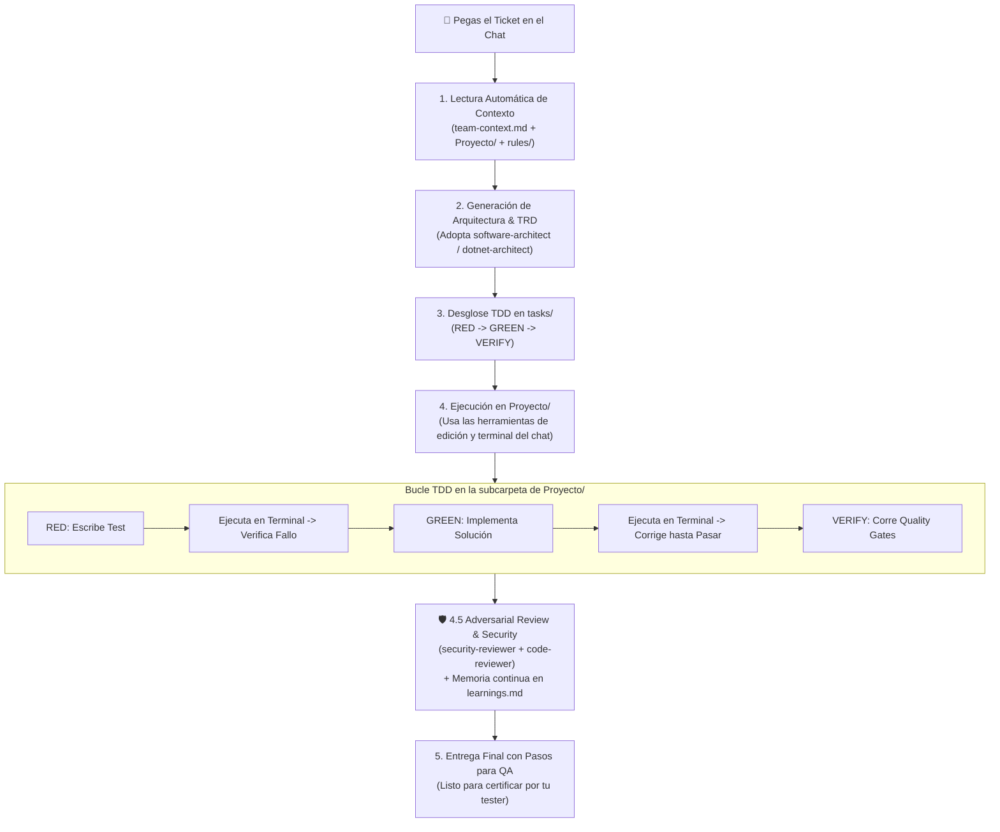

# 🏭 Faena: Context-Driven AI Factory Workspace

> **"Simplemente pega el ticket en el chat y el asistente de IA hace el trabajo con todo el contexto del proyecto."**
> Un esqueleto de ingeniería de software diseñado para operar **directamente en el chat** de cualquier asistente de IA (**Cursor**, **Claude Code**, **ChatGPT**, **Gemini**, **Windsurf**, **Copilot** o **Antigravity**). Proporciona a cualquier LLM todo el contexto organizacional, arquitectónico, reglas de calidad y habilidades técnicas necesarias para resolver tickets de punta a punta.

---

## 🎯 ¿Qué es Faena?

**Faena** es un **harness y esqueleto de contexto** para trabajar en diferentes empresas y proyectos:

- **100% Nativo en el Chat**: No requiere scripts de Python, dependencias externas ni configuración de CLI. Trabaja directamente en la ventana de chat del editor de IA que prefieras.
- **Aislamiento Multi-Empresa**:
  - Para cada cliente o empresa (**Proyecto A**), clonas este repo.
  - En la carpeta **`Proyecto/`**, clonas los repositorios de código fuente reales de ese cliente (ej. `Proyecto/backend-api`, `Proyecto/frontend-web`).
  - En **`tasks/context/team-context.md`**, registras el organigrama de la empresa (Tech Lead, QA, DevOps, compañeros) para que la IA comprenda las menciones a personas y sepa qué programar vs. qué delegar.
  - En **`rules/project/`**, defines las reglas y convenciones obligatorias de esa empresa.
  - Para otro cliente (**Proyecto B**), clonas Faena nuevamente y configuras sus respectivos repos en `Proyecto/` y su contexto de equipo.
- **Flujo TDD Estricto**: Todo ticket se descompone en pruebas primero (**RED**), implementación que las hace pasar (**GREEN**) y verificación de calidad (**VERIFY**).
- **Resiliencia & Review (Inspirado en ECC)**: La IA ejecuta una auditoría de seguridad y calidad sobre el `git diff` antes de dar el ticket por concluido y guarda los descubrimientos en `tasks/context/learnings.md`.

---

## 🔄 El Flujo de Trabajo en el Chat



---

## 🚀 Cómo Usarlo en tu Día a Día

### Paso 1: Clonar y preparar los repositorios del cliente
```bash
git clone https://github.com/tu-usuario/Faena.git Mi-Empresa-A
cd Mi-Empresa-A

# Clonas los repositorios del cliente dentro de Proyecto/
cd Proyecto
git clone git@github.com:empresa-a/backend-api.git
git clone git@github.com:empresa-a/frontend-portal.git
cd ..
```

### Paso 2: Configurar el equipo en `tasks/context/team-context.md`
Abre [`tasks/context/team-context.md`](tasks/context/team-context.md) y anota los nombres de tus jefes y compañeros:
- **Tech Lead**: Nombre de tu líder técnico (para aprobaciones de arquitectura).
- **QA**: Nombre de tu tester asignado (para handoffs de pruebas).
- **DevOps**: Nombre del encargado de infraestructura (para secretos y variables).

### Paso 3: El Flujo por Comandos Arrastrables (Drag & Drop en el Chat)

El flujo de trabajo está diseñado para ser 100% interactivo mediante el arrastre de comandos markdown (`@commands/...`) directamente a tu chat:

```mermaid
flowchart LR
    C1["1️⃣ Arrastra @commands/1-ticket.md\n+ Pegas el ticket"] --> O1["tasks/task-nombre/design-nombre.md\n(Requerimientos)"]
    O1 --> C2["2️⃣ Arrastra @commands/2-create-trd.md\n+ tasks/task-nombre/design-nombre.md"]
    C2 --> O2["tasks/task-nombre/trd-nombre.md\n+ test-spec-nombre.md\n(Arquitectura & Handoffs)"]
    O2 --> C3["3️⃣ Arrastra @commands/3-create-tasks.md\n+ tasks/task-nombre/trd.md"]
    C3 --> O3["task01-setup, task02-red, task03-green\n+ README.md (Checklist)"]
    O3 --> C4["4️⃣ Arrastra @task01, @task02...\n(Ejecución TDD en Proyecto/)"]
    C4 --> O4["5️⃣ Security Review\n+ Handoff listo para QA"]
```



#### 1. Crear los Requerimientos desde el Ticket
Arrastra al chat el comando de intake y pega el texto del ticket (Jira, DevOps, Slack):
```markdown
@commands/1-ticket.md
Ticket: #4321 - Implementar autenticación JWT con Refresh Tokens en el portal y backend
```
- **Qué hace la IA**: Lee `tasks/context/team-context.md`, identifica qué repositorio en `Proyecto/` será afectado y genera el documento de alcance en `tasks/task-<nombre>/design-<nombre>.md`.

#### 2. Generar el TRD (Requerimientos Técnicos) y Test Spec
Arrastra al chat el comando para crear las especificaciones técnicas:
```markdown
@commands/2-create-trd.md tasks/task-<nombre>/design-<nombre>.md
```
- **Qué hace la IA**: Diseña los diagramas de arquitectura Mermaid, define responsabilidades de módulos en `Proyecto/`, especifica los tests Given-When-Then y genera las secciones de **QA Handoff** y **DevOps Handoff** para tu equipo. Crea `tasks/task-<nombre>/trd-<nombre>.md` y `test-spec-<nombre>.md`.

#### 3. Generar las Tareas Atómicas de Implementación
Arrastra al chat el comando para crear el desglose TDD:
```markdown
@commands/3-create-tasks.md tasks/task-<nombre>/trd-<nombre>.md
```
- **Qué hace la IA**: Crea la lista ordenada de tareas atómicas (`task01-setup-*.md`, `task02-red-*.md`, `task03-green-*.md`) y un `README.md` con casillas de verificación (`- [ ]`).

#### 4. Ejecutar las Tareas una a una (TDD en `Proyecto/`)
Arrastra cada archivo de tarea secuencialmente al chat:
```markdown
@tasks/task-<nombre>/task01-setup-...md
```
- **Fase RED**: La IA escribe los tests en `Proyecto/` y corre el comando en terminal (`npm test`, `dotnet test`) verificando que fallen por la causa esperada.
- **Fase GREEN**: La IA implementa la solución en `Proyecto/`, corre los tests en terminal hasta que pasen todos y valida compilación/linter.
- La IA marca automáticamente `[x]` en el `README.md`.

#### 5. Auditoría de Seguridad y Entrega para QA
Al completar la última tarea:
- La IA audita el `git diff` con el rol de `security-reviewer.md`.
- Registra descubrimientos en `tasks/context/learnings.md`.
- Genera el reporte final de entrega con endpoints y payloads listo para que tu tester de QA certifique el ticket.
- (Opcional): Arrastra `@commands/4-update-context.md` para sincronizar los archivos de contexto del proyecto.

---

## 📁 Estructura del Repositorio

```
Faena/
├── Proyecto/                   # 📁 Código fuente del cliente (100% ignorado en el git de Faena)
│   ├── .gitkeep
│   ├── README.md               # Guía de clonación de repos
│   ├── backend-api/            # (Repo del cliente)
│   └── frontend-web/           # (Repo del cliente)
│
├── tasks/                      # 🎫 Gestión de tickets y contexto
│   ├── context/
│   │   ├── team-context.md     # Organigrama del equipo, roles (Tech Lead, QA, DevOps)
│   │   ├── tech-context.md     # Stack tecnológico detectado
│   │   ├── project-structure.md# Estructura de repositorios
│   │   └── learnings.md        # Memoria continua entre tickets
│   └── tickets/                # Tickets guardados como referencia
│
├── rules/                      # 📏 Reglas y directivas de calidad
│   ├── project/                # Reglas específicas de la empresa (máxima prioridad)
│   ├── security/               # Directivas de seguridad OWASP y prevención de fugas
│   ├── skills-routing.md       # Enrutamiento obligatorio a la skill del dominio
│   └── process-task-list.md    # Protocolo estricto TDD
│
├── skills/                     # 🧠 Habilidades y patrones técnicos profundos (única fuente)
│   ├── README.md               # Catálogo generado por scripts/build-skills-index.ps1
│   ├── angular-developer/      # Reactividad moderna en Angular (Signals, resource, forms)
│   ├── dotnet-patterns/        # C# idiomático, Clean Architecture, inmutabilidad
│   ├── csharp-testing/         # Testing con xUnit, FluentAssertions, Moq
│   ├── abp-*/                  # Suite completa de ABP Framework (DDD, EF Core, Angular)
│   ├── azure-function/         # Azure Functions y bindings
│   └── project/                # Skills y SDKs privados de la empresa
│
├── commands/                   # 🧩 Comandos arrastrables del flujo
│   ├── 1-ticket.md             # Intake del ticket → tasks/task-<nombre>/design-<nombre>.md
│   ├── 1b-design.md            # (Opcional) Diseño colaborativo con design-facilitator
│   ├── 1c-decompose.md         # (Opcional) Descompone specs grandes en fases
│   ├── 2-create-trd.md         # TRD + Test Spec con handoffs QA/DevOps
│   ├── 3-create-tasks.md       # Desglose TDD (setup / RED / GREEN+VERIFY)
│   ├── 4-update-context.md     # Sincronización del contexto del proyecto
│   ├── design-to-blueprint-process/  # Pipeline UI opcional: 0 inventario → 7 paquete de ejecución
│   ├── page-structure-process/       # Estructura y breakpoints de página (PAGE-STRUCTURE.txt)
│   └── ...                     # create-adr, create-gherkins, create/load-context, design-ux-ui, make-agent
│
├── agents/                     # 🤖 28 agentes/roles (las skills viven solo en skills/)
│   ├── coding/                 # Implementadores, testers TDD, reviewers de seguridad
│   └── design/                 # Arquitectos de software y analistas de contexto
│
├── scripts/                    # 🛠️ Utilidades del harness
│   ├── build-skills-index.ps1  # Regenera skills/README.md desde los SKILL.md
│   ├── validate-faena.ps1      # Verifica la integridad del harness (CI + pre-commit)
│   └── faena-known-refs.txt    # Deuda tolerada: referencias históricas rotas
│
├── .github/workflows/          # ✅ CI: valida el harness en cada push y PR
├── .githooks/pre-commit        # ✅ Hook opcional: git config core.hooksPath .githooks
│
├── AGENTS.md                   # 📜 Protocolo universal para agentes de IA
├── CLAUDE.md                   # 📜 Directivas para Claude Code
├── GEMINI.md                   # 📜 Directivas para Gemini / Antigravity
├── OPENCODE.md                 # 📜 Directivas para OpenCode / Ollama local
├── .cursorrules                # 📜 Directivas para Cursor
└── .gitignore                  # 🔒 Aislamiento estricto de Proyecto/**
```

---

## 🔒 Aislamiento y Privacidad de Código
El archivo `.gitignore` contiene la regla `Proyecto/**`. Esto asegura que el código de la empresa que esté dentro de `Proyecto/` **nunca se subirá a tu repositorio de Faena**, permitiendo que cada repositorio del cliente conserve sus propias ramas, remotos y políticas de seguridad independientes.
