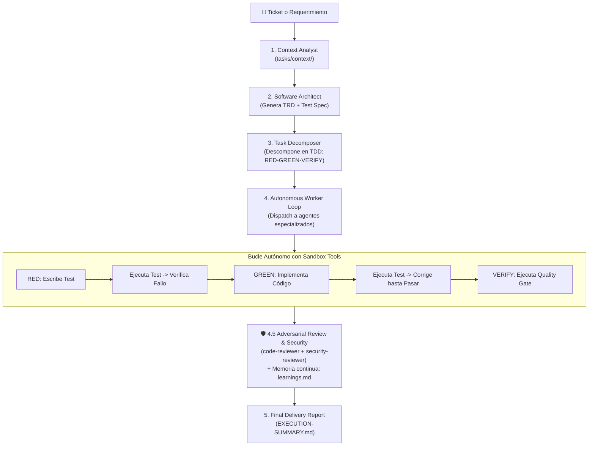

# 🏭 Faena: Autonomous AI Factory

> **"Simplemente dale un ticket y que el trabajo se haga."**
> An autonomous, test-driven software engineering factory that takes any ticket, specification, or user story and turns it into tested, verified, and production-ready code — across **any** LLM provider (**Claude**, **ChatGPT / OpenAI**, **Gemini**, **Ollama**, **DeepSeek**, **OpenRouter**).

---

## 🎯 ¿Qué es Faena?

**Faena** (en español: labor, trabajo, faena productiva) es un **esqueleto de factoría de desarrollo autónoma** diseñado para resolver tickets en diferentes empresas y proyectos:

- **Estructura Multi-Proyecto / Multi-Empresa**:
  - Cada vez que trabajas para un cliente o empresa (ej. **Proyecto A**), clonas este repo.
  - Dentro existe la carpeta **`Proyecto/`**, donde clonas todos los repositorios de código fuente relacionados con ese cliente (ej. backend, frontend, microservicios).
  - En **`rules/project/`** ajustas las reglas, convenciones de arquitectura y estándares específicos de esa empresa.
  - En **`skills/project/`** agregas las skills y conocimientos de SDKs internos o APIs de esa empresa.
  - Para otra empresa (**Proyecto B**), simplemente clonas Faena de nuevo y configuras su respectivo folder `Proyecto/` y sus reglas/skills.
- **Test-Driven Development (TDD) estricto**: Todo cambio comienza con pruebas que fallan primero (**RED**), implementación que las hace pasar (**GREEN**) y puertas de calidad que aseguran cero regresiones (**VERIFY**).
- **Separación de Persona vs. Procedimiento**: Los agentes definen **QUIÉN** sabe qué; los comandos definen **CÓMO** se ejecuta; y el motor de Faena ejecuta **EL FLUJO**.
- **Universal Multi-Provider**: Funciona nativamente con Claude (Anthropic), ChatGPT (OpenAI), Google Gemini, modelos locales (Ollama), DeepSeek o OpenRouter, sin dependencias pesadas obligatorias (funciona usando la librería estándar de Python).
- **Doble Modalidad**:
  1. **Modo Autónomo (CLI Engine)**: Le das un ticket en consola y Faena ejecuta todo el pipeline de principio a fin, ejecutando herramientas en sandbox (lectura, edición, comandos de pruebas en los repos de `Proyecto/`).
  2. **Modo Asistente IDE (Cursor / Claude Code / Antigravity)**: Usa el catálogo completo de 38 agentes especializados y comandos (`/create-context`, `/create-trd`, `/create-tasks`, etc.) directamente dentro de tu editor preferido.

---

## 🔄 El Flujo de la Factoría (Pipeline con Gate de Resiliencia)



---

## 🚀 Inicio Rápido (Quick Start con Proyecto A)

### 1. Clonar Faena y configurar la empresa
```bash
# Clonas Faena para tu cliente o empresa
git clone https://github.com/tu-usuario/Faena.git Proyecto-Empresa-A
cd Proyecto-Empresa-A

# Clonas los repositorios de código de esa empresa dentro de Proyecto/
cd Proyecto
git clone git@github.com:empresa-a/backend-api.git
git clone git@github.com:empresa-a/frontend-app.git
cd ..
```

### 2. Configurar variables de entorno (.env)
```bash
FAENA_PROVIDER=gemini        # o claude, chatgpt, ollama, deepseek, openrouter
GEMINI_API_KEY=tu_api_key    # o ANTHROPIC_API_KEY, OPENAI_API_KEY, etc.
```

Comprueba los repositorios detectados y proveedores activos:
```bash
python faena_cli.py project
python faena_cli.py providers
```

### 3. Ajustar reglas y skills de la empresa (Opcional pero recomendado)
- Edita o añade reglas en `rules/project/` (ej. `rules/project/company-standards.mdc`).
- Añade conocimientos o SDKs en `skills/project/`.

### 4. Ejecutar un Ticket
```bash
# Faena analiza los repositorios en Proyecto/, genera TRD y tareas, y programa los cambios
python faena_cli.py run tasks/tickets/TASK-001.md

# O puedes apuntar a un repositorio específico dentro de Proyecto/:
python faena_cli.py run tasks/tickets/TASK-001.md --target backend-api
```

---

## 🔌 Proveedores Soportados (Multi-Provider)

| Proveedor | Flag CLI | Variable de Entorno | Modelos Recomendados |
| :--- | :--- | :--- | :--- |
| **Anthropic Claude** | `--provider claude` | `ANTHROPIC_API_KEY` | `claude-3-7-sonnet-latest`, `claude-3-5-sonnet` |
| **OpenAI ChatGPT** | `--provider chatgpt` | `OPENAI_API_KEY` | `gpt-4o`, `o3-mini`, `gpt-4.1` |
| **Google Gemini** | `--provider gemini` | `GEMINI_API_KEY` | `gemini-2.5-flash`, `gemini-2.5-pro` |
| **Ollama (Local)** | `--provider ollama` | `OLLAMA_BASE_URL` | `llama3.1`, `qwen2.5-coder` |
| **DeepSeek** | `--provider deepseek` | `DEEPSEEK_API_KEY` | `deepseek-chat`, `deepseek-reasoner` |
| **OpenRouter** | `--provider openrouter` | `OPENROUTER_API_KEY` | Cualquiera disponible en OpenRouter |

---

## 🛠️ Comandos de la CLI de Faena

```bash
# Ejecución completa de ticket
python faena_cli.py run <ticket> [--provider ...] [--model ...] [--interactive] [--resume]

# Inicializar estructura en un repositorio nuevo
python faena_cli.py init

# Analizar codebase y actualizar contexto del proyecto
python faena_cli.py context

# Generar únicamente el TRD y Test Spec
python faena_cli.py trd <ticket>

# Generar los archivos de tareas TDD a partir de un TRD existente
python faena_cli.py tasks tasks/task-feature/trd-feature.md

# Ver estado de proveedores y claves API configuradas
python faena_cli.py providers

# Listar los 38 agentes especializados disponibles
python faena_cli.py agents

# Ver sesiones y tickets activos en el repositorio
python faena_cli.py status

# Sincronización y actualización con ECC (Enterprise Coding Companion)
python faena_cli.py sync                        # Compara agentes y skills con ECC
python faena_cli.py sync --update               # Actualiza todos los agentes y skills desactualizados
python faena_cli.py sync --import-skill <skill> # Importa un nuevo skill de ECC (ej. docker-patterns)
python faena_cli.py sync --import-agent <agent> # Importa un nuevo agente de ECC (ej. go-build-resolver.md)
```

---

## 🤖 Catálogo de Agentes Especializados (38 Agentes)

Faena incluye una biblioteca de agentes especializados distribuidos en `agents/coding/` y `agents/design/`:

### Diseño y Arquitectura (`agents/design/`)
- **`software-architect`**: Diseño de sistemas, contratos de interfaces y diagramas UML/Mermaid.
- **`project-context-analyst`**: Análisis estático de repositorios, dependencias y convenciones.
- **`design-facilitator`**: Sesiones interactivas de diseño exploratorio.
- **`ux-ui-design`**: Flujos de usuario y diseño de interfaces.

### Testing y TDD (`agents/coding/`)
- **`jest-tester`**: Especialista en Jest / TS para fase RED.
- **`pytest-tester`**: Especialista en pytest / Python para fase RED.
- **`xunit-tester`**: Especialista en xUnit / .NET para fase RED.
- **`integration-tester`**: Pruebas de integración HTTP, fixtures y mocks.

### Implementación (`agents/coding/`)
- **`fastapi-backend`**: Desarrollo de APIs asíncronas de alto rendimiento con FastAPI y Pydantic.
- **`typescript-pro`**: Tipado estricto, genéricos avanzados y patrones limpios en TypeScript.
- **`angular-developer`**: Desarrollo en Angular con signals y componentes reactivos.
- **`aspnet-webapi-backend`**: Backend en ASP.NET Core y Clean Architecture.
- **`sqlserver-database-specialist`** / **`cosmosdb-nosql-specialist`**: Modelado y persistencia.

---

## 📁 Estructura del Repositorio

```
Faena/
├── faena/                         # Motor autónomo de la factoría
│   ├── providers/                 # Abstracción Multi-Provider (Claude, OpenAI, Gemini, Ollama...)
│   │   ├── base.py
│   │   ├── anthropic.py
│   │   ├── openai_provider.py
│   │   ├── gemini.py
│   │   └── factory.py
│   ├── tools/                     # Herramientas del Sandbox (archivos, terminal, búsquedas)
│   ├── orchestrator/              # Orquestador del pipeline
│   │   ├── pipeline.py            # Ciclo de vida completo del ticket
│   │   ├── context_engine.py      # Gestor de tasks/context/
│   │   ├── trd_engine.py          # Generador de TRD y Test Spec
│   │   ├── task_engine.py         # Generador de tareas RED-GREEN-VERIFY
│   │   ├── executor.py            # Bucle de ejecución con autocuración
│   │   └── state.py               # Persistencia de estado y checkpoints
│   ├── agents/                    # Emparejamiento dinámico de personas
│   └── cli.py                     # Interfaz de línea de comandos
├── agents/                        # 38 Agentes especializados (Markdown personas)
├── commands/                      # Comandos y procedimientos (/create-trd, /create-tasks...)
├── rules/                         # Reglas de calidad y disciplina TDD
├── skills/                        # Habilidades técnicas (CQRS, Masstransit, API design...)
├── tasks/                         # Directorio de trabajo
│   ├── tickets/                   # Tickets y requerimientos de entrada
│   └── context/                   # Contexto vivo del proyecto
├── faena_cli.py                   # Script lanzador raíz
├── faena.config.json.example      # Ejemplo de configuración JSON
├── .env.example                   # Ejemplo de variables de entorno
└── pyproject.toml                 # Configuración de empaquetado pip
```

---

## 💻 Integración con Editores (Cursor, Claude Code, Antigravity)

Además de usar el CLI, los mismos agentes y flujos están configurados en la raíz del repositorio (`agents/`, `commands/`, `rules/`) para que puedas invocar:
- `@software-architect` para diseñar una solución.
- `@jest-tester` o `@pytest-tester` para escribir pruebas primero.
- `/create-context` para refrescar el contexto del proyecto.
- `/create-trd` para formular la especificación técnica.
- `/create-tasks` para generar la lista de tareas TDD.

Faena unifica el trabajo tanto si programas en la terminal como si trabajas en tu IDE asistido por IA.
