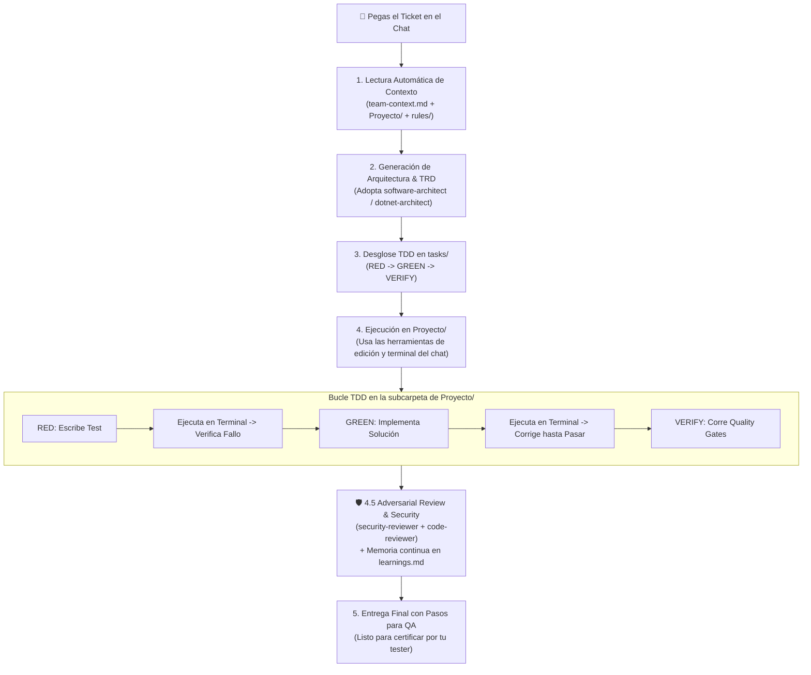

# 🏭 Faena: Context-Driven AI Factory Workspace

> **"Simplemente pega el ticket en el chat y el asistente de IA hace el trabajo con todo el contexto del proyecto."**
> Un esqueleto de ingeniería de software diseñado para operar **directamente en el chat** de cualquier asistente de IA (**Cursor**, **Claude Code**, **ChatGPT**, **Gemini**, **Windsurf**, **Copilot** o **Antigravity**). Proporciona a cualquier LLM todo el contexto organizacional, arquitectónico, reglas de calidad y habilidades técnicas necesarias para resolver tickets de punta a punta.

---

## 🎯 ¿Qué es Faena?

**Faena** es un **harness y esqueleto de contexto** para trabajar en diferentes empresas y proyectos:

- **100% Nativo en el Chat**: No requiere scripts de Python, dependencias externas ni configuración de CLI. Trabaja directamente en la ventana de chat del editor de IA que prefieras.
- **Aislamiento Multi-Empresa**:
  - Para cada cliente o empresa (**Proyecto A**), clonas este repo.
  - En la carpeta **`Proyecto/`**, clonas los repositorios de código fuente reales de ese cliente (ej. `Proyecto/backend-api`, `Proyecto/frontend-web`).
  - En **`tasks/context/team-context.md`**, registras el organigrama de la empresa (Tech Lead, QA, DevOps, compañeros) para que la IA comprenda las menciones a personas y sepa qué programar vs. qué delegar.
  - En **`rules/project/`**, defines las reglas y convenciones obligatorias de esa empresa.
  - Para otro cliente (**Proyecto B**), clonas Faena nuevamente y configuras sus respectivos repos en `Proyecto/` y su contexto de equipo.
- **Flujo TDD Estricto**: Todo ticket se descompone en pruebas primero (**RED**), implementación que las hace pasar (**GREEN**) y verificación de calidad (**VERIFY**).
- **Resiliencia & Review (Inspirado en ECC)**: La IA ejecuta una auditoría de seguridad y calidad sobre el `git diff` antes de dar el ticket por concluido y guarda los descubrimientos en `tasks/context/learnings.md`.

---

## 🔄 El Flujo de Trabajo en el Chat



---

## 🚀 Cómo Usarlo en tu Día a Día

### Paso 1: Clonar y preparar los repositorios del cliente
```bash
git clone https://github.com/tu-usuario/Faena.git Mi-Empresa-A
cd Mi-Empresa-A

# Clonas los repositorios del cliente dentro de Proyecto/
cd Proyecto
git clone git@github.com:empresa-a/backend-api.git
git clone git@github.com:empresa-a/frontend-portal.git
cd ..
```

### Paso 2: Configurar el equipo en `tasks/context/team-context.md`
Abre [`tasks/context/team-context.md`](tasks/context/team-context.md) y anota los nombres de tus jefes y compañeros:
- **Tech Lead**: Nombre de tu líder técnico (para aprobaciones de arquitectura).
- **QA**: Nombre de tu tester asignado (para handoffs de pruebas).
- **DevOps**: Nombre del encargado de infraestructura (para secretos y variables).

### Paso 3: Abrir tu chat de IA y pegar el ticket
Abre la carpeta en tu editor de IA favorito (**Cursor**, **Claude Code**, **Antigravity**, etc.) y en el chat simplemente escribe:

> *"Trabajemos en este ticket: [Pega aquí el requerimiento o la historia de Jira/Azure DevOps]"*

La IA leerá automáticamente [`AGENTS.md`](AGENTS.md), [`CLAUDE.md`](CLAUDE.md), [`GEMINI.md`](GEMINI.md) o [`.cursorrules`](.cursorrules), entenderá el organigrama de la empresa, localizará los repositorios en `Proyecto/` y desarrollará la solución paso a paso.

---

## 📁 Estructura del Repositorio

```
Faena/
├── Proyecto/                   # 📁 Código fuente del cliente (100% ignorado en el git de Faena)
│   ├── .gitkeep
│   ├── README.md               # Guía de clonación de repos
│   ├── backend-api/            # (Repo del cliente)
│   └── frontend-web/           # (Repo del cliente)
│
├── tasks/                      # 🎫 Gestión de tickets y contexto
│   ├── context/
│   │   ├── team-context.md     # Organigrama del equipo, roles (Tech Lead, QA, DevOps)
│   │   ├── tech-context.md     # Stack tecnológico detectado
│   │   ├── project-structure.md# Estructura de repositorios
│   │   └── learnings.md        # Memoria continua entre tickets
│   └── tickets/                # Tickets guardados como referencia
│
├── rules/                      # 📏 Reglas y directivas de calidad
│   ├── project/                # Reglas específicas de la empresa (máxima prioridad)
│   ├── security/               # Directivas de seguridad OWASP y prevención de fugas
│   └── process-task-list.mdc   # Protocolo estricto TDD
│
├── skills/                     # 🧠 Habilidades y patrones técnicos profundos
│   ├── angular-developer/      # Reactividad moderna en Angular (Signals, resource, forms)
│   ├── dotnet-patterns/        # C# idiomático, Clean Architecture, inmutabilidad
│   ├── csharp-testing/         # Testing con xUnit, FluentAssertions, Moq
│   ├── abp-*/                  # Suite completa de ABP Framework (DDD, EF Core, Angular)
│   ├── azure-function/         # Azure Functions y bindings
│   └── project/                # Skills y SDKs privados de la empresa
│
├── agents/                     # 🤖 47 Agentes y roles especializados
│   ├── coding/                 # Implementadores, testers TDD, reviewers de seguridad
│   └── design/                 # Arquitectos de software y analistas de contexto
│
├── AGENTS.md                   # 📜 Protocolo universal para agentes de IA
├── CLAUDE.md                   # 📜 Directivas para Claude Code
├── GEMINI.md                   # 📜 Directivas para Gemini / Antigravity
├── .cursorrules                # 📜 Directivas para Cursor
└── .gitignore                  # 🔒 Aislamiento estricto de Proyecto/**
```

---

## 🔒 Aislamiento y Privacidad de Código
El archivo `.gitignore` contiene la regla `Proyecto/**`. Esto asegura que el código de la empresa que esté dentro de `Proyecto/` **nunca se subirá a tu repositorio de Faena**, permitiendo que cada repositorio del cliente conserve sus propias ramas, remotos y políticas de seguridad independientes.
