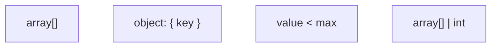

This command enables collaborative design sessions that progress from initial concept to comprehensive documentation. Uses the **design-facilitator** agent to guide exploratory conversations and produce implementation-ready design documents.

## Purpose

Use this command when you need to:
- Design new features or capabilities
- Plan system architecture changes
- Explore API or data model designs
- Document technical approaches
- Create implementation specifications
- Think through complex design problems

## Execution Steps

### 1. Load Project Context (Optional)

**Attempt to load project context:**

Try to read and execute the `load-context.md` command (located in `commands/load-context.md`) to prime the session with project understanding. This loads available context from `tasks/context/` to align the design with existing architecture, patterns, and conventions.

**If context is available, use it to:**
- Align with existing architecture patterns
- Respect established conventions
- Identify integration points
- Understand current system state
- Reference relevant technologies

**If context loading fails or directory doesn't exist:**
- Proceed with design conversation anyway
- Ask user directly for relevant context (tech stack, architecture style, constraints)
- Note in design document that it was created without full project context
- Design based on general best practices and user input

### 2. Understand Design Request

**Analyze the user's prompt to identify:**

Design type:
- Feature design (user-facing functionality)
- System design (architecture, components)
- API design (endpoints, contracts, integrations)
- Data model design (schemas, relationships)
- Workflow design (processes, state machines)
- Refactoring design (restructuring existing code)
- Infrastructure design (deployment, scaling)

Design scope:
- New capability vs. modification
- Single component vs. multi-component
- Frontend, backend, or full-stack
- Integration requirements
- Performance/scale requirements

Design maturity:
- Early exploration (many unknowns)
- Refinement (core idea exists)
- Detailed specification (ready for implementation)

### 3. Clarifying Questions Phase

**Engage in dialogue to uncover requirements.**

For **any** design request, ask clarifying questions in categories:

**Core Requirements:**
- What problem does this solve for users?
- What are the success criteria?
- What does "done" look like?
- Are there specific user flows to support?

**Context & Constraints:**
- Who are the users/consumers?
- What are the performance requirements?
- Are there security/compliance considerations?
- What are the time/resource constraints?
- Any technology preferences or restrictions?

**Integration & Dependencies:**
- What existing systems does this interact with?
- What data sources are involved?
- Are there external APIs or services?
- What authentication/authorization is needed?

**Edge Cases & Error Handling:**
- What happens if [external service] fails?
- How do we handle invalid input?
- What are the error recovery strategies?
- Are there rate limits or quotas to consider?

**Scale & Evolution:**
- What's the expected load (users, requests, data)?
- How might this evolve in the future?
- Are there phasing or rollout considerations?
- What metrics should we track?

**Question Flow Strategy:**

1. **Start broad** - Ask 3-5 high-level questions to understand scope
2. **Wait for answers** - Don't overwhelm with all questions at once
3. **Go deeper** - Follow up based on responses
4. **Validate understanding** - Summarize what you've learned
5. **Ask if anything is missing** - Let user add information

**Conversation Tips:**
- Ask one category of questions at a time
- Number questions for easy reference
- Explain why you're asking if not obvious
- Offer examples if user seems unsure
- It's okay to say "I'll make a reasonable assumption about X" if they don't know

### 4. Design Synthesis Phase

**After gathering information, synthesize the design.**

Create the design covering:

**Problem Statement:**
- Clear articulation of what's being solved
- Context from project perspective
- Success criteria and goals
- Key constraints identified

**Solution Overview:**
- High-level approach (2-3 paragraphs)
- Key design decisions and rationale
- How it fits into existing system
- What patterns or approaches are used

**Detailed Design:**

Include relevant sections based on design type:
- **Architecture**: Component diagram, service boundaries, data flow
- **API Design**: Endpoints, request/response schemas, authentication
- **Data Model**: Schemas, relationships, indexes, migrations
- **User Flow**: Step-by-step user interactions
- **State Management**: State transitions, persistence
- **Integration**: External services, message flows, error handling
- **Security**: Authentication, authorization, data protection
- **Performance**: Caching, optimization strategies, scalability

Use **mermaid diagrams** where helpful:
- Component diagrams for architecture
- Sequence diagrams for flows
- State diagrams for workflows
- ER diagrams for data models
- Flowcharts for logic

**Mermaid Color Palette** - Use ONLY these colors for diagram fills:
1. `#4A90E2` - Medium blue (primary elements, components, UI layer)
2. `#50C878` - Emerald green (success states, domain models, data)
3. `#E67E22` - Warm orange (processes, transformations, business logic)
4. `#9B59B6` - Purple (external systems, utilities, libraries)
5. `#E74C3C` - Coral red (warnings, critical paths, error states)
6. `#16A085` - Teal (utilities, helpers, infrastructure)
7. `#F39C12` - Amber (intermediate states, pending, queues)
8. `#3498DB` - Sky blue (secondary components, services)
9. `#27AE60` - Forest green (validated states, persistence layer)
10. `#C0392B` - Deep red (errors, boundaries, constraints)

These colors work well with both light and dark themes. Use different colors to distinguish architectural layers and system boundaries.

**Character Escaping in Diagram Labels**:

Special characters in node labels must be escaped with HTML entities:

| Character | Unquoted | In Quotes | Escaping Required? | HTML Entity |
|-----------|----------|-----------|-------------------|-------------|
| `/`, `\`, `{`, `}`, `[`, `]`, `\|` | Breaks label (shape delimiters) | Always OK | No (quote or escape) | `&#47;` `&#92;` `&#123;` `&#125;` `&#91;` `&#93;` `&#124;` |
| `&`, `<`, `>` | Must escape | Must escape | Yes, always | `&amp;` `&lt;` `&gt;` |

**Examples**:


**Implementation Considerations:**
- Phasing strategy (MVP vs. full implementation)
- Technical risks and mitigations
- Dependencies and prerequisites
- Testing strategy
- Deployment considerations
- Monitoring and observability

**Alternatives Considered:**
- Other approaches evaluated
- Trade-offs analysis
- Why this approach was selected

**Open Questions:**
- Unresolved decisions
- Areas needing more research
- Future considerations

### 5. Design Documentation Output

**Write the design document inside a dedicated task folder under tasks/.**

**Filename convention:**
```
tasks/task-{brief-descriptive-name}/design-{brief-descriptive-name}.md
```

**Examples:**
- `tasks/task-user-authentication/design-user-authentication.md`
- `tasks/task-payment-processing-api/design-payment-processing-api.md`
- `tasks/task-real-time-notifications/design-real-time-notifications.md`
- `tasks/task-reporting-dashboard/design-reporting-dashboard.md`

**Document structure:**

```markdown
# Design: {Descriptive Title}

**Status**: Draft  
**Created**: {YYYY-MM-DD}  
**Author**: AI Design Facilitator  
**Related Context**: {Links to relevant project context if applicable}

## Overview

{2-3 paragraph summary of what's being designed and why}

## Problem Statement

{Clear articulation of the problem being solved}

### Goals
- {Goal 1}
- {Goal 2}
- {Goal 3}

### Constraints
- {Constraint 1}
- {Constraint 2}

### Success Criteria
- {Measurable criterion 1}
- {Measurable criterion 2}

## Solution Design

{High-level approach with rationale}

### Architecture

{Diagrams and component descriptions}

### [Other relevant sections based on design type]

## Implementation Guidance

### Phase 1: {Name}
- {Step 1}
- {Step 2}

### Phase 2: {Name}
- {Step 1}
- {Step 2}

## Testing Strategy

{How to validate the design works}

## Monitoring & Observability

{What to monitor, key metrics}

## Alternatives Considered

### Alternative 1: {Name}
- **Pros**: {Benefits}
- **Cons**: {Drawbacks}
- **Decision**: {Why not chosen}

## Open Questions

- [ ] {Question 1}
- [ ] {Question 2}

## Appendix

{Additional details, references, research}
```

**After writing the document:**

Show the user:
```
✅ Design document created: tasks/task-{name}/design-{name}.md

📋 Document includes:
  - Problem statement and goals
  - Detailed solution design
  - {List key sections included}
  - Implementation guidance
  - {X} diagrams

💡 Next steps:
  - Review the design document
  - Address any open questions
  - Share with team for feedback
  - Use as specification for implementation
  - Run @commands/4-update-context.md after approval to capture design decisions
```

### 6. Iteration Support

**If user requests changes or has feedback:**

1. **Discuss the changes** - Understand what needs adjustment
2. **Update the design** - Modify the approach based on feedback
3. **Update the document** - Edit the file in tasks/
4. **Explain changes** - Note what was modified and why

**Support multiple rounds of refinement until design is ready.**

### 7. Error Handling

**If project context is unavailable:**
- Note that design may not align with existing patterns
- Ask user for relevant context (tech stack, architecture style)
- Proceed with general best practices
- Flag areas where context would improve design

**If design scope is too large:**
- Suggest breaking into multiple design documents
- Propose phased approach
- Focus on MVP first

**If requirements are vague:**
- Don't guess - ask questions
- Provide examples to help user clarify
- Offer to start with a simpler scope

**If technical constraints conflict:**
- Present the trade-offs clearly
- Recommend an approach with rationale
- Document why other approaches won't work

## Important Notes

- **Always load context first** - Designs should align with project
- **Ask before assuming** - Clarifying questions are essential
- **Iterate freely** - Design is a conversation, not one-shot
- **Document rationale** - Explain the "why" not just the "what"
- **Use diagrams** - Visual aids clarify complex designs
- **Consider implementation** - Designs should be buildable
- **Write to tasks/** - Persistent documentation for reference
- **Suggest context update** - Capture design decisions in project context

## Usage Pattern

Typical flow:
1. User: `/design [their design request]`
2. Agent: Loads context via load-context command
3. Agent: Asks 3-5 initial clarifying questions
4. User: Provides answers
5. Agent: Asks follow-up questions as needed
6. User: Provides more details
7. Agent: Synthesizes design with diagrams
8. Agent: Writes design document to tasks/task-{name}/design-{name}.md
9. User: Reviews and may request changes
10. Agent: Iterates on design as needed
11. After approval: 
    - Output next step for user:
      > 👉 **Siguiente paso:** Arrastra al chat `@commands/2-create-trd.md tasks/task-{name}/design-{name}.md`
    - User can run `@commands/4-update-context.md` to capture design in project context

## Exit Conditions

**Success**: Design document written to tasks/, user satisfied with design
**Incomplete**: User decides to pause (document saved for later)
**Redirect**: Design scope requires different approach or specialist


