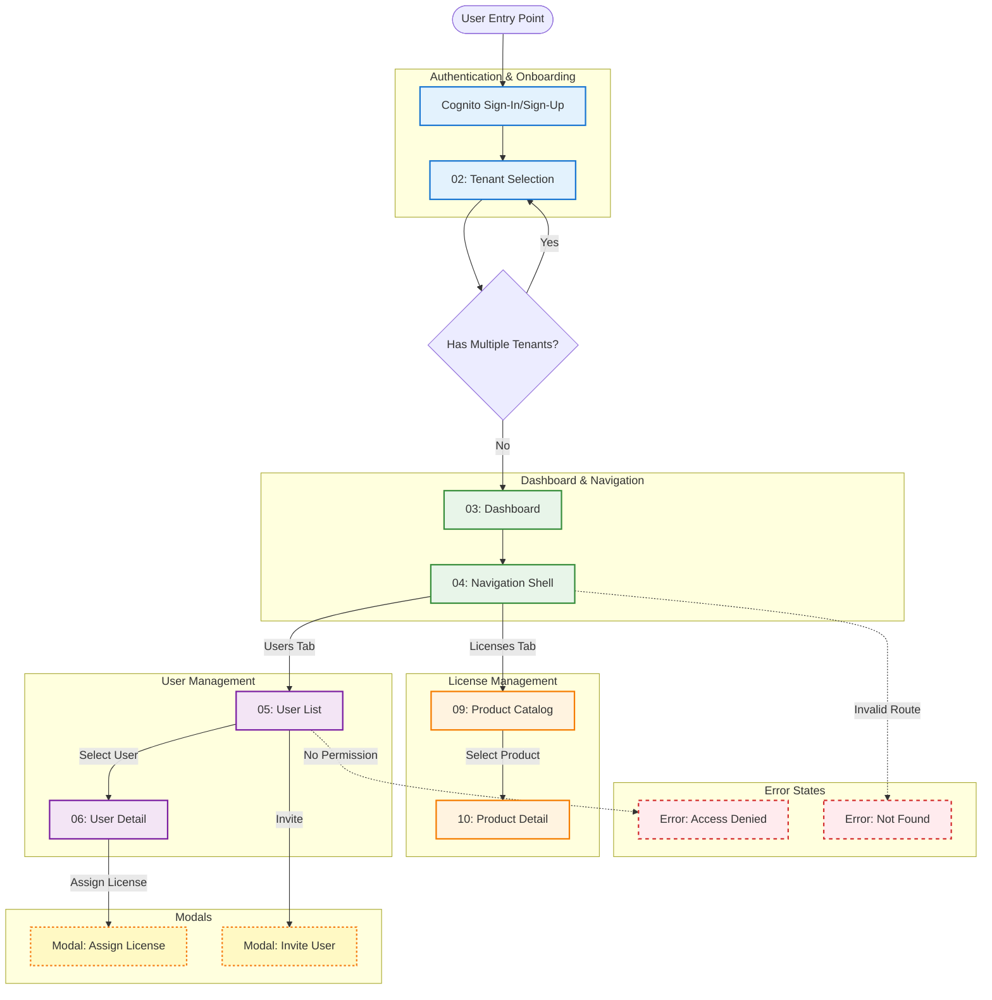
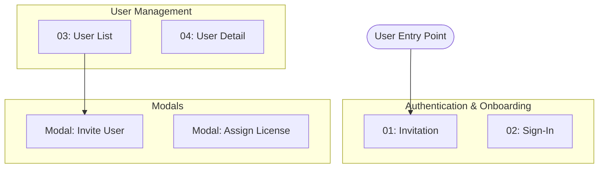
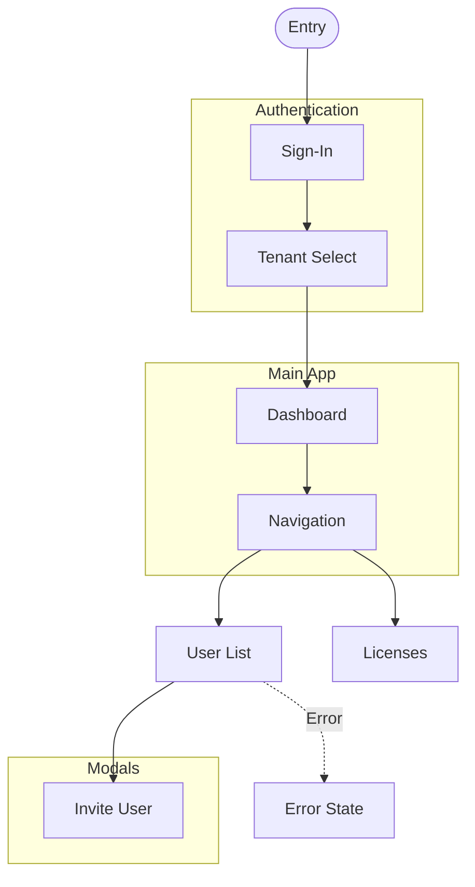
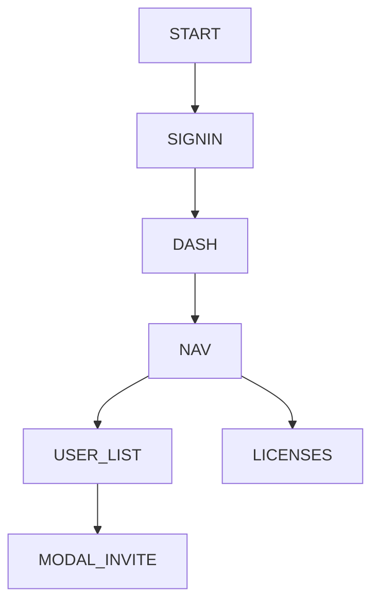
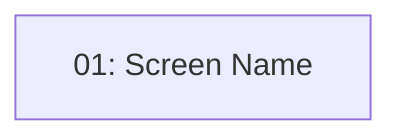
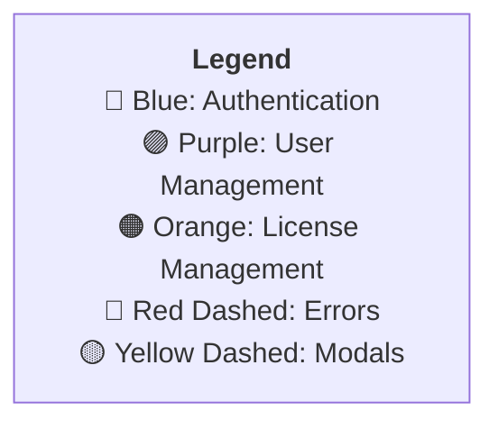

---
name: ux-ui-designer
description: Creates design task files from requirements. Invoked as `@commands/design-ux-ui.md`. Generates executable task files that reference `agents/design/` for execution.
tools: Read, Write, grep, codebase_search
model: sonnet
---

# UX/UI Design Process Guide

**Purpose:** Define the phased workflow for creating screen flows and HTML mockups from requirements.

**Architecture:**
```
User: @commands/design-ux-ui.md [requirements files]
  ↓
Phase 0-2: Discovery → Blueprint → Task File Generation
  ↓
Output: task01-XX.md, task02-XX.md, ... task08-XX.md (in project root)
  ↓
User: New chat → Attach @task01-[feature].md
  ↓
Output: flows/01-XX-flows.md + screens/01-XX.html, 02-XX.html, etc.
```

---

## Workflow Phases

**Phase 0 (Optional):** Discovery & Requirements Analysis  
**Phase 1 (Required):** Project Blueprint & Navigation Hub  
**Phase 2 (Required):** Task File Generation ⭐  
**Phase 3 (Separate Chats):** Task Execution → Flows + Mockups

---

## Phase 0: Discovery & Scope Management

**Trigger:** 20+ screens OR multiple requirement files OR user requests discovery

### Process

1. **Scan Requirements**
   - Read all PRD files
   - Read all Gherkin feature files
   - Inventory user stories with line references

2. **Group by Feature Areas**
   - Authentication & Onboarding
   - Core functionality (domain-specific)
   - Admin/Management features
   - Reporting & Analytics
   - User profile & settings
   - Error states & empty states

3. **Estimate Scope**
   - Count screens per feature area
   - Count email templates
   - Count external UI specs (e.g., Cognito branding)
   - Assess complexity (Low/Medium/High)

4. **Create Discovery Document**

**File:** `00-discovery.md`

**Structure:**
```markdown
# UX/UI Design Discovery
## [Project Name]

**Date:** [Date]  
**Status:** Discovery Complete

## Executive Summary
- [X] user stories analyzed
- [Y] Gherkin feature files reviewed
- [Z] screens estimated
- Complexity: [Low/Medium/High]

## Requirements Inventory

### User Stories
1. **[Story ID]** [Title] - [PRD #LX-Y](link)
   - Screens: [Screen names]
   - Complexity: [Low/Medium/High]

[... continue for all stories ...]

### Gherkin Feature Files
1. **[filename.feature]** - [Domain]
   - Scenarios: [X]
   - Screens impacted: [Screen names]

[... continue for all files ...]

## Feature Area Groupings

### [Feature Area 1]
- **Screens:** [3-5 screens]
- **Complexity:** [Rating]
- **User Stories:** [IDs]
- **Priority:** [High/Medium/Low]

[... continue for 6-8 feature areas ...]

## Screen Count Estimates
- Primary screens: [X]
- Modal/dialogs: [Y]
- Email templates: [Z]
- External UI specs: [N]
- **Total deliverables:** [X+Y+Z+N]

## Complexity Assessment
- **Overall:** [High/Medium/Low]
- **Factors:**
  - Multi-tenancy: [Yes/No]
  - Complex RBAC: [Yes/No]
  - Real-time features: [Yes/No]
  - External integrations: [Yes/No]
  - Accessibility requirements: [Yes/No]

## Recommended Phasing

**Batch 1 (High Priority):** [3-5 screens]
- [Feature area] - Rationale

**Batch 2 (Medium Priority):** [3-5 screens]
- [Feature area] - Rationale

**Batch 3 (Low Priority):** [3-5 screens]
- [Feature area] - Rationale

## Scope Confirmation Options

**Option A: Full System Design**
- All [X] screens + [Y] templates
- Effort: [N] weeks
- Deliverables: Complete design system

**Option B: MVP Batch (Batch 1 only)**
- [X] screens
- Effort: [N] weeks
- Deliverables: Core functionality

**Option C: Custom Scope**
- User selects feature areas

---
**Next Step:** User selects option → Proceed to Phase 1
```

5. **Wait for User Confirmation**
   - Present discovery summary
   - Pause for scope selection

---

## Phase 1: Project Blueprint & Navigation

**Always required.** Creates the master navigation hub.

### Process

1. **Identify All Screens**
   - Extract from requirements or discovery
   - Assign numbering scheme (01-XX)
   - Categorize by feature area
   - Plan file paths for screens, flows, and emails

2. **Document File Structure**
   - Create directory tree showing complete project structure
   - Include comments explaining each directory purpose
   - This goes in README.md as "Project Structure" section

**Example Directory Structure:**
```
<tasks_dir>/UI-UX_<feature_name>/
├── README.md                     # ⭐ Phase 1: Blueprint & navigation
├── 00-discovery.md               # Phase 0: Optional discovery
├── task01-[feature].md           # ⭐ Phase 2: Task files (numbered)
├── task02-[feature].md           # Each is self-contained
├── task03-[feature].md
├── ... (6-8 task files total)
├── 02-cognito-branding.md        # If needed (external UI specs)
├── flows/                        # Phase 3: Flow docs (per task)
│   ├── 01-[feature]-flows.md
│   ├── 02-[feature]-flows.md
│   └── ...
├── screens/                      # Phase 3: HTML mockups
│   ├── 01-*.html
│   ├── 02-*.html
│   └── ...
└── emails/                       # Phase 3: Email templates
    ├── 01-*.html
    └── ...
```

3. **Design Mermaid Flow Diagram**

**Requirements:**
- **Use subgraphs to group screens by feature area** (improves readability)
- Color-code by feature area
- **Add clickable nodes for ALL screens** (linking to planned file paths, even before files exist)
- Show decision points and branching
- Include email/notification triggers
- Map error states with dotted lines

**Template:**


**Best Practices:**
- **Use subgraphs** to visually group related screens (auth, user mgmt, licenses, modals, errors)
- **Order connections carefully**:
  1. Define all subgraphs first
  2. Main navigation path (top-to-bottom)
  3. Secondary navigation at same level
  4. Modal/dialog interactions
  5. Error paths last (keeps them on edges)
- **Add click statements for EVERY screen**, even before files exist (links activate in Phase 3)
- **Use consistent color coding** that matches subgraph groupings
- **Test layout incrementally** - add connections in small groups and verify positioning

4. **Create README.md**

**Requirements:**
- Include complete project structure (directory tree)
- Create Mermaid diagram with:
  - Subgraphs grouping screens by feature area
  - Clickable links for ALL screens (paths planned now, files created in Phase 3)
  - Color coding matching subgraph organization
  - Decision points, error paths, and modal triggers
- Document design system (colors, typography, Shadcn components)
- List all task files with priority and dependencies
- Provide implementation guidance

**Template:** See [README Template](#readme-template) below

5. **Present Blueprint**
   - Show README to user
   - Explain structure and navigation
   - **PAUSE** for user approval

---

## Phase 2: Task File Generation ⭐

**NEW: Core innovation.** Creates executable task files for isolated chat sessions.

### Principles

1. **Self-Contained:** Each task file has ALL context needed (via links)
2. **Feature-Scoped:** 3-5 screens per task (manageable in one session)
3. **Independent:** Can execute in any order (unless dependencies noted)
4. **Clean Context:** No reliance on previous chat history

### Process

1. **Group Screens by Feature Area**
   - From discovery or blueprint
   - Target: 6-8 feature area groupings
   - Each group: 3-5 screens
   
   **Example groupings:**
   - Authentication & Onboarding (3 screens)
   - User Management (4 screens)
   - License Management (4 screens)
   - Audit & Reporting (3 screens)
   - User Profile (3 screens)
   - Multi-Tenant Components (3 screens)
   - Error & Empty States (6 screens)
   - Loading States (2 screens)

2. **Create Task Files**

**Location:** Root of project directory (same level as README.md)

**Naming Convention:** `task##-[feature-area].md`
- `task01-auth-flows.md`
- `task02-user-management.md`
- `task03-license-management.md`
- etc.

**Numbering:** Start at 01, increment sequentially

**Template:** See [Task File Template](#task-file-template) below

3. **Add Task Manifest to README**

Add this section to README.md:

```markdown
## Design Task Files

**Execution:** Attach task file in a new chat to create flows and mockups.

| # | Task File | Screens | Priority | Dependencies |
|---|-----------|---------|----------|--------------|
| 01 | [task01-auth-flows.md](./task01-auth-flows.md) | 3 | High | None |
| 02 | [task02-user-management.md](./task02-user-management.md) | 4 | High | None |
| 03 | [task03-license-management.md](./task03-license-management.md) | 4 | High | None |
| 04 | [task04-audit-reporting.md](./task04-audit-reporting.md) | 3 | Medium | None |
| 05 | [task05-user-profile.md](./task05-user-profile.md) | 3 | Medium | None |
| 06 | [task06-multi-tenant.md](./task06-multi-tenant.md) | 3 | Low | None |
| 07 | [task07-error-states.md](./task07-error-states.md) | 6 | Low | None |
| 08 | [task08-loading-states.md](./task08-loading-states.md) | 2 | Low | None |

**Total:** 28 screens across 8 task files
```

4. **Present to User**
   - Show README with task manifest table
   - Explain execution model
   - User can execute tasks in parallel or sequence
   - Each task is independent

---

## Phase 3: Task Execution

**Executed in NEW chat sessions, one task file at a time.**

### User Invocation

Simply attach the task file in a new chat:

```
User: [Opens new chat]
User: [Attaches @task01-auth-flows.md]
User: "Create the flows and mockups for this task"
```

**Note:** The task file is fully self-contained and includes links to the process guide.

### Agent Process

1. **Read Task File**
   - Parse feature area and scope
   - Identify all screens to create
   - Note requirements and dependencies

2. **Read Linked Context**
   - Open README for design system specs
   - Open discovery for requirements context
   - Open source PRD sections (line refs from task)
   - Open relevant Gherkin files

3. **Create Both Deliverables Together**

   **A. Generate Flow Documentation**
   
   **File:** `flows/XX-[feature]-flows.md`
   
   - One flow file per feature area
   - Documents all screens in that feature
   - Template: See [Flow Documentation Template](#flow-documentation-template)
   
   **B. Generate HTML Mockups**
   
   **Files:** `screens/XX-*.html` (one per screen)
   
   - All screens for this feature area
   - All states per screen (default, loading, error, empty)
   - Template: See [HTML Mockup Template](#html-mockup-template)

4. **Verify Deliverables**
   - All screens documented in flow file
   - All screens have HTML mockups
   - All links work (flow → mockup, mockup ← → flow)
   - Requirements traceability complete
   - Design system applied consistently

5. **Update Navigation (Optional)**
   - Add flow file link to README if not already present
   - Verify all cross-references work

---

## Templates

### README Template

```markdown
# UX/UI Design Documentation
## [Project Name]

**Version:** 1.0  
**Date:** [Date]  
**Status:** [In Progress/Complete]

## Quick Navigation

- **[Discovery Document](./00-discovery.md)** - Requirements analysis & scope
- **[Source: PRD](../../path/to/prd.md)** - Product requirements document
- **[Source: Features](../../path/to/features/)** - Gherkin test scenarios
- **[Generated Flows](./flows/)** - Screen flow documentation
- **[Generated Mockups](./screens/)** - HTML screen mockups
- **[Email Templates](./emails/)** - Email template mockups

---

## Project Structure

```
<tasks_dir>/UI-UX_<feature_name>/
├── README.md                            # This file - project blueprint
├── 00-discovery.md                      # Requirements analysis
├── task01-[feature].md                  # Task files (numbered, self-contained)
├── task02-[feature].md
├── task03-[feature].md
├── ... (6-8 task files)
├── 02-cognito-branding.md               # External UI specs (if applicable)
├── flows/                               # Phase 3: Flow documentation (per task)
│   ├── 01-[feature]-flows.md
│   ├── 02-[feature]-flows.md
│   └── ...
├── screens/                             # Phase 3: HTML mockups
│   ├── 01-screen-name.html
│   ├── 02-screen-name.html
│   ├── modal-*.html                     # Modals/dialogs
│   └── ... (all screens)
└── emails/                              # Phase 3: Email templates
    ├── 01-template-name.html
    └── ...
```

---

## Design Task Files

**Execution:** Attach task file in a new chat to create flows and mockups.

| # | Task File | Screens | Priority | Dependencies | Status |
|---|-----------|---------|----------|--------------|--------|
| 01 | [task01-auth-flows.md](./task01-auth-flows.md) | 3 | High | None | ⏳ Pending |
| 02 | [task02-user-management.md](./task02-user-management.md) | 4 | High | None | ⏳ Pending |
| 03 | [task03-license-management.md](./task03-license-management.md) | 4 | High | None | ⏳ Pending |
| 04 | [task04-audit-reporting.md](./task04-audit-reporting.md) | 3 | Medium | None | ⏳ Pending |
| 05 | [task05-user-profile.md](./task05-user-profile.md) | 3 | Medium | None | ⏳ Pending |
| 06 | [task06-multi-tenant.md](./task06-multi-tenant.md) | 3 | Low | None | ⏳ Pending |
| 07 | [task07-error-states.md](./task07-error-states.md) | 6 | Low | None | ⏳ Pending |
| 08 | [task08-loading-states.md](./task08-loading-states.md) | 2 | Low | None | ⏳ Pending |

**Total:** [X] screens across [Y] task files  
**Legend:** ⏳ Pending | ✅ Complete | 🚧 In Progress

---

## Interactive Flow Diagram

**Note:** Clickable links are added during Phase 1 planning, even before files exist. Links become active as screens are created in Phase 3.

```mermaid
[... Mermaid diagram from Phase 1 with subgraphs and ALL click links ...]
```

## Design System

### Colors
- **Primary:** #1976d2 (Blue)
- **Primary Dark:** #115293
- **Background:** #fafafa
- **Surface:** #ffffff
- **Error:** #d32f2f
- **Success:** #388e3c

### Typography
- **Font Family:** Inter, system-ui, sans-serif
- **Headings:** 700 weight
- **Body:** 400 weight
- **Labels:** 500 weight

### Spacing Scale
- 4px, 8px, 12px, 16px, 24px, 32px, 48px, 64px

### Shadcn UI Components
- **Forms:** Input, Select, Checkbox, Radio, Button
- **Display:** Card, Badge, Avatar, Table, Progress
- **Overlays:** Dialog, AlertDialog, Sheet, DropdownMenu
- **Feedback:** Alert, Toast, Skeleton

## Accessibility

**Standard:** WCAG 2.1 Level AA

**Key Requirements:**
- Semantic HTML structure
- ARIA labels on all interactive elements
- Keyboard navigation support
- 4.5:1 color contrast minimum
- Focus indicators on all controls
- Screen reader compatibility

## Responsive Design

**Approach:** Mobile-first

**Breakpoints:**
- Mobile: 320px - 767px
- Tablet: 768px - 1023px
- Desktop: 1024px+

## Implementation Guide

### For Frontend Developers
1. HTML mockups map directly to React components
2. Use Shadcn UI components as specified
3. Follow accessibility attributes in mockups
4. Maintain responsive breakpoints

### For Backend Developers
1. Flow docs define API requirements
2. Interaction flows specify request/response
3. Permission rules define authorization

### For QA Engineers
1. Flow docs provide test scenarios
2. States documented = test cases
3. Accessibility specs = a11y test checklist

## Complete Screen Index

[... List all screens with links ...]

## Next Steps

1. Execute task files in order of priority
2. Review generated flow docs
3. Implement HTML mockups as React components
4. Conduct accessibility audit

---
*Design system maintained by @ux-ui-design agent*
```

### Task File Template

```markdown
# Design Task ##: [Feature Area]

**Process Guide:** `commands/design-ux-ui.md`  
**File:** `task##-[feature-area].md`

> **Self-Contained Task:** This file contains all context needed for execution.  
> Attach in a new chat to create flow documentation and HTML mockups.

---

## Context Links

**Required reading before execution:**
- **[Project README](./README.md)** - Design system, navigation, full specs
- **[Discovery Document](./00-discovery.md)** - Requirements analysis & context
- **[PRD](../path/to/prd.md#LX-Y)** - Source requirements with line references
- **[Gherkin Features](../path/to/features/)** - Test scenarios

---

## Feature Area Scope

**Feature:** [Feature Area Name] (e.g., "Authentication & Onboarding")  
**Screens:** [3-5 screens]  
**Priority:** [High/Medium/Low]  
**Dependencies:** [None / "Requires task-X to be completed first"]

---

## Screens to Create

### 1. SCREEN XX: [Screen Name]

**Requirements:**
- **[Story ID]** [Title] - [PRD #LX-Y](link-to-prd)
- **[feature.feature]** [Scenario] - [Link to Gherkin](link-to-feature)

**Purpose:** [One sentence: what this screen does]

**User Goals:**
- [Goal 1: what user wants to accomplish]
- [Goal 2]
- [Goal 3]

**Key UI Elements:**
- [Major component 1: e.g., "Login form with email/password"]
- [Major component 2: e.g., "MFA enrollment wizard"]
- [Major component 3: e.g., "Error message display"]

**States Required:**
- Default state
- Loading state
- Error state (specify error scenarios)
- Empty state (if applicable)
- Permission-based variants (if applicable)

**Complexity:** [Low/Medium/High]

---

### 2. SCREEN XX: [Next Screen]

[... repeat structure for all 3-5 screens in this feature area ...]

---

## Design System Reference

**See [Project README](../README.md) for complete specifications:**
- Color palette and semantic colors
- Typography scale and font family
- Spacing system (4px base unit)
- Shadcn UI component library
- Accessibility standards (WCAG 2.1 AA)
- Responsive breakpoints (320px, 768px, 1024px)
- Icon system and visual language

**Key Shadcn Components for This Feature:**
- [Component 1: e.g., "Card, Button, Input"]
- [Component 2: e.g., "Dialog, Form, Label"]
- [Component 3: e.g., "Alert, Badge, Separator"]

---

## Deliverables to Create

### 1. Flow Documentation File

**File:** `./flows/##-[feature]-flows.md`

**Structure:** Document ALL [N] screens in this feature area with:
   - Purpose and user goals
- Layout structure (ASCII diagram)
- UI elements and interactions
- Step-by-step interaction flows
- All states per screen
- Requirements traceability links
- Accessibility specifications
- Responsive behavior
- Shadcn UI component mapping
- Links to related screens

**Template:** Follow Flow Documentation Template in `commands/design-ux-ui.md`

### 2. HTML Mockup Files

**Files:** `./screens/XX-*.html` (one per screen, [N] files total)

**Structure:** Each HTML file includes:
- Semantic HTML5 with ARIA attributes
- Embedded responsive CSS (mobile-first)
- All states (toggled via CSS classes)
- Realistic placeholder content
- React component boundary comments
- Accessibility documentation
- Demo state toggle functions

**Template:** Follow HTML Mockup Template in `commands/design-ux-ui.md`

---

## Execution Checklist

**Before starting:**
- [ ] Read README for complete design system specs
- [ ] Review discovery for requirements context
- [ ] Read all PRD sections linked above
- [ ] Review Gherkin scenarios for edge cases
- [ ] Check dependencies (if any listed)

**During execution:**
- [ ] Create flow documentation file with ALL screens
- [ ] Create HTML mockup for EACH screen
- [ ] Include ALL states for each screen
- [ ] Add requirements traceability links throughout
- [ ] Apply design system consistently
- [ ] Verify WCAG 2.1 AA compliance
- [ ] Test responsive behavior at all breakpoints

**After completion:**
- [ ] Verify: 1 flow file + [N] HTML files created
- [ ] Check all links work (flow ↔ mockups)
- [ ] Confirm all requirements covered
- [ ] Validate accessible markup (ARIA, semantic HTML)
- [ ] Optional: Update README with flow file link

---

## Navigation Map

**This feature connects to:**
- **Entry points:** [How users reach these screens]
- **Exit points:** [Where users go after completing flows]
- **Related features:** [Other feature areas that interact with this one]
- **Error paths:** [Error screens users might see]

---

## Execution Instructions

When this task file is attached in a new chat:

1. **Read Context:** Review all linked documents (README, discovery, PRD, Gherkin)
2. **Create Flow Doc:** Generate `flows/##-[feature]-flows.md` documenting ALL screens
3. **Create HTML Mockups:** Generate `screens/XX-*.html` for EACH screen (one file per screen)
4. **Verify:** Check all links work, requirements covered, accessibility compliant

**Process Guide:** See `commands/design-ux-ui.md` for detailed templates

---

*Self-contained task file - executable in clean chat context*
```

### Flow Documentation Template

```markdown
# [Feature Area] Screen Flows

**File:** `flows/##-[feature]-flows.md`  
**Feature:** [Name]  
**Screens:** XX-YY  
**Date:** [Date]

---

## Quick Links

[← README](../README.md) | [Discovery](../00-discovery.md) | [PRD](../../path/to/prd.md) | [Screen Index](#screen-index)

---

## SCREEN XX: [Screen Name]

**[→ View HTML Mockup](../screens/XX-screen-name.html)**

### Purpose
[One sentence describing what this screen does and why it exists]

### User Goals
- [What user wants to accomplish]
- [Secondary goal]

### Requirements Traceability
- **[Story-ID]** [Title] - [PRD #LX-Y](link)
- **[file.feature]** [Scenario] - [Gherkin link](link)

### Layout
```
┌─────────────────────┐
│  Header             │
├─────────────────────┤
│  Main Content       │
│  ┌───────────────┐ │
│  │  Card/Section │ │
│  └───────────────┘ │
└─────────────────────┘
```

### UI Elements
- **[Group]:** Element name - behavior description
- **[Group]:** Element name - behavior description

### Interaction Flow
1. User action → System response
2. Next action → Result
3. Final state or navigation to [Next Screen](#screen-yy)

### States
- **Default:** Normal appearance and content
- **Loading:** Loading indicator placement
- **Error:** Error message format and recovery path
- **Empty:** Empty state message and CTA (if applicable)

### Permission-Based Display
- **[Role]:** Can see X, can do Y
- **[Role]:** Can see X, cannot do Z

### Accessibility
- Semantic HTML: `<main>`, `<section>`, headings
- ARIA: labels on buttons, roles on dynamic content
- Keyboard: Tab order, Enter/Space actions, Escape closes modals
- Screen reader: Announcements via `aria-live` for dynamic updates

### Shadcn Components
- [Component]: Usage and configuration
- [Component]: Props and variants

### Navigation
- **From:** [Previous Screen] via [trigger]
- **To:** [Next Screen] via [action]
- **Related:** [Related Screen] for [purpose]

---

[... Repeat structure for all screens in feature ...]

---

## Screen Index

1. [SCREEN XX: Name](../screens/XX-name.html) - Description
2. [SCREEN YY: Name](../screens/YY-name.html) - Description

---

*Flow documentation generated by @ux-ui-design agent*
```

### HTML Mockup Template

```html
<!DOCTYPE html>
<html lang="en">
<head>
    <meta charset="UTF-8">
    <meta name="viewport" content="width=device-width, initial-scale=1.0">
    <title>[Screen Name] - [Project]</title>
    <style>
        /* === RESET === */
        * { margin: 0; padding: 0; box-sizing: border-box; }
        
        /* === BASE STYLES === */
        body {
            font-family: Inter, system-ui, sans-serif;
            font-size: 14px;
            line-height: 1.5;
            color: #212121;
            background-color: #fafafa;
        }

        /* === COMPONENT: [Name] (Maps to Shadcn [Component]) === */
        .component-class {
            /* Component styles */
        }

        /* === RESPONSIVE: Mobile First === */
        @media (max-width: 767px) { /* Mobile */ }
        @media (min-width: 768px) and (max-width: 1023px) { /* Tablet */ }
        @media (min-width: 1024px) { /* Desktop */ }

        /* === ACCESSIBILITY === */
        :focus-visible { outline: 2px solid #1976d2; outline-offset: 2px; }

        /* === STATES === */
        .state-loading { /* Loading styles */ }
        .state-error { /* Error styles */ }
        .state-empty { /* Empty styles */ }
    </style>
</head>
<body>
    <!-- REACT COMPONENT: [ComponentName] -->
    <div class="wrapper" role="main" aria-labelledby="page-title">
        
        <h1 id="page-title">[Screen Title]</h1>
        
        <!-- Main content -->
        
    </div>
    <!-- END COMPONENT -->

    <!-- DEMO: State Toggle (remove in production) -->
    <script>
        function setState(state) {
            document.body.className = `state-${state}`;
        }
        console.log('Demo: setState("loading"), setState("error"), etc.');
    </script>

    <!--
    ACCESSIBILITY NOTES:
    - Semantic HTML: main, section, headings
    - ARIA: [specific attributes used]
    - Keyboard: Tab order follows visual layout, Enter/Space activates
    - Screen reader: [specific announcements]
    
    SHADCN COMPONENTS:
    - [Component 1]: [Usage notes]
    - [Component 2]: [Usage notes]
    -->
</body>
</html>
```

---

## Mermaid Diagram Standards

### Use Subgraphs for Organization (Recommended)

Subgraphs improve readability by visually grouping related screens:



### Connection Ordering (Critical for Clean Layout)

**⚠️ Order matters!** Mermaid positions nodes based on the **order of first appearance** in connections.

**Best Practice Order:**
1. Define subgraphs first (just structure)
2. Main navigation path (top-to-bottom flow)
3. Secondary paths within each level
4. Branch paths (modals, dialogs)
5. Error/edge cases last (keeps them to sides)

**Good Example:**


**Bad Example (Causes Messy Layout):**


**Key Rules:**
- **Primary flow first**: Start → Auth → Dashboard → Main sections (top-to-bottom)
- **Group related connections**: All "NAV → X" together, all "USER_LIST → X" together
- **Modals/dialogs late**: Define these connections after main flow
- **Errors last**: Dotted error paths at the very end
- **Test incrementally**: Add connections in small groups and check layout

### Add Clickable Links for ALL Screens

Add click statements during Phase 1 planning, even before files exist:



### Color Coding by Feature

Use consistent color palette and apply to classes:

```mermaid
flowchart TD
    %% Define color classes (match subgraph purposes)
    classDef auth fill:#e3f2fd,stroke:#1976d2,stroke-width:2px
    classDef users fill:#f3e5f5,stroke:#7b1fa2,stroke-width:2px
    classDef licenses fill:#fff3e0,stroke:#f57c00,stroke-width:2px
    classDef errors fill:#ffebee,stroke:#d32f2f,stroke-width:2px,stroke-dasharray: 5 5
    classDef modals fill:#fff9c4,stroke:#f57f17,stroke-width:2px,stroke-dasharray: 3 3
    
    %% Apply classes to screen nodes
    class SCREEN01,SCREEN02 auth
    class SCREEN03,SCREEN04 users
```

### Include a Legend

Help readers understand color coding and symbols:



---

## Quality Gates

### Before Marking Phase Complete

**Phase 1 (Blueprint):**
- [ ] README created with all sections
- [ ] Project structure (directory tree) documented
- [ ] Mermaid diagram complete:
  - [ ] Uses subgraphs to group screens by feature area
  - [ ] Includes ALL screens with clickable links (paths planned, files TBD)
  - [ ] Color-coded by feature area
  - [ ] Shows decision points and error paths
  - [ ] Includes legend
- [ ] All screens numbered and categorized
- [ ] Design system specifications complete
- [ ] User approves structure

**Phase 2 (Task Files):**
- [ ] All feature areas have task files
- [ ] Each task scoped to 3-5 screens
- [ ] All context links work
- [ ] Design system embedded/referenced
- [ ] Execution checklist included
- [ ] User understands execution model

**Phase 3 (Task Execution):**
- [ ] Flow documentation complete for all screens
- [ ] HTML mockups created for all screens
- [ ] All states documented/implemented
- [ ] Requirements traceability verified
- [ ] Accessibility compliance checked
- [ ] Responsive behavior specified
- [ ] Navigation links updated

---

## File Naming Conventions

**Task Files:** `task##-[feature-area].md` (root of project directory)
- `task01-auth-flows.md`
- `task02-user-management.md`
- `task03-license-management.md`

**Flow Documents:** `##-[feature-area]-flows.md` (in `flows/` directory)
- `01-auth-flows.md`
- `02-user-management-flows.md`
- `03-license-management-flows.md`

**HTML Mockups:** `##-[screen-name].html` (in `screens/` directory)
- `01-invitation-acceptance.html`
- `02-tenant-selection.html`
- `03-dashboard.html`

**Email Templates:** `##-[template-name].html` (in `emails/` directory)
- `01-user-invitation.html`
- `02-license-assigned.html`
- `03-license-revoked.html`

---

## Key Principles

### For Task Generation (This Guide)
1. **Feature-scoped tasks:** 3-5 screens per task file (manageable scope)
2. **Self-contained:** Each task links to all context (README, discovery, PRD, Gherkin)
3. **Independent execution:** Tasks can run in any order, in parallel or sequence
4. **Clean context:** Each task executes in a new chat with no history dependency

### For Task Execution (@ux-ui-design agent)
1. **Read context first:** README for design system, PRD/Gherkin for requirements
2. **Create both deliverables:** Flow doc + HTML mockups together
3. **Requirements traceability:** Link every screen to source requirements
4. **Accessibility first:** WCAG 2.1 AA compliance in all mockups
5. **Implementation ready:** Semantic HTML, Shadcn mapping, React comments

---

**For agent persona and behavioral traits, see `agents/design/ux-ui-design.md`**

