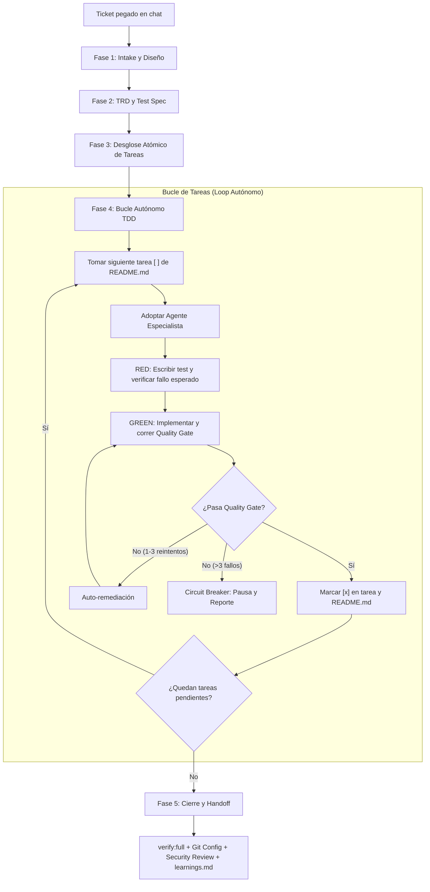

# 🤖 Comando: orchestrate (Orquestador E2E Autónomo)

Usa este comando cuando quieras arrastrar un ticket al chat o pegar su requerimiento y dejar que el orquestador ejecute de principio a fin todo el flujo de Faena de forma autónoma: desde el diseño inicial hasta la implementación completa con Quality Gates verificados en verde.

---

## 🎯 Directiva del Orquestador

Cuando el usuario invoque `@commands/orchestrate.md` y proporcione la descripción de un ticket:

1. **NO te detengas a pedir confirmación entre fases** (salvo que se active un disparador del Circuit Breaker / Regla de Parada).
2. **Aplica rigurosamente todas las invariantes de [PROTOCOL.md](../PROTOCOL.md)**:
   - **Resolución multi-tenant (`.active-tenant` según [PROTOCOL.md](../PROTOCOL.md) §1)**: al iniciar, resuelve las 4 raíces lógicas:
     - Si `.active-tenant` no existe o vale `default` (o si el prompt ya especifica `**Tenant**: \`default\``): `<proyecto_dir>` = `Proyecto`, `<context_dir>` = `tasks/context`, `<tasks_dir>` = `tasks`, `<rules_dir>` = `rules/project`.
     - Si `.active-tenant` contiene `<tenant>` != `default` (o el prompt indica `**Tenant**: \`<tenant>\``): `<proyecto_dir>` = `tenants/<tenant>/Proyecto`, `<context_dir>` = `tenants/<tenant>/context`, `<tasks_dir>` = `tenants/<tenant>/tasks`, `<rules_dir>` = `tenants/<tenant>/rules`.
   - **Aislamiento de código**: todo cambio de producción vive en `<proyecto_dir>/<repo>/`.
   - **Terminal en el repo del cliente**: comandos ejecutados dentro de `<proyecto_dir>/<repo>/`.
   - **Contexto leído antes de actuar**: desde `<context_dir>/`.
   - **TDD estricto**: test RED antes de código GREEN.
   - **Quality Gates reales**: nunca inventes comandos ni debilites tests.
   - **Identidad Git corporativa** configurada en el repo al cierre (`<context_dir>/team-context.md`), para que el commit que haga la persona salga con la cuenta correcta.
   - **Rama propia, sin commits y sin push**: nunca se trabaja sobre una rama base, y el orquestador **nunca** ejecuta `git commit` ni `git push` (ver *Política Git del modo autónomo*). Los commits los hace siempre una persona.
   - **Revisión de seguridad** previa al cierre.
   - **Actualización de memoria** en `<context_dir>/learnings.md`.

---

## 🔄 Máquina de Estados (Pipeline de 5 Fases)



---

### Fase 1: Intake del Ticket y Diseño

1. **Lectura de contexto corporativo**:
   - Lee `<context_dir>/team-context.md` (identifica Tech Lead, QA y DevOps).
   - Lee `<context_dir>/tech-context.md` y `<rules_dir>/company-standards.md` (si existe).
   - Inspecciona `<proyecto_dir>/` en disco (no con `git status` ni búsquedas que respeten `.gitignore`) para determinar el repositorio afectado (ej. `<proyecto_dir>/growthhacking.PrototypeZero/`) y obtén su rama actual con `git -C <proyecto_dir>/<repo> branch --show-current`. Si hay varios repositorios candidatos y el ticket no permite elegir uno con certeza, activa el **Circuit Breaker** (caso 4) antes de escribir nada.
   - Aplica la **Política Git del modo autónomo** (abajo): rama de trabajo y commit base. La rama resultante es la que se anota en `**Branch**:`.
   - Consulta `rules/skills-routing.md` y `skills/README.md` para identificar las skills requeridas.
2. **Generación de carpeta y diseño**:
   - Extrae un slug descriptivo en minúsculas (ej. `<tasks_dir>/task-recuperacion-carrito/`).
   - Crea `<tasks_dir>/task-<nombre>/design-<nombre>.md` siguiendo la estructura estándar de `commands/1-ticket.md`, incluyendo los metadatos de cabecera para sincronización con el dashboard:
     - `**Ticket Origen**:` (título o ID del ticket), `**Repositorio Afectado**: \`<proyecto_dir>/<repo>/\``, `**Branch**: \`<rama-de-trabajo>\`` y `**Base Commit**: \`<sha>\`` (ver *Política Git del modo autónomo*).
     - Resumen ejecutivo y objetivos.
     - Personas y actores (con asignaciones reales de `<context_dir>/team-context.md`).
     - Criterios de aceptación (Gherkin: Dado-Cuando-Entonces).
     - Alcance técnico (In Scope / Out of Scope).
     - Coordinación de equipo (QA Handoff y DevOps Handoff).
3. **Transición**: Pasa inmediatamente a la **Fase 2** sin esperar input del usuario.

---

### Fase 2: TRD y Especificación de Pruebas

1. **Adopción de rol y plantillas**:
   - Actúa como arquitecto técnico (`agents/design/software-architecture.md` o `agents/coding/dotnet-architect.md` según el stack).
   - Usa **exactamente** las plantillas de TRD y Test Spec de `commands/2-create-trd.md` (mismas secciones y numeración), para que el resultado sea idéntico al del modo manual. Lo único que se omite es su *Phase 6 — Stop for Review*.
   - Si se cumple alguno de sus *Edge Cases* (documento Level 1, >15 tareas, varias capas sin fronteras claras) **no esperes la decisión del usuario**: continúa con un único set de tareas y deja la advertencia en el TRD (sección *Summary*) y en el reporte final.
2. **Generación del TRD (`<tasks_dir>/task-<nombre>/trd-<nombre>.md`)**:
   - Objetivos y alcance técnico detallado.
   - Diagramas de arquitectura Mermaid (componentes y flujo).
   - Responsabilidades de módulos con rutas exactas en `<proyecto_dir>/<repo>/`.
   - Estrategia de testing (pirámide de pruebas, boundaries mockeables).
   - **Sección 6 (Task Breakdown)**: Desglose numerado de tareas con archivos a crear/modificar.
   - **Sección 7 (Team Coordination & Handoffs)**: Handoff a QA y DevOps con nombres de `<context_dir>/team-context.md`.
3. **Generación de Test Spec (`<tasks_dir>/task-<nombre>/test-spec-<nombre>.md`)**:
   - Especificaciones Given-When-Then para cada módulo y caso de borde.
4. **Transición**: Pasa inmediatamente a la **Fase 3** sin esperar input del usuario.

---

### Fase 3: Desglose Atómico de Tareas y README

1. **Generación de archivos de tarea** (plantillas *Setup*, *RED*, *GREEN* y *README* de `commands/3-create-tasks.md`, sin variaciones):
   - Lee la Sección 6 del TRD y genera los archivos individuales en `<tasks_dir>/task-<nombre>/`:
     - `task01-setup-<descripcion>.md` (si requiere configuración o baseline).
     - `taskNN-red-<descripcion>.md` (fase RED: tests que deben fallar).
     - `taskNN-green-<descripcion>.md` (fase GREEN + VERIFY: implementación y calidad).
2. **Generación del `README.md` del ticket (`<tasks_dir>/task-<nombre>/README.md`)**:
   - Cabecera con `**Location**: \`<proyecto_dir>/<repo>/\`` y `**Branch**: \`<rama-git-actual>\`` (el dashboard lee estos campos).
   - Tabla general de tareas con las columnas de la plantilla (`| Task | Name | Phase | Size | Est. Hours | Dependencies | Agent |`) y agentes que existan en `agents/coding/`.
   - **Quality Gates obligatorios** (comandos reales verificados para el repo en `<proyecto_dir>/<repo>/`):
     - `verify:quick`: comando de test aislado de la feature.
     - `verify`: suite de pruebas del componente afectado.
     - `verify:full`: build completo + suite de tests.
   - **Progress Tracking**: Checklist con checkboxes en blanco `- [ ]` para cada tarea.
3. **Transición**: Pasa inmediatamente a la **Fase 4** sin esperar input del usuario.

---

### Fase 4: Bucle Autónomo TDD (Ejecución de Tareas)

El orquestador procesa secuencialmente todas las tareas pendientes del `README.md`:

```
Mientras existan tareas con "- [ ]" en <tasks_dir>/task-<nombre>/README.md:
  1. Identificar la siguiente tarea pendiente (ej. task01, task02-red, task03-green).
  2. Leer el archivo de la tarea y el agente recomendado en su frontmatter o tabla.
  3. Ejecutar la disciplina TDD correspondiente:
```

#### Para tareas SETUP (`task01-setup-*.md`):
- Configurar rutas, dependencias o baseline en `<proyecto_dir>/<repo>/`.
- Ejecutar el comando de verificación baseline.

#### Para tareas RED (`taskNN-red-*.md`) — sub-tarea X.1:
- Adoptar el agente de pruebas (ej. `agents/coding/xunit-tester.md`, `agents/coding/jest-tester.md`, `agents/coding/pytest-tester.md`).
- Escribir el test en `<proyecto_dir>/<repo>/` siguiendo `test-spec-*.md`.
- Ejecutar el test de forma aislada en la terminal dentro de `<proyecto_dir>/<repo>/`.
- **Validar fallo esperado**: El test DEBE fallar por ausencia de la implementación requerida (no por syntax error, imports rotos ajenos o fallo de compilación previo).
- Registrar la salida del fallo en el archivo de la tarea.
- **Criterio de cierre RED**: la tarea se marca `[x]` cuando el test falla por la razón esperada. En RED **no** se exige que pase ningún Quality Gate (fallaría por diseño). Si el test pasa de inmediato o falla por otra razón, corrige el test (nunca el requisito) con hasta 3 intentos; después, Circuit Breaker.

#### Para tareas GREEN (`taskNN-green-*.md`) — sub-tareas X.2 y X.3:
- Adoptar el agente de implementación (ej. `agents/coding/aspnet-webapi-backend.md`, `agents/coding/angular-developer.md`, etc.).
- Escribir el código mínimo necesario para satisfacer el test en `<proyecto_dir>/<repo>/`.
- Ejecutar el test del ticket para confirmar que pasa a verde.
- X.2: ejecutar `verify:quick` del `README.md`.
- X.3 (VERIFY): ejecutar `verify` del `README.md`; en la última tarea GREEN, también `verify:full`.

#### Finalización de cada tarea:
- Si se cumple el criterio de cierre de la tarea (RED: falla esperada registrada; SETUP/GREEN: gates en verde con su salida pegada):
  1. Marcar `[x]` dentro del archivo de la tarea `<tasks_dir>/task-<nombre>/taskNN-*.md`.
  2. Marcar `[x]` en el `<tasks_dir>/task-<nombre>/README.md` del ticket.
  3. **Avanzar automáticamente a la siguiente tarea sin detenerse ni pedir confirmación.**

---

## 🌿 Política Git del Modo Autónomo

Se aplica al final de la Fase 1, antes de tocar código:

1. **Rama de trabajo.** Lee `**Prefijo de rama**` en `<context_dir>/team-context.md` (por defecto `feature/`) y la convención de ramas de `<rules_dir>/company-standards.md` si existe (esa manda).
   - Si la rama actual es base (`main`, `master`, `develop`, `dev`, `trunk`, `release/*`) o está en *detached HEAD*: `git -C <proyecto_dir>/<repo> checkout -b <prefijo><slug>` (si ya existe, `git checkout <prefijo><slug>`).
   - Si ya estás en una rama de feature, úsala tal cual.
   - Si el árbol de trabajo tiene cambios sin commitear que no son del ticket, **no** cambies de rama: Circuit Breaker (caso 3).
2. **Commit base.** Guarda `git -C <proyecto_dir>/<repo> rev-parse HEAD` en el `design-<nombre>.md` como `**Base Commit**: \`<sha>\``. Es la referencia de la auditoría de la Fase 5 y permite a la persona que revisa ver todo el cambio con `git diff <sha>`.
3. **Sin commits.** El orquestador **nunca** ejecuta `git commit` (ni `git add` para preparar uno). Todo el cambio queda en el árbol de trabajo de la rama del ticket para revisión humana.
4. **Nunca push, nunca PR, nunca reescritura de historia** (`push`, `rebase`, `reset`, `commit --amend`, `stash`).

---

## 🛑 Circuit Breaker (Regla de Parada y Control de Fallos)

El orquestador interrumpe la ejecución autónoma y solicita intervención humana **ÚNICAMENTE** en estos casos:

1. **Fallo persistente de Quality Gate**:
   - El orquestador tiene hasta **3 intentos de auto-remediación** para corregir un fallo de compilación o de test en una tarea GREEN.
   - Si tras 3 intentos el Quality Gate sigue fallando, **DETENERSE**, presentar el log de error exacto y pedir instrucciones.
2. **Regla *When Tests Disagree* ([rules/process-task-list.md](../rules/process-task-list.md#when-tests-disagree-pause-and-report))**:
   - Si dos tests entran en contradicción directa sobre el comportamiento de negocio.
   - Si las expectativas del test violan el esquema, DTOs o la arquitectura definida en el TRD.
3. **Bloqueo externo**: Falta de credenciales, secretos inexistentes, comandos de repo ausentes (un gate del `README.md` que el repo no define), o cambios ajenos sin commitear en el repo.
4. **Ambigüedad de destino**: no se puede determinar con certeza el repositorio afectado dentro de `<proyecto_dir>/`.

---

### Fase 5: Cierre, Auditoría de Seguridad y Handoff

Una vez marcadas todas las tareas `[x]` en el `README.md`:

1. **Quality Gate Final**: Ejecutar `verify:full` en `<proyecto_dir>/<repo>/` y confirmar código de salida 0.
2. **Verificación de Identidad Git**:
   - Comprobar `git config --local user.email` dentro de `<proyecto_dir>/<repo>/` contra el correo corporativo indicado en `<context_dir>/team-context.md`, porque la persona hará el commit y el push desde esa misma configuración.
   - Si falta, configurarlo con `git config --local`.
3. **Auditoría de Seguridad**:
   - Inspeccionar `git diff <Base Commit>` (incluye archivos nuevos: revisa también `git status --porcelain`) contra `rules/security/security.md` y con la perspectiva de `agents/coding/security-reviewer.md`. Las correcciones se dejan en el árbol de trabajo, igual que el resto del cambio.
   - Verificar: sin secretos quemados, sin SQL injection, sin bypass de autorizaciones, sin prints de depuración.
4. **Memoria y Aprendizaje**:
   - Registrar cualquier convención, trampa resuelta o ajuste técnico en `<context_dir>/learnings.md`.
5. **Reporte Consolidado al Usuario**:
   - Presentar el resumen ejecutivo final:
     - Rama de trabajo y commit base (el cambio queda sin commitear, listo para revisión).
     - Archivos modificados y creados en `<proyecto_dir>/<repo>/`.
     - Comandos sugeridos para que la persona revise y publique: `git -C <proyecto_dir>/<repo> diff <Base Commit>`, luego su propio `git add` / `git commit` y `git push -u origin <rama>`.
     - Evidencia de Quality Gates en verde.
     - Sección de **QA Handoff** lista para copiar (endpoints, payloads, escenarios clave).
     - Sección de **DevOps Handoff** (si aplica).

---

## 💡 Modo Subagentes (Recomendado para Contextos Grandes)

Si el entorno soporta subagentes (como Antigravity / Claude Code / Swarms):
- El Orquestador actúa como coordinador central.
- Para cada tarea `taskNN`, delega la ejecución de la tarea a un subagente worker dedicado con contexto limpio.
- Los subagentes **no** heredan `CLAUDE.md`/`AGENTS.md`: pásale al worker las rutas de `PROTOCOL.md`, `rules/process-task-list.md`, el `README.md` del ticket (sección **Quality Gates**), el TRD, el test spec, el archivo de tarea y las raíces resueltas (`<proyecto_dir>`, `<context_dir>`, `<rules_dir>`).
- El worker ejecuta solo esa tarea en `<proyecto_dir>/<repo>/`, corre sus gates y devuelve el resultado con la salida de terminal. El coordinador es quien marca `[x]` en el archivo de tarea y en el `README.md`, para que no haya dos escritores del mismo checklist.
- Esto garantiza **cero contaminación de contexto** y máxima precisión en tickets con muchas tareas.
