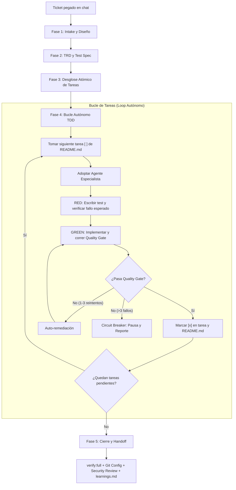

# 🤖 Comando: orchestrate (Orquestador E2E Autónomo)

Usa este comando cuando quieras arrastrar un ticket al chat o pegar su requerimiento y dejar que el orquestador ejecute de principio a fin todo el flujo de Faena de forma autónoma: desde el diseño inicial hasta la implementación completa con Quality Gates verificados en verde.

---

## 🎯 Directiva del Orquestador

Cuando el usuario invoque `@commands/orchestrate.md` y proporcione la descripción de un ticket:

1. **NO te detengas a pedir confirmación entre fases** (salvo que se active un disparador del Circuit Breaker / Regla de Parada).
2. **Aplica rigurosamente todas las invariantes de [PROTOCOL.md](PROTOCOL.md)**:
   - Aislamiento de código: todo cambio de producción vive en `Proyecto/<repo>/`.
   - Terminal en el repo del cliente: comandos ejecutados en `Proyecto/<repo>/`.
   - Contexto leído antes de actuar (`tasks/context/`).
   - TDD estricto: test RED antes de código GREEN.
   - Quality Gates reales: nunca inventes comandos ni debilites tests.
   - Identidad Git corporativa antes de commits.
   - Revisión de seguridad previa al cierre.
   - Actualización de memoria en `tasks/context/learnings.md`.

---

## 🔄 Máquina de Estados (Pipeline de 5 Fases)



---

### Fase 1: Intake del Ticket y Diseño

1. **Lectura de contexto corporativo**:
   - Lee `tasks/context/team-context.md` (identifica Tech Lead, QA y DevOps).
   - Lee `tasks/context/tech-context.md` y `rules/project/company-standards.md`.
   - Inspecciona `Proyecto/` para determinar el repositorio afectado (ej. `Proyecto/growthhacking.PrototypeZero/`).
   - Consulta `rules/skills-routing.md` y `skills/README.md` para identificar las skills requeridas.
2. **Generación de carpeta y diseño**:
   - Extrae un slug descriptivo en minúsculas (ej. `tasks/task-recuperacion-carrito/`).
   - Crea `tasks/task-<nombre>/design-<nombre>.md` siguiendo la estructura estándar de `commands/1-ticket.md`:
     - Resumen ejecutivo y objetivos.
     - Personas y actores (con asignaciones reales de `tasks/context/team-context.md`).
     - Criterios de aceptación (Gherkin: Dado-Cuando-Entonces).
     - Alcance técnico (In Scope / Out of Scope).
     - Coordinación de equipo (QA Handoff y DevOps Handoff).
3. **Transición**: Pasa inmediatamente a la **Fase 2** sin esperar input del usuario.

---

### Fase 2: TRD y Especificación de Pruebas

1. **Adopción de rol**:
   - Actúa como arquitecto técnico (`agents/design/software-architecture.md` o `agents/coding/dotnet-architect.md` según el stack).
2. **Generación del TRD (`tasks/task-<nombre>/trd-<nombre>.md`)**:
   - Objetivos y alcance técnico detallado.
   - Diagramas de arquitectura Mermaid (componentes y flujo).
   - Responsabilidades de módulos con rutas exactas en `Proyecto/<repo>/`.
   - Estrategia de testing (pirámide de pruebas, boundaries mockeables).
   - **Sección 6 (Task Breakdown)**: Desglose numerado de tareas con archivos a crear/modificar.
   - **Sección 7 (Team Coordination & Handoffs)**: Handoff a QA y DevOps con nombres de `tasks/context/team-context.md`.
3. **Generación de Test Spec (`tasks/task-<nombre>/test-spec-<nombre>.md`)**:
   - Especificaciones Given-When-Then para cada módulo y caso de borde.
4. **Transición**: Pasa inmediatamente a la **Fase 3** sin esperar input del usuario.

---

### Fase 3: Desglose Atómico de Tareas y README

1. **Generación de archivos de tarea**:
   - Lee la Sección 6 del TRD y genera los archivos individuales en `tasks/task-<nombre>/`:
     - `task01-setup-<descripcion>.md` (si requiere configuración o baseline).
     - `taskNN-red-<descripcion>.md` (fase RED: tests que deben fallar).
     - `taskNN-green-<descripcion>.md` (fase GREEN + VERIFY: implementación y calidad).
2. **Generación del `README.md` del ticket (`tasks/task-<nombre>/README.md`)**:
   - Tabla general de tareas (Task, Nombre, Fase, Tamaño, Horas est., Dependencias, Agente asignado de `agents/coding/`).
   - **Quality Gates obligatorios** (comandos reales verificados para el repo en `Proyecto/<repo>/`):
     - `verify:quick`: comando de test aislado de la feature.
     - `verify`: suite de pruebas del componente afectado.
     - `verify:full`: build completo + suite de tests.
   - **Progress Tracking**: Checklist con checkboxes en blanco `- [ ]` para cada tarea.
3. **Transición**: Pasa inmediatamente a la **Fase 4** sin esperar input del usuario.

---

### Fase 4: Bucle Autónomo TDD (Ejecución de Tareas)

El orquestador procesa secuencialmente todas las tareas pendientes del `README.md`:

```
Mientras existan tareas con "- [ ]" en tasks/task-<nombre>/README.md:
  1. Identificar la siguiente tarea pendiente (ej. task01, task02-red, task03-green).
  2. Leer el archivo de la tarea y el agente recomendado en su frontmatter o tabla.
  3. Ejecutar la disciplina TDD correspondiente:
```

#### Para tareas SETUP (`task01-setup-*.md`):
- Configurar rutas, dependencias o baseline en `Proyecto/<repo>/`.
- Ejecutar el comando de verificación baseline.

#### Para tareas RED (`taskNN-red-*.md`):
- Adoptar el agente de pruebas (ej. `agents/coding/xunit-tester.md`, `agents/coding/jest-tester.md`, `agents/coding/pytest-tester.md`).
- Escribir el test en `Proyecto/<repo>/` siguiendo `test-spec-*.md`.
- Ejecutar el test de forma aislada en la terminal dentro de `Proyecto/<repo>/`.
- **Validar fallo esperado**: El test DEBE fallar por ausencia de la implementación requerida (no por syntax error, imports rotos ajenos o fallo de compilación previo).
- Registrar la salida del fallo.

#### Para tareas GREEN (`taskNN-green-*.md`):
- Adoptar el agente de implementación (ej. `agents/coding/aspnet-webapi-backend.md`, `agents/coding/angular-developer.md`, etc.).
- Escribir el código mínimo necesario para satisfacer el test en `Proyecto/<repo>/`.
- Ejecutar el test del ticket para confirmar que pasa a verde.
- Ejecutar el Quality Gate `verify:quick` o `verify` indicado en el `README.md`.

#### Finalización de cada tarea:
- Si el Quality Gate pasa exitosamente:
  1. Marcar `[x]` dentro del archivo de la tarea `tasks/task-<nombre>/taskNN-*.md`.
  2. Marcar `[x]` en el `README.md` del ticket.
  3. **Avanzar automáticamente a la siguiente tarea sin detenerse ni pedir confirmación.**

---

## 🛑 Circuit Breaker (Regla de Parada y Control de Fallos)

El orquestador interrumpe la ejecución autónoma y solicita intervención humana **ÚNICAMENTE** en estos casos:

1. **Fallo persistente de Quality Gate**:
   - El orquestador tiene hasta **3 intentos de auto-remediación** para corregir un fallo de compilación o de test en una tarea GREEN.
   - Si tras 3 intentos el Quality Gate sigue fallando, **DETENERSE**, presentar el log de error exacto y pedir instrucciones.
2. **Regla *When Tests Disagree* ([rules/process-task-list.md](rules/process-task-list.md#L77-L88))**:
   - Si dos tests entran en contradicción directa sobre el comportamiento de negocio.
   - Si las expectativas del test violan el esquema, DTOs o la arquitectura definida en el TRD.
3. **Bloqueo externo**: Falta de credenciales, secretos inexistentes o comandos de repo ausentes.

---

### Fase 5: Cierre, Auditoría de Seguridad y Handoff

Una vez marcadas todas las tareas `[x]` en el `README.md`:

1. **Quality Gate Final**: Ejecutar `verify:full` en `Proyecto/<repo>/` y confirmar código de salida 0.
2. **Verificación de Identidad Git**:
   - Comprobar `git config --local user.email` dentro de `Proyecto/<repo>/` contra el correo corporativo indicado en `tasks/context/team-context.md`.
   - Si falta, configurarlo antes de cualquier operación Git.
3. **Auditoría de Seguridad**:
   - Inspeccionar el `git diff` del repositorio contra `rules/security/security.md` y con la perspectiva de `agents/coding/security-reviewer.md`.
   - Verificar: sin secretos quemados, sin SQL injection, sin bypass de autorizaciones, sin prints de depuración.
4. **Memoria y Aprendizaje**:
   - Registrar cualquier convención, trampa resuelta o ajuste técnico en `tasks/context/learnings.md`.
5. **Reporte Consolidado al Usuario**:
   - Presentar el resumen ejecutivo final:
     - Archivos modificados y creados en `Proyecto/<repo>/`.
     - Evidencia de Quality Gates en verde.
     - Sección de **QA Handoff** lista para copiar (endpoints, payloads, escenarios clave).
     - Sección de **DevOps Handoff** (si aplica).

---

## 💡 Modo Subagentes (Recomendado para Contextos Grandes)

Si el entorno soporta subagentes (como Antigravity / Claude Code / Swarms):
- El Orquestador actúa como coordinador central.
- Para cada tarea `taskNN`, delega la ejecución de la tarea a un subagente worker dedicado con contexto limpio.
- El worker lee únicamente el TRD, el archivo de tarea y el repo `Proyecto/<repo>/`, ejecuta el ciclo RED/GREEN, corre el Quality Gate y devuelve el resultado.
- Esto garantiza **cero contaminación de contexto** y máxima precisión en tickets con muchas tareas.
