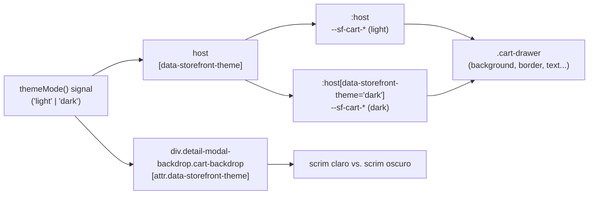

# TRD: Cart drawer theme-aware (light/dark)

## 1. Resumen

El panel del carrito del storefront público debe seguir la misma paleta que el resto del catálogo.
Se resuelve con tokens CSS `--sf-cart-*` declarados en `:host` / `:host[data-storefront-theme='dark']`
y consumidos por el bloque `.cart-drawer`. No requiere cambios de lógica ni de contrato de API.

## 2. Arquitectura del cambio

## 3. Módulos modificados

| Archivo | Cambio |
|---------|--------|
| `apps/angular/src/app/public/storefront/storefront-catalog.component.scss` | 19 tokens `--sf-cart-*` (light + dark) y refactor de `.cart-drawer` |
| `apps/angular/src/app/public/storefront/storefront-catalog.component.html` | `data-storefront-theme` en el backdrop del carrito y en el CTA de checkout |

## 4. Tokens

| Token | Light | Dark |
|-------|-------|------|
| `--sf-cart-bg` | `#ffffff` | `#131f37` |
| `--sf-cart-border` | `rgba(25, 67, 131, 0.14)` | `rgba(255, 255, 255, 0.12)` |
| `--sf-cart-shadow` | `-20px 0 50px rgba(22, 33, 63, 0.16)` | `-20px 0 50px rgba(0, 0, 0, 0.5)` |
| `--sf-cart-divider` | `rgba(22, 33, 63, 0.1)` | `rgba(255, 255, 255, 0.08)` |
| `--sf-cart-heading` | `var(--sf-brand-navy)` | `#ffffff` |
| `--sf-cart-text` | `rgba(22, 33, 63, 0.72)` | `#cbd5e1` |
| `--sf-cart-text-muted` | `rgba(22, 33, 63, 0.6)` | `#64748b` |
| `--sf-cart-dismiss-bg` | `rgba(22, 33, 63, 0.06)` | `rgba(255, 255, 255, 0.1)` |
| `--sf-cart-dismiss-hover-bg` | `rgba(22, 33, 63, 0.12)` | `rgba(255, 255, 255, 0.2)` |
| `--sf-cart-dismiss-text` | `#4b5a78` | `#94a3b8` |
| `--sf-cart-dismiss-hover-text` | `var(--sf-brand-navy)` | `#ffffff` |
| `--sf-cart-empty-icon-bg` | `rgba(25, 67, 131, 0.06)` | `rgba(255, 255, 255, 0.05)` |
| `--sf-cart-empty-icon` | `rgba(22, 33, 63, 0.45)` | `#64748b` |
| `--sf-cart-item-bg` | `#f4fff3` | `rgba(255, 255, 255, 0.03)` |
| `--sf-cart-item-border` | `rgba(25, 67, 131, 0.1)` | `rgba(255, 255, 255, 0.07)` |
| `--sf-cart-media-bg` | `#eaf1fd` | `#1a2944` |
| `--sf-cart-media-icon` | `rgba(22, 33, 63, 0.28)` | `rgba(255, 255, 255, 0.2)` |
| `--sf-cart-danger` | `#dc2626` | `#f87171` |
| `--sf-cart-danger-hover` | `#b91c1c` | `#fca5a5` |

## 5. Decisiones técnicas

1. **Tokens en el host, no atributo por elemento.** El drawer es un único contenedor: redefinir los
   tokens en `:host[data-storefront-theme='dark']` evita repetir `[attr.data-storefront-theme]` en
   ~15 nodos y garantiza que cualquier elemento futuro dentro del drawer herede el tema.
2. **Dark mode sin regresión.** Los valores oscuros se copian literalmente de los que había
   hardcodeados, por lo que el resultado en modo oscuro es idéntico al actual.
3. **Backdrop compartido.** El carrito reutiliza `detail-modal-backdrop`; al añadirle el atributo
   hereda el scrim claro del modal (`rgba(237, 255, 236, 0.8)` + `blur(10px)`), que es el
   comportamiento esperado en modo claro.
4. **Contraste.** En modo claro los textos usan navy con alfa (`0.6`–`1`), y el rojo de acciones
   destructivas baja a `#dc2626` (contraste ~4.8:1 sobre `#f4fff3`, AA para texto normal).

## 6. Team Coordination & Handoffs

### QA Handoff

- **Ruta**: `/<tenant>/catalog` (storefront público), botón del carrito en el navbar o barra flotante.
- **Casos**:
  1. Modo claro + carrito vacío: drawer blanco, título navy, icono y textos en gris azulado, CTA verde.
  2. Modo claro + carrito con ítems: tarjetas `#f4fff3`, borde suave, stepper visible, total navy.
  3. Modo oscuro + carrito vacío/lleno: idéntico al comportamiento previo (fondo `#131f37`).
  4. Toggle de tema con el drawer abierto: debe re-colorear sin cerrarse.
  5. Backdrop: en modo claro se ve claro con blur; en oscuro, scrim oscuro.
  6. Botón de cierre y enlaces "Seguir comprando"/"Vaciar carrito": legibles y con hover en ambos modos.
- **Sin API involucrada**: todo es presentación.

### DevOps Handoff

- Sin variables de entorno, secretos ni migraciones.
- Solo requiere rebuild del bundle Angular (`npm run build` / pipeline habitual).

## 7. Riesgos

- Bajo: cambio puramente CSS + dos bindings de atributo. El riesgo de regresión visual en modo
  oscuro se mitiga replicando los valores existentes.
