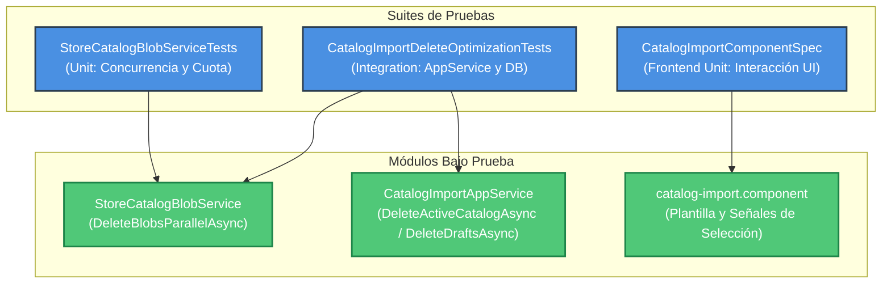

# Test Specification: Optimización de Eliminación de Catálogo y Desbloqueo de Borradores Incompletos

**Related TRD**: `trd-catalog-import-delete-fix.md`  
**Created:** 2026-11-04  
**Location:** `Proyecto/growthhacking.PrototypeZero/`  

---

## Architecture Diagram

---

## Module Tests

### Module: `StoreCatalogBlobService` (`services/core/PrototypeZero.CoreService/Store/CatalogImport/StoreCatalogBlobService.cs`)

**Responsibility**: Administra la persistencia, lectura y borrado concurrente de blobs en Azure Blob Storage y sincronización de cuota de almacenamiento.

#### Test Suite: `StoreCatalogBlobServiceTests`

**Test: Eliminación masiva paralela procesa todos los blobs en concurrencia**
- **Given:** Una lista de 50 nombres de blobs existentes en el contenedor.
- **When:** Se ejecuta `DeleteBlobsParallelAsync(blobNames)`.
- **Then:** Cada uno de los 50 blobs se elimina satisfactoriamente mediante llamadas concurrentes a Azure Blob Storage.
- **And:** El tiempo total de procesamiento no escala de forma lineal respecto al número de blobs.

**Test: Descuento consolidado de cuota tras eliminación masiva**
- **Given:** Una lista de blobs eliminados con un tamaño combinado acumulado de 15,000,000 bytes.
- **When:** Se ejecuta la eliminación masiva paralela.
- **Then:** Se realiza exactamente una invocación a `quotaService.RemoveUsedAsync(15000000)` con el total agregado, en lugar de 50 llamadas individuales.

---

### Module: `CatalogImportAppService` (`services/core/PrototypeZero.CoreService/Store/CatalogImport/CatalogImportAppService.cs`)

**Responsibility**: Coordina el ciclo de vida de importación de catálogos y la eliminación limpia de borradores y registros de importación.

#### Test Suite: `CatalogImportDeleteOptimizationTests`

**Test: DeleteActiveCatalogAsync elimina borradores, imágenes en paralelo y resetea importación a Idle**
- **Given:** Un catálogo activo con estado `Ready` conteniendo 100 borradores, cada uno con una imagen asociada.
- **When:** Se ejecuta `DeleteActiveCatalogAsync()`.
- **Then:** La tabla `Store.CatalogProductDrafts` queda vacía para el tenant.
- **And:** Se invoca el borrado paralelo de los 100 blobs de imágenes.
- **And:** El registro en `Store.CatalogImports` tiene `Status = CatalogImportStatus.Idle`, `ActiveBlobName = null` y `PendingBlobName = null`.

**Test: DeleteDraftsAsync elimina borradores seleccionados e imágenes huérfanas concurrentemente**
- **Given:** 10 borradores de catálogo donde 5 son seleccionados para borrado y poseen imágenes únicas no compartidas.
- **When:** Se ejecuta `DeleteDraftsAsync([id1, id2, id3, id4, id5])`.
- **Then:** Los 5 borradores se eliminan de la base de datos.
- **And:** Los blobs de imágenes correspondientes se eliminan sin bloqueos síncronos.

---

### Module: `catalog-import.component` (`apps/angular/src/app/store/catalog-import/`)

**Responsibility**: Manejo de la tabla de borradores, reactividad de selección y habilitación de botones de acción.

#### Test Suite: `CatalogImportComponentSpec`

**Test: Casilla de verificación de fila habilitada para borradores incompletos**
- **Given:** Un borrador cargado en la grilla con `status = CatalogProductDraftStatus.Incomplete`.
- **When:** Se renderiza la fila en la tabla.
- **Then:** El elemento `<input type="checkbox">` de la fila NO contiene el atributo `disabled`.
- **And:** El usuario puede hacer clic y alternar su selección en `selectedDraftIds()`.

**Test: Seleccionar todos incluye borradores incompletos**
- **Given:** Una lista de 10 borradores visibles donde 3 tienen estado `Incomplete` y 7 tienen estado `Ready`.
- **When:** El usuario marca el checkbox del encabezado (`toggleSelectAll(true)`).
- **Then:** La señal `selectedDraftIds()` contiene los 10 IDs (incluyendo los 3 incompletos).
- **And:** El botón "Eliminar seleccionados" está habilitado.

**Test: Botón Publicar seleccionados se deshabilita si hay incompletos seleccionados**
- **Given:** Una selección activa en `selectedDraftIds()` que incluye al menos un borrador con `status = Incomplete`.
- **When:** Se evalúa el estado del botón "Publicar seleccionados".
- **Then:** El botón permanece deshabilitado (`disabled = true`).

**Test: Botón Publicar seleccionados se habilita si todos los seleccionados son válidos**
- **Given:** Una selección activa compuesta exclusivamente por borradores con `status = Ready` o `RequireReview`.
- **When:** Se evalúa el estado del botón "Publicar seleccionados".
- **Then:** El botón se encuentra habilitado (`disabled = false`).
