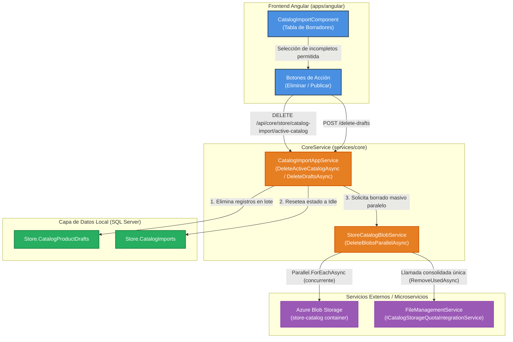
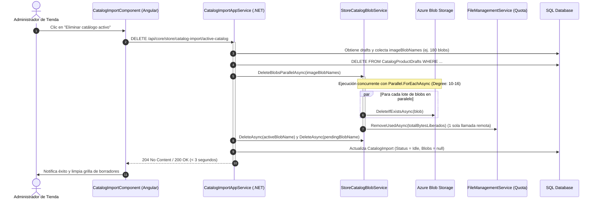

# TRD: Optimización de Eliminación de Catálogo y Desbloqueo de Borradores Incompletos

**Version:** 1.0  
**Created:** 2026-11-04  
**Location:** `Proyecto/growthhacking.PrototypeZero/`  

---

## 1. Overview

Resolver los cuellos de botella de latencia y bloqueos de interfaz durante la gestión y eliminación de catálogos y borradores extraídos por IA. La solución optimiza el backend paralelizando la eliminación de blobs en Azure Blob Storage y consolidando el descuento de cuota en una única llamada, eliminando los timeouts 504 del API Gateway. En el frontend, se elimina el bloqueo en los checkboxes de borradores incompletos, permitiendo su selección y descarte individual o por lote, trasladando la restricción de validación exclusivamente a la acción de publicación.

**In Scope:**
- Paralelización de la eliminación de imágenes en `StoreCatalogBlobService` mediante `Parallel.ForEachAsync` con grado de concurrencia configurable (`MaxDegreeOfParallelism = 10` a `16`).
- Consolidación del cálculo de bytes liberados y llamada única agregada a `ICatalogStorageQuotaIntegrationService.RemoveUsedAsync` en lugar de una llamada HTTP remota por cada imagen.
- Refactorización de `CatalogImportAppService.DeleteActiveCatalogAsync` y `CatalogImportAppService.DeleteDraftsAsync` para aprovechar la eliminación paralela de blobs.
- Desbloqueo de las casillas de verificación de fila en `catalog-import.component.html` retirando `[disabled]="!canPublish(row)"`.
- Actualización de `toggleSelectAll` y señales computadas en `catalog-import.component.ts` para permitir selección global de borradores para borrado, blindando el botón "Publicar seleccionados" si hay incompletos seleccionados.
- Pruebas unitarias y de integración en `PrototypeZero.CoreService.Tests` y specs en `apps/angular`.

**Out of Scope:**
- Alteraciones en la firma o contrato del microservicio `FileManagementService` (`ICatalogStorageQuotaIntegrationService`).
- Modificaciones al motor de inferencia de IA o prompts de extracción en `AiService`.

---

## 2. Architecture

### Component Diagram



### Data Flow & Execution Sequence



---

## 3. Technology Stack

| Technology | Version | Justification |
|------------|---------|---------------|
| .NET 9 / C# 13 | 9.0 | Stack actual de `PrototypeZero.CoreService`. Uso de `Parallel.ForEachAsync` nativo para optimización de I/O concurrente. |
| Azure.Storage.Blobs | 12.x | SDK oficial de Azure Storage ya instalado en el proyecto. |
| Angular / Signals | 19.x | Stack actual en `apps/angular` con gestión reactiva de estados y signals computadas. |
| ABP Framework | 9.x | Framework de microservicios y UOW transaccional. |

*Nota: No se incorporan dependencias externas adicionales.*

---

## 4. Module Responsibilities

### Module 1: `StoreCatalogBlobService.cs` (`services/core/PrototypeZero.CoreService/Store/CatalogImport/`)
**Responsibility**: Gestión de operaciones sobre Azure Blob Storage para catálogos y sus imágenes asociadas, coordinando cuota de almacenamiento.
**Key Functions**:
- `Task<long> DeleteBlobsParallelAsync(IReadOnlyCollection<string> blobNames, CancellationToken cancellationToken = default)` - Elimina una colección de blobs en paralelo mediante `Parallel.ForEachAsync(maxDegreeOfParallelism: 12)`.
- `Task DeleteAsync(string blobName)` - Elimina un blob individual (mantenido para archivos de catálogo activos/pendientes).
- `Task RemoveUsedQuotaAsync(long totalBytes)` - Notifica una única vez a `ICatalogStorageQuotaIntegrationService` con el total consolidado liberado.

### Module 2: `CatalogImportAppService.cs` (`services/core/PrototypeZero.CoreService/Store/CatalogImport/`)
**Responsibility**: Orquesta el flujo de negocio del catálogo de importación, publicación, edición y eliminación de borradores.
**Key Functions**:
- `Task DeleteActiveCatalogAsync()` - Refactorizado para invocar la eliminación concurrente de blobs y liberar el catálogo en pocos segundos sin superar timeouts.
- `Task DeleteDraftsAsync(List<Guid> draftIds)` - Refactorizado para verificar referencias no bloqueantes y delegar la eliminación de blobs huérfanos concurrentemente.

### Module 3: `catalog-import.component.html` (`apps/angular/src/app/store/catalog-import/`)
**Responsibility**: Plantilla visual de la tabla de importación de catálogos y barra de acciones.
**Key Elements**:
- `<input type="checkbox" ...>` de celda: Remueve `[disabled]="!canPublish(row)"` para permitir selección libre.
- `<input type="checkbox" ...>` de cabecera: Vinculado a `allSelected()` y `toggleSelectAll($event.target.checked)`.
- Botón "Publicar seleccionados": Vinculado a `canPublishSelected()` para deshabilitarse si hay borradores incompletos en la selección activa.

### Module 4: `catalog-import.component.ts` (`apps/angular/src/app/store/catalog-import/`)
**Responsibility**: Lógica y reactividad del componente Angular para selección y eliminación de borradores.
**Key Functions / Signals**:
- `canPublishSelected = computed(() => ...)`: Señal que comprueba si todos los elementos seleccionados tienen estado válido para publicar.
- `allSelected = computed(() => ...)`: Comprueba si todos los elementos visibles están seleccionados.
- `toggleSelectAll(checked: boolean)`: Selecciona o deselecciona todos los borradores de la vista actual sin filtrar por estado incompleto.
- `deleteSelected()`: Envía los IDs seleccionados (completos o incompletos) al backend para su eliminación.

---

## 5. Testing Strategy

**Test Pyramid**:
- 60% Unit Tests: Pruebas unitarias sobre `StoreCatalogBlobService` (eliminación en paralelo, cálculo de cuota acumulada) y validación de componentes Angular.
- 30% Integration Tests: Pruebas de integración sobre `CatalogImportAppService` (`DeleteActiveCatalogAsync`, `DeleteDraftsAsync`) verificando que la base de datos se limpie y las llamadas concurrentes a blobs se efectúen correctamente.
- 10% Manual / E2E Verification: Verificación por QA con catálogos de 200+ ítems en ambiente staging.

**Mockable Boundaries**:
- `IBlobContainer<StoreCatalogContainer>` y `BlobClient` / `BlobContainerClient`.
- `ICatalogStorageQuotaIntegrationService`.
- `IRepository<CatalogProductDraft, Guid>` e `IRepository<CatalogImport, Guid>`.

**Coverage Requirements**:
- 100% en métodos modificados de eliminación concurrente.
- Pruebas de regresión que certifiquen que la eliminación de un catálogo con 200+ imágenes tome menos de 5 segundos en condiciones estándar de red.

**Quality Gates**:
```bash
# verify:quick (< 5 seconds)
dotnet test services/core/PrototypeZero.CoreService.Tests --filter "FullyQualifiedName~CatalogImport|FullyQualifiedName~StoreCatalog"

# verify (< 30 seconds)
dotnet test services/core/PrototypeZero.CoreService.Tests

# verify:full (< 2 minutes)
dotnet build services/core/PrototypeZero.CoreService && dotnet test services/core/PrototypeZero.CoreService.Tests
```

---

## 6. Task Breakdown

### Task List

| Task | Name | Phase | Files Created | Files Modified | Dependencies | Est. | Agent |
|------|------|-------|---------------|----------------|--------------|------|-------|
| 01 | Setup y Verificación de Línea Base | setup | - | - | None | 0.5h | dotnet-architect |
| 02 | Pruebas RED: Eliminación Concurrente y Selección en Frontend | red | `CatalogImportDeleteOptimizationTests.cs` | - | 01 | 1.5h | xunit-tester |
| 03 | Implementación GREEN: Optimización Backend y Desbloqueo Frontend | green+verify | - | `StoreCatalogBlobService.cs`, `CatalogImportAppService.cs`, `catalog-import.component.html`, `catalog-import.component.ts` | 02 | 2h | aspnet-webapi-backend |

### Task Details

#### Task 01: Setup y Verificación de Línea Base
- **Phase**: setup
- **Description**: Verificar compilación y baseline de tests de `PrototypeZero.CoreService` y `apps/angular`. Asegurar aislamiento para pruebas concurrentes.
- **Dependencies**: Ninguna.
- **Estimated Effort**: 0.5 horas.
- **Agent**: `dotnet-architect`.

#### Task 02: Pruebas RED: Eliminación Concurrente y Selección en Frontend
- **Phase**: red
- **Description**: Escribir pruebas unitarias que evidencien:
  1. `StoreCatalogBlobService` debe soportar eliminación masiva paralela de blobs y emitir una sola llamada acumulativa de cuota.
  2. `CatalogImportAppService.DeleteActiveCatalogAsync` debe eliminar todos los borradores y llamar a la eliminación paralela de imágenes sin ciclos secuenciales bloqueantes.
  3. `catalog-import.component.spec.ts` debe verificar que borradores incompletos tengan el checkbox habilitado y permitan ser seleccionados para borrado masivo.
- **Files Created**:
  - `services/core/PrototypeZero.CoreService.Tests/Store/CatalogImport/CatalogImportDeleteOptimizationTests.cs`
- **Dependencies**: Task 01.
- **Estimated Effort**: 1.5 horas.
- **Agent**: `xunit-tester`.

#### Task 03: Implementación GREEN: Optimización Backend y Desbloqueo Frontend
- **Phase**: green+verify
- **Description**:
  1. Implementar `DeleteBlobsParallelAsync` en `StoreCatalogBlobService.cs`.
  2. Refactorizar `DeleteActiveCatalogAsync` y `DeleteDraftsAsync` en `CatalogImportAppService.cs`.
  3. Eliminar `[disabled]="!canPublish(row)"` en `catalog-import.component.html`.
  4. Ajustar `toggleSelectAll`, `allSelected` y `canPublishSelected` en `catalog-import.component.ts`.
  5. Ejecutar quality gates hasta aprobación verde.
- **Files Modified**:
  - `services/core/PrototypeZero.CoreService/Store/CatalogImport/StoreCatalogBlobService.cs`
  - `services/core/PrototypeZero.CoreService/Store/CatalogImport/CatalogImportAppService.cs`
  - `apps/angular/src/app/store/catalog-import/catalog-import.component.html`
  - `apps/angular/src/app/store/catalog-import/catalog-import.component.ts`
- **Dependencies**: Task 02.
- **Estimated Effort**: 2 horas.
- **Agent**: `aspnet-webapi-backend`.

---

## 7. Team Coordination & Handoffs

### QA Handoff (Assigned QA: Laura)
- **Surfaces & Endpoints to Test**:
  - `DELETE /api/core/store/catalog-import/active-catalog`
  - `POST /api/core/store/catalog-import/drafts/delete-drafts`
  - Pantalla Angular: `/store/products/import-catalog`
- **Test Scenarios & Edge Cases**:
  - Carga masiva: Importar catálogo con 200+ ítems e imágenes. Pulsar "Eliminar catálogo activo". Medir tiempo de respuesta (debe ser inferior a 5s y responder HTTP 200/204).
  - Borradores incompletos: Cargar catálogo con productos sin precio o categoría (estado Incompleto). Verificar que sus casillas no estén deshabilitadas.
  - Selección individual: Marcar la casilla de un producto incompleto. Comprobar que "Eliminar seleccionados" se habilite y lo elimine correctamente.
  - Selección global: Pulsar el checkbox general en el encabezado. Verificar que marque todas las filas visibles independientemente de su estado.
  - Protección de publicación: Al tener seleccionado un producto incompleto, comprobar que "Publicar seleccionados" esté deshabilitado para evitar errores 500/400.

### DevOps Handoff (Assigned DevOps: Sofía)
- **Infraestructura y Nube**:
  - No se requieren nuevas variables ni secretos en Key Vault.
  - La paralelización de peticiones HTTP hacia Azure Blob Storage se mantiene en un grado de concurrencia razonable (10-16 hilos) para no superar límites de throttling de la cuenta de almacenamiento de Azure.

---

## 8. Reference Documents

- **Design Document**: `tasks/task-catalog-import-delete-fix/design-catalog-import-delete-fix.md`
- **Test Specification**: `tasks/task-catalog-import-delete-fix/test-spec-catalog-import-delete-fix.md`
- **Target Repository**: `Proyecto/growthhacking.PrototypeZero/`
- **Contexto Corporativo**:
  - `tasks/context/team-context.md`
  - `tasks/context/project-structure.md`

---

## Summary

Esta entrega optimiza drásticamente la latencia de eliminación de catálogos mediante I/O paralela en Azure y agrega una capa de consistencia en el frontend Angular, garantizando que los administradores de tienda puedan descartar cualquier borrador defectuoso o eliminar catálogos pesados en tiempo real sin experimentar bloqueos ni timeouts 504.

**Estimated Effort**: 4 horas  
**Risk Level**: Low  
**Dependencies**: Ninguna dependencia nueva  

---

**Ready for task file generation**:  
👉 **Siguiente paso:** Arrastra al chat `@commands/3-create-tasks.md tasks/task-catalog-import-delete-fix/trd-catalog-import-delete-fix.md`
