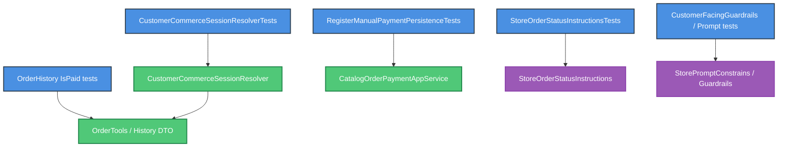

# Test Specification: Consistencia de estado tras pago manual (Portal ↔ Agente WhatsApp)

**Related TRD**: `trd-manual-payment-agent-status.md`  
**Created**: 2026-10-28  

---

## Architecture Diagram

---

## Module Tests

### Module: `CustomerCommerceSessionResolver` (`services/core/.../Store/Orders/` o `Store/Tools/`)

**Responsibility**: Elegir checkout/crédito abierto o, en su defecto, el último pedido fulfillable pagado.

#### Test Suite: `CustomerCommerceSessionResolverTests`

**Test: Solo pedido Paid → retorna ese pedido como sesión fulfillable**
- **Given:** Lista con un `CatalogOrder` `Paid` (y opcionalmente `Shipped` legacy).
- **When:** `SelectActiveOrLatestFulfillable(orders)`.
- **Then:** Retorna ese pedido; no retorna null.

**Test: Draft tiene prioridad sobre Paid**
- **Given:** Un `Draft` reciente y un `Paid` más antiguo del mismo cliente.
- **When:** Se selecciona la sesión.
- **Then:** Retorna el `Draft`.

**Test: PendingPayment tiene prioridad sobre Paid**
- **Given:** `PendingPayment` y `Paid`.
- **When:** Se selecciona la sesión.
- **Then:** Retorna `PendingPayment`.

**Test: OnCredit / PaymentReminder tienen prioridad sobre Paid**
- **Given:** Pedido `OnCredit` (o `PaymentReminder`) y otro `Paid`.
- **When:** Se selecciona la sesión.
- **Then:** Retorna el de crédito/recordatorio (misma precedencia que hoy: checkout primero, luego crédito).

**Test: Cancelled no se usa como fulfillable**
- **Given:** Solo pedidos `Cancelled`.
- **When:** Se selecciona la sesión.
- **Then:** Retorna null.

**Test: Hint de Paid prohíbe reinicio de pago/checkout**
- **Given:** Pedido `Paid` con `OrderNumber` conocido.
- **When:** `BuildPaidFulfillmentReminderHint(order)`.
- **Then:** El texto indica pedido pagado / fulfillment; indica usar GetOrderDetails; no pide payment link ni reiniciar checkout; `NewPurchaseAllowed` semántica documentada en el hint.

---

### Module: `OrderTools` / History DTO (`OrderTools.cs`, `CatalogOrderHistoryEntryMcpDto`)

**Responsibility**: Exponer estado de pago autoritativo al agente.

#### Test Suite: `CatalogOrderHistoryIsPaidTests` (nombre orientativo)

**Test: Historial marca IsPaid en pedidos Paid/Shipped**
- **Given:** Entradas de historial construidas desde pedidos `Paid` y `PendingPayment`.
- **When:** Se proyecta `IsPaid` (vía proyección o mapping usado por `GetUserOrderHistory`).
- **Then:** `Paid`/`Shipped` → `IsPaid=true`; `PendingPayment` → `false`.

**Test: GetOrderDetails ya reporta IsPaid (regresión)**
- **Given:** Pedido `Paid` del cliente.
- **When:** Se proyecta detalle MCP (o se reutiliza `CatalogOrderStatusProjection.IsPaid`).
- **Then:** `IsPaid` es true y `Status` comercial es «Pagado».

---

### Module: `CatalogOrderPaymentAppService` (`Store/Payments/PaymentAppService.cs`)

**Responsibility**: Persistencia correcta del pago manual.

#### Test Suite: `RegisterManualPaymentPersistenceTests`

**Test: RegisterManualPayment deja order Paid y payment Approved**
- **Given:** Pedido `PendingPayment` con total positivo; gateway/shipping precondiciones satisfechas según fixture del test (o shipping deshabilitado si el harness lo permite).
- **When:** `RegisterManualPayment(CreatePaymentDto)` con amount = total.
- **Then:** `order.Status == Paid`; existe `Payment` con `Status == Approved` y `RelatedEntityId == order.Id`.

**Test: Tras pago manual el estado comercial no vuelve a PendingPayment solo por consultar**
- **Given:** Pedido ya `Paid` tras registro manual.
- **When:** Se relee el pedido desde repositorio.
- **Then:** Sigue `Paid` (sin mutación espuria).

---

### Module: `StoreOrderStatusInstructions` (`services/ai/.../ChatBot/StoreOrderStatusInstructions.cs`)

**Responsibility**: Reglas de follow-up de estado/envío.

#### Test Suite: `StoreOrderStatusInstructionsTests`

**Test: Null/checkout vacío no implica unpaid**
- **Given:** `StoreOrderStatusInstructions.ToolRules`.
- **When:** Se inspecciona el texto.
- **Then:** Contiene regla explícita de que ausencia de checkout abierto / Active null-or-Paid-fulfillment **no** significa pago no verificado.

**Test: Follow-up de envío exige tools de detalle/historial**
- **Given:** ToolRules.
- **When:** Assert de contenido.
- **Then:** Exige `GetOrderDetails` o `GetUserOrderHistory` en el turno para preguntas de estado/envío.

**Test: IsPaid / Pagado prohíbe pedir comprobante o reiniciar dirección**
- **Given:** ToolRules.
- **When:** Assert de contenido.
- **Then:** Prohíbe solicitar comprobante o re-capturar dirección cuando el tool result muestra pagado; distingue envío por preparar de deuda.

**Test: Independencia order vs shipment se mantiene**
- **Given:** ToolRules existentes.
- **When:** Assert de contenido.
- **Then:** Conserva que shipment status no implica unpaid (regresión de reglas actuales).

---

### Module: `StorePromptConstrains` / `CustomerFacingGuardrails`

**Responsibility**: Orquestación y guardrails de comprobante.

#### Test Suite: `StorePaidOrderPromptTests` (o extender suites existentes)

**Test: StorePromptConstrains aclara Paid en Active como fulfillment**
- **Given:** `AiAppService.StorePromptConstrains`.
- **When:** Assert de contenido.
- **Then:** Indica que Status Paid/Shipped en Active no es cart; no CreateOrder/UpdateOrder por pregunta de estado; usar GetOrderDetails/history.

**Test: Guardrails no escalan comprobante si IsPaid**
- **Given:** Texto de `CustomerFacingGuardrails` (Store).
- **When:** Assert de contenido.
- **Then:** Instrucción de no tratar imagen de comprobante como pago pendiente / no RequestHumanIntervention por “pago no verificado” cuando tools del turno muestran `IsPaid=true`.

---

## Integration Tests

### Test Suite: `Integration` (manual / QA + opcional harness)

**Test: E2E manual payment → WhatsApp status (Laura)**
- **Given:** Tenant Store, gateway ManualVerification, pedido con pago manual aprobado y mensaje «pagado exitosamente».
- **When:** Cliente pregunta «¿Cuándo lo envían?».
- **Then:** Respuesta refleja Pagado / preparación de envío; no pide comprobante ni dirección de nuevo; portal y DB siguen Paid/Approved.

**Test: PendingPayment sin aprobar (control negativo)**
- **Given:** Pedido esperando verificación manual.
- **When:** Cliente pregunta por el pedido.
- **Then:** Agente no afirma Pagado.

**Test: Paid + Draft concurrente**
- **Given:** Pedido Paid y Draft nuevo.
- **When:** Cliente pregunta por el número del pedido pagado.
- **Then:** Estado del Paid no se confunde con el Draft; no se atribuye deuda del checkout al pedido pagado.

---

## Test Fixtures

**Fixture: `paid-catalog-order`**
- **Purpose**: Pedido `Paid` con OrderNumber tipo `CAT-…`, items y opcional shipment «por preparar».
- **Content**: Entidad in-memory o builder usado por resolver tests.

**Fixture: `pending-payment-order`**
- **Purpose**: Pedido `PendingPayment` para precedencia y control negativo.
- **Content**: Mismo builder con Status distinto.

**Fixture: `manual-payment-dto`**
- **Purpose**: `CreatePaymentDto` con amount = total, método activo, currency COP.
- **Content:** Campos mínimos para `RegisterManualPayment`.

---

## Test Statistics

- **Estimated Test Cases**: 16–20  
- **Test Suites**: 5–6  
- **Coverage Target**: 100% en paths de selección Paid vs checkout; asserts de contenido en prompts críticos  
