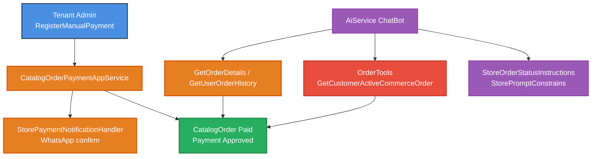

# TRD: Consistencia de estado tras pago manual (Portal ↔ Agente WhatsApp)

**Version:** 1.0  
**Created:** 2026-10-28  
**Location:** `Proyecto/growthhacking.PrototypeZero/`  

---

## 1. Overview

Tras `RegisterManualPayment`, Core marca el pedido `Paid`, crea `Payment` `Approved` y notifica por WhatsApp («pedido pagado exitosamente»). En el siguiente turno el Agente puede afirmar que no hay pedido activo ni pago verificado y reiniciar captura de comprobante/dirección. La causa raíz es que `GetCustomerActiveCommerceOrder` **excluye** pedidos `Paid` (retorna `null`), y el modelo interpreta «sin checkout activo» como «sin pago», sin consultar `GetOrderDetails` / `GetUserOrderHistory` de forma autoritativa.

**In Scope:**
- Confirmar/regresar persistencia post-`RegisterManualPayment` (`Paid` + `Approved`).
- Enriquecer la tool MCP de sesión comercial para no devolver `null` ambiguo cuando existe un pedido `Paid`/`Shipped` reciente.
- Endurecer instrucciones Store (`StoreOrderStatusInstructions`, `StorePromptConstrains`, guardrails) para follow-ups de envío/estado.
- Exponer `IsPaid` en historial MCP cuando falte.
- Tests unitarios en Core + AiService (TDD).

**Out of Scope:**
- Flujo Wompi / `StorePaymentHandler` (salvo colateral documentado).
- OCR de comprobantes / visión de imágenes.
- Rediseño de métodos manuales Colombia.
- Nuevos secretos o infra Azure.

---

## 2. Architecture

### Component Diagram



### Data Flow (bug → fix)

```mermaid
sequenceDiagram
    autonumber
    actor C as Cliente WhatsApp
    participant Admin as Tenant Admin
    participant Core as CatalogOrderPaymentAppService
    participant MCP as OrderTools
    participant AI as AiService prompts

    Admin->>Core: RegisterManualPayment
    Core->>Core: Status=Paid, Payment=Approved
    Core-->>C: "pedido pagado exitosamente"
    C->>AI: "¿Cuándo lo envían?"
    Note over MCP: ANTES: Active → null → modelo dice "sin pago"
    AI->>MCP: GetCustomerActiveCommerceOrder
    MCP-->>AI: Paid fulfillable + ReminderHint (NewPurchaseAllowed)
    AI->>MCP: GetOrderDetails / GetUserOrderHistory
    MCP-->>AI: IsPaid=true, Status=Pagado, shipment state
    AI-->>C: Pedido pagado; envío por preparar (sin deuda)
```

**Decisión de diseño (Tech Lead):** corrección durable = **MCP + prompts**, no solo prompt. `GetCustomerActiveCommerceOrder` debe, si no hay checkout/crédito abierto, devolver el último pedido `Paid`/`Shipped` del cliente con `ReminderHint` explícito y `NewPurchaseAllowed = true`, en lugar de `null`. El carrito sigue siendo solo `Draft`/`PendingPayment`; mutaciones (`UpdateOrder`/`AddItemToOrder`) ya fallan fuera de esos estados.

Key patterns: MCP tools en Core, prompt composition en AiService (`CommercialRulesetProvider`), proyección `CatalogOrderStatusProjection.IsPaid`.  
See: [system-patterns.md](/tasks/context/system-patterns.md), repo `tasks/context/saas-multi-tenancy-and-features.md`.

---

## 3. Technology Stack

| Technology | Version | Justification |
|------------|---------|---------------|
| — | — | Sin dependencias nuevas |

**Project Technologies**: .NET 10 / ABP 10.5 / xUnit — [tech-context.md](/tasks/context/tech-context.md).

---

## 4. Module Responsibilities

### Module 1: `OrderTools.cs` (`services/core/PrototypeZero.CoreService/Store/Tools/`)

**Responsibility**: Tools MCP de pedido; la sesión activa no debe confundir «sin checkout» con «sin pago».

**Key Functions**:
- `GetCustomerActiveCommerceOrder(...)` — Si existe Draft/PendingPayment/OnCredit/PaymentReminder, comportamiento actual. Si no, cargar el último `Paid`/`Shipped` no cancelado y devolver DTO con `ReminderHint` de fulfillment + `NewPurchaseAllowed = true` (no `null` ambiguo).
- `GetUserOrderHistory(...)` — Incluir `IsPaid` por entrada.
- `GetOrderDetails(...)` — Sin cambio de contrato; ya expone `IsPaid` / `Status=Pagado`.

**Dependencies**: `IRepository<CatalogOrder>`, `CatalogOrderStatusProjection`, credit/shipping helpers existentes.

### Module 2: `CustomerActiveCommerceOrderMcpDto` / history DTOs (`services/core/.../Contracts/Store/Orders/Mcp/`)

**Responsibility**: Contrato estructurado hacia el agente.

**Key changes**:
- Documentar/asegurar campos usados por el hint de pedido pagado (`Status`, `ReminderHint`, `NewPurchaseAllowed`).
- `CatalogOrderHistoryEntryMcpDto.IsPaid` (bool) poblado vía `CatalogOrderStatusProjection.IsPaid`.

### Module 3: Helper de resolución (opcional, testable)  
`CustomerCommerceSessionResolver` o método estático en helper existente bajo `Store/Tools/` / `Store/Orders/`

**Responsibility**: Seleccionar checkout abierto vs último fulfillable (`Paid`/`Shipped`) de forma unit-testeable sin levantar MCP completo.

**Key Functions**:
- `SelectActiveOrLatestFulfillable(IEnumerable<CatalogOrder> orders): CatalogOrder?` — prioridad checkout/crédito; fallback Paid/Shipped más reciente.
- `BuildPaidFulfillmentReminderHint(CatalogOrder order): string` — texto MCP para no pedir pago ni reiniciar checkout.

### Module 4: `StoreOrderStatusInstructions.cs` (`services/ai/.../ChatBot/`)

**Responsibility**: Reglas no negociables de follow-up de estado/envío.

**Key content additions**:
- Null/ausencia de checkout abierto ≠ unpaid.
- Tras confirmación de pago o pregunta de envío: obligar `GetOrderDetails` / `GetUserOrderHistory` en el turno.
- Si `IsPaid` / Status Pagado: no pedir comprobante ni dirección ya capturada; no iniciar `CreateOrder` por esa pregunta.
- Distinguir shipment «por preparar» de deuda.

### Module 5: `AiAppService.StorePromptConstrains` + `CustomerFacingGuardrails`

**Responsibility**: Orquestación de tools y guardrails de comprobante.

**Key changes**:
- Aclarar semántica de `GetCustomerActiveCommerceOrder` cuando Status es Paid/Shipped (fulfillment, no cart).
- Status/shipping questions: no afirmar «sin pago verificado» sin tool result del turno.
- Imágenes de comprobante: no escalar HITL como si el pago estuviera pendiente si tools del turno muestran `IsPaid=true`.

### Module 6: `CatalogOrderPaymentAppService` (regresión)

**Responsibility**: Ya marca `Paid` + `Approved` + publica notificación; este ticket **verifica** con tests de regresión, sin rediseñar el flujo salvo bug real de persistencia.

---

## 5. Testing Strategy

**Test Pyramid**:
- 75% Unit: resolver de sesión, hints, strings de instrucciones, `IsPaid` en historial, proyección.
- 20% Integration/AppService: `RegisterManualPayment` deja `Paid`+`Approved` (si harness de tests Core lo permite).
- 5% E2E manual: Laura (WhatsApp real / sandbox).

**Mockable Boundaries**:
- Repositorios / DbContext en tests de AppService.
- No mockear el enum/`CatalogOrderStatusProjection` (dominio puro).

**Coverage Requirements**:
- Paths Paid fallback + open checkout precedence: 100%.
- Instrucciones críticas (null ≠ unpaid, no proof when IsPaid): asserts de contenido.

**Quality Gates**:

```bash
# Core
dotnet test services/core/PrototypeZero.CoreService.Tests --filter "FullyQualifiedName~CustomerCommerce|FullyQualifiedName~CatalogOrderStatus|FullyQualifiedName~ManualPayment|FullyQualifiedName~OrderTools|FullyQualifiedName~OrderHistory"

# AiService
dotnet test services/ai/PrototypeZero.AiService.Tests --filter "FullyQualifiedName~StoreOrderStatus|FullyQualifiedName~CustomerFacingGuardrails|FullyQualifiedName~CommercialRuleset|FullyQualifiedName~StorePrompt"
```

(Ejecutar desde `Proyecto/growthhacking.PrototypeZero`.)

---

## 6. Task Breakdown

| Task | Name | Phase | Files Created | Files Modified | Dependencies | Est. | Agent |
|------|------|-------|---------------|----------------|--------------|------|-------|
| 01 | Setup / fixtures | setup | (opcional fixtures) | — | None | 0.5h | xunit-tester |
| 02 | RED: sesión MCP + historial IsPaid | red | `CustomerCommerceSessionResolverTests.cs`, tests historial/DTO | — | 01 | 2h | xunit-tester |
| 03 | GREEN: resolver + OrderTools + DTOs | green+verify | helper resolver | `OrderTools.cs`, MCP DTOs | 02 | 3h | aspnet-webapi-backend |
| 04 | RED: prompts / guardrails | red | `StoreOrderStatusInstructionsTests.cs`, updates guardrail/prompt tests | — | 01 | 1.5h | xunit-tester |
| 05 | GREEN: prompts / guardrails | green+verify | — | `StoreOrderStatusInstructions.cs`, `AiAppService.cs`, `CustomerFacingGuardrails.cs` | 04 | 2h | aspnet-webapi-backend |
| 06 | RED+GREEN: regresión RegisterManualPayment | red+green | `RegisterManualPaymentPersistenceTests.cs` (o equivalente) | `PaymentAppService.cs` solo si falla | 01 | 2h | xunit-tester |

### Task Details

#### Task 01: Setup
- **Phase**: setup  
- **Description**: Confirmar proyectos de test, namespaces y si hace falta fixture mínima de `CatalogOrder` para resolver.  
- **Dependencies**: None · **Est.**: 0.5h · **Agent**: xunit-tester  

#### Task 02: RED sesión MCP
- **Phase**: red  
- **Description**: Tests que fallen: (1) con solo pedido Paid → sesión retorna ese pedido + hint fulfillment, no null; (2) Draft coexiste con Paid → prioridad Draft; (3) historial expone `IsPaid=true` para Paid.  
- **Files Created**: `PrototypeZero.CoreService.Tests/Store/Orders/CustomerCommerceSessionResolverTests.cs` (+ test historial si aplica)  
- **Dependencies**: 01 · **Est.**: 2h · **Agent**: xunit-tester  

#### Task 03: GREEN sesión MCP
- **Phase**: green+verify  
- **Description**: Implementar resolver + wire en `GetCustomerActiveCommerceOrder`; añadir `IsPaid` al historial; `dotnet test` verde + build Core.  
- **Files Modified**: `OrderTools.cs`, DTOs MCP, helper nuevo  
- **Dependencies**: 02 · **Est.**: 3h · **Agent**: aspnet-webapi-backend  

#### Task 04: RED prompts
- **Phase**: red  
- **Description**: Asserts de contenido en instrucciones/guardrails (null ≠ unpaid; mandatory status tools; no proof when IsPaid; Paid status de Active no es cart).  
- **Files Created**: `StoreOrderStatusInstructionsTests.cs`; extender `CustomerFacingGuardrailsTests` / composition tests  
- **Dependencies**: 01 · **Est.**: 1.5h · **Agent**: xunit-tester  

#### Task 05: GREEN prompts
- **Phase**: green+verify  
- **Description**: Actualizar textos de orquestación y guardrails; tests AiService verdes.  
- **Dependencies**: 04 · **Est.**: 2h · **Agent**: aspnet-webapi-backend  

#### Task 06: Regresión pago manual
- **Phase**: red+green  
- **Description**: Test que tras registrar pago manual el pedido queda `Paid` y el payment `Approved`. Solo tocar AppService si el test revela regresión real.  
- **Dependencies**: 01 · **Est.**: 2h · **Agent**: xunit-tester  

---

## 7. Team Coordination & Handoffs

### QA Handoff (Laura)
- **Surfaces**: Tenant Admin → pagos manuales del pedido; detalle de pedido; WhatsApp Store agent.
- **Pasos**: Gateway `ManualVerification` → pedido PendingPayment → `RegisterManualPayment` → detalle portal Pagado → WhatsApp «¿Cuándo lo envían?» → respuesta Pagado / envío sin pedir comprobante ni dirección de nuevo.
- **Edge**: Pedido Paid + nuevo Draft; PendingPayment sin aprobar (no debe decir Pagado); reenvío de imagen de comprobante con pedido ya Paid (no tratar como deuda).
- **Delegated**: Certificación E2E sandbox WhatsApp + contraste DB/portal.

### DevOps Handoff (Sofía)
- **Environment Variables**: Ninguna nueva.
- **Secrets / Vault**: Ninguno.
- **Infrastructure**: Verificar en staging que outbox/Service Bus entrega `StorePaymentNotificationEto` (para no confundir fallo de notificación con bug de agente).

---

## 8. Reference Documents

- **Test Specification**: `test-spec-manual-payment-agent-status.md`
- **Design**: `design-manual-payment-agent-status.md`
- **Target Repository**: `Proyecto/growthhacking.PrototypeZero`
- **Team / Tech / Patterns**: [team-context.md](/tasks/context/team-context.md), [tech-context.md](/tasks/context/tech-context.md), [system-patterns.md](/tasks/context/system-patterns.md)
- **Example instruction tests**: `services/ai/PrototypeZero.AiService.Tests/ChatBot/StoreCatalogDiscoveryInstructionsTests.cs`
- **Example status projection tests**: `services/core/PrototypeZero.CoreService.Tests/Store/Orders/CatalogOrderStatusProjectionTests.cs`
- **Key sources**: `OrderTools.cs`, `PaymentAppService.RegisterManualPayment`, `StoreOrderStatusInstructions.cs`, `AiAppService.StorePromptConstrains`

---

## Summary

Endurecer la sesión MCP para que un cliente con pedido recién pagado no reciba `null` en la tool de activo, y alinear prompts para que follow-ups de envío usen `GetOrderDetails`/`GetUserOrderHistory` sin comunicar deuda ni reiniciar checkout. Confirmar con tests la persistencia `Paid`/`Approved` del registro manual.

**Estimated Effort**: 1.5–2.5 días  
**Risk Level**: Medium (cambio de semántica MCP visible al LLM; mitigado con hints + prompts + tests)  
**Dependencies**: Ninguna package nueva  

---

**Ready for task file generation**:  
👉 **Siguiente paso:** Arrastra al chat `@commands/3-create-tasks.md tasks/task-manual-payment-agent-status/trd-manual-payment-agent-status.md`
