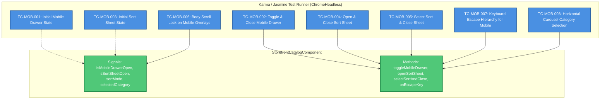

# Test Specification: Rediseño Responsive Móvil del Catálogo Storefront

**Related TRD:** `trd-mobile-storefront-responsive.md`  
**Created:** 2026-11-04  
**Target Component:** `apps/angular/src/app/public/storefront/storefront-catalog.component.ts`  

---

## Architecture Diagram



---

## Module Tests

### Module: `StorefrontCatalogComponent` (`apps/angular/src/app/public/storefront/storefront-catalog.component.ts`)

**Responsibility:** Gestionar la reactividad y las interacciones móviles para navegación, filtrado, ordenamiento y control de vistas en dispositivos táctiles.

#### Test Suite: `StorefrontCatalogComponent - Mobile Navigation & Interactions`

#### Test: TC-MOB-001 - Initial Mobile Drawer State
- **Given:** El componente se inicializa en el ciclo de vida de Angular.
- **When:** Se consulta el valor de la señal `isMobileDrawerOpen`.
- **Then:** Debe ser `false` de forma predeterminada.

#### Test: TC-MOB-002 - Toggle & Close Mobile Drawer
- **Given:** El componente está inicializado con `isMobileDrawerOpen = false`.
- **When:** Se invoca `toggleMobileDrawer()`.
- **Then:** `isMobileDrawerOpen()` debe cambiar a `true`.
- **When:** Se invoca `closeMobileDrawer()`.
- **Then:** `isMobileDrawerOpen()` debe retornar a `false`.

#### Test: TC-MOB-003 - Initial Sort Sheet State
- **Given:** El componente está cargado.
- **When:** Se consulta el valor de la señal `isSortSheetOpen`.
- **Then:** Debe ser `false` por defecto.

#### Test: TC-MOB-004 - Open & Close Sort Sheet
- **Given:** El componente tiene `isSortSheetOpen = false`.
- **When:** Se llama a `openSortSheet()`.
- **Then:** `isSortSheetOpen()` pasa a ser `true`.
- **When:** Se llama a `closeSortSheet()`.
- **Then:** `isSortSheetOpen()` pasa a ser `false`.

#### Test: TC-MOB-005 - Select Sort Option and Close Sheet
- **Given:** El modal/sheet de ordenamiento está abierto (`isSortSheetOpen = true`) con `sortMode = 'category'`.
- **When:** El usuario llama a `selectSortAndClose('priceAsc')`.
- **Then:** `sortMode()` se actualiza a `'priceAsc'`, se solicita la recarga de productos con el nuevo orden, y `isSortSheetOpen()` se cierra (`false`).

#### Test: TC-MOB-006 - Body Scroll Lock Effect on Mobile Overlays
- **Given:** La página está en su estado normal de navegación.
- **When:** Se abre el drawer móvil (`isMobileDrawerOpen = true`).
- **Then:** La clase `sf-scroll-locked` o el bloqueo de scroll debe aplicarse al `document.body`.
- **When:** Se cierra el drawer móvil (`isMobileDrawerOpen = false`).
- **Then:** El bloqueo de scroll del body se retira.

#### Test: TC-MOB-007 - Keyboard Escape Hierarchy for Mobile Overlays
- **Given:** El sheet de ordenamiento móvil está abierto (`isSortSheetOpen = true`) y el modal de producto está abierto (`isModalOpen = true`).
- **When:** El usuario presiona la tecla Escape (`onEscapeKey()`).
- **Then:** Se debe cerrar prioritariamente el sheet de ordenamiento (`isSortSheetOpen = false`), manteniendo el modal de producto abierto.
- **When:** Si el drawer móvil está abierto (`isMobileDrawerOpen = true`), presionar Escape debe cerrar el drawer primero antes de cerrar el modal de producto.

#### Test: TC-MOB-008 - Mobile Category Bar Selection
- **Given:** El catálogo tiene categorías disponibles en el carrusel horizontal.
- **When:** El usuario pulsa una categoría mediante `selectCategory('accesorios')`.
- **Then:** `selectedCategory()` cambia a `'accesorios'` y el catálogo actualiza los productos mostrados.

---

## Integration Tests

### Test Suite: `Storefront Mobile Integration`

#### Test: Mobile View Switch & Responsive Fallback
- **Given:** El catálogo carga en un viewport simulado de 375px (iPhone).
- **When:** El usuario navega entre categorías usando el carrusel horizontal superior.
- **Then:** Los productos correspondientes se muestran en tarjetas horizontales con su imagen miniatura cuadrada a la izquierda, título arriba a la derecha y precio en la parte inferior derecha.

---

## Test Fixtures & Mock Data

### Fixture: `mockCategories`
```typescript
export const mockCategories: PublicStorefrontCategoryDto[] = [
  { id: 'cat-1', name: 'MOCHILAS', slug: 'mochilas', productCount: 8 },
  { id: 'cat-2', name: 'GAFAS', slug: 'gafas', productCount: 12 },
  { id: 'cat-3', name: 'ARETES', slug: 'aretes', productCount: 25 },
];
```

---

## Test Statistics

- **Total Unit Test Cases:** 8
- **Integration Test Cases:** 1
- **Expected Test Execution Time:** < 0.25 segundos en Chrome Headless
- **Target Coverage:** 100% de las nuevas señales y métodos de UI móvil
