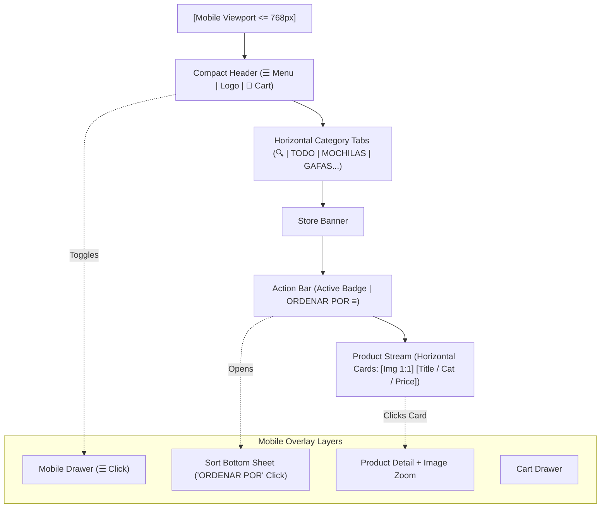

# TRD: Rediseño Responsive Móvil del Catálogo Storefront

**Version:** 1.0  
**Created:** 2026-11-04  
**Location:** `Proyecto/growthhacking.PrototypeZero/apps/angular/src/app/public/storefront/`  

---

## 1. Overview

El propósito de este requerimiento es transformar la interfaz del catálogo público (`StorefrontCatalogComponent`) en dispositivos móviles (`viewport <= 768px`) para alinearla con el estándar de comercio móvil moderno de la referencia visual proporcionada (estilo Kyte - *María Isabel Accesorios*). La solución elimina la acumulación vertical previa de filtros y datos de contacto, introduciendo una barra superior compacta con menú lateral (`☰`), un carrusel de categorías horizontal con buscador, una barra de ordenamiento modal y tarjetas de productos en disposición horizontal con proporciones óptimas para pantallas táctiles.

**In Scope:**
- Barra de navegación móvil compacta con botón hamburguesa `☰`, logo del comercio y botón de carrito con insignia.
- Drawer lateral deslizable para móvil que aloja la información comercial, enlaces a redes sociales, alternador de modo oscuro/claro y selector de idioma.
- Carrusel horizontal deslizable de categorías (pestañas `TODO`, categorías en mayúsculas con subrayado activo y botón de búsqueda `🔍`).
- Barra de ordenamiento móvil con badge de categoría activa y botón `ORDENAR POR` con selector tipo bottom-sheet modal.
- Formato horizontal para las tarjetas de productos en pantallas móviles: imagen cuadrada (~38% ancho, bordes redondeados) a la izquierda; título en negrita, subtítulo tenue y precio destacado a la derecha.
- Preservación 100% intacta del layout de escritorio (cuadrícula de 3-4 columnas y sidebar tradicional) para `viewport > 768px`.
- Pruebas unitarias completas en Jasmine/Karma.

**Out of Scope:**
- Modificación de endpoints backend de ABP / C#.
- Cambios en las APIs de checkout de WhatsApp o carrito de compras.
- Rediseño del modal de administración del tenant.

---

## 2. Architecture

### Component Diagram

```mermaid
graph TB
    subgraph UI_Storefront["Storefront Public View (Angular 21)"]
        Navbar["Header Bar\n(Logo + Hamburger + Cart)"]:::uiStyle
        MobileDrawer["Mobile Navigation Drawer\n(Brand, Contact, Theme, Lang)"]:::uiStyle
        CatCarousel["Horizontal Categories Bar\n(Search + Carousel Tabs)"]:::uiStyle
        Banner["Storefront Banner"]:::uiStyle
        ActionBar["Mobile Action Bar\n(Active Pill + 'ORDENAR POR')"]:::uiStyle
        SortSheet["Sort Bottom Sheet Modal"]:::uiStyle
        ProductList["Product List\n(Mobile Horizontal Cards / Desktop Grid)"]:::domainStyle
        ProductDetail["Product Detail Modal + Image Zoom"]:::domainStyle
    end

    subgraph State_Manager["StorefrontCatalogComponent State (Signals)"]
        DrawerSignal["isMobileDrawerOpen = signal(false)"]:::stateStyle
        SortSheetSignal["isSortSheetOpen = signal(false)"]:::stateStyle
        CatSignal["selectedCategory = signal('all')"]:::stateStyle
        SortSignal["sortMode = signal('category')"]:::stateStyle
        ZoomSignal["isImageZoomOpen = signal(false)"]:::stateStyle
        ScrollEffect["bodyScrollLockEffect (Sync with overlays)"]:::stateStyle
    end

    Navbar -.-> DrawerSignal
    CatCarousel -.-> CatSignal
    ActionBar -.-> SortSheetSignal
    SortSheet -.-> SortSignal
    ProductList -.-> ProductDetail

    DrawerSignal --> ScrollEffect
    SortSheetSignal --> ScrollEffect
    ZoomSignal --> ScrollEffect

    classDef uiStyle fill:#4A90E2,stroke:#2A60A0,stroke-width:2px,color:#FFFFFF;
    classDef domainStyle fill:#50C878,stroke:#208848,stroke-width:2px,color:#FFFFFF;
    classDef stateStyle fill:#E67E22,stroke:#B05510,stroke-width:2px,color:#FFFFFF;
```



### Mobile Layout Hierarchy Flow



---

## 3. Technology Stack

| Technology | Version | Justification |
| :--- | :--- | :--- |
| Angular Core & Signals | `~21.2.0` | Gestión de estado reactivo local (`signal`, `computed`, `effect`) sin dependencias de terceros. |
| SCSS / CSS Flexbox & Grid | CSS3 | Disposición horizontal responsiva mediante media queries modernas y propiedades fluidas. |
| Karma & Jasmine | Standard Angular | Ejecución de pruebas unitarias automatizadas en modo Chrome Headless. |

*Nota: No se añaden librerías externas para evitar sobrecargar el bundle del cliente.*

---

## 4. Module Responsibilities

### `apps/angular/src/app/public/storefront/storefront-catalog.component.ts`
**Responsibility:** Gestionar el estado reactivo, eventos de interacción móvil y sincronización de bloqueo de scroll para los nuevos overlays.

**Key Properties & Signals:**
- `readonly isMobileDrawerOpen = signal<boolean>(false)` - Controla la visibilidad del drawer lateral móvil.
- `readonly isSortSheetOpen = signal<boolean>(false)` - Controla la visibilidad del selector de ordenamiento móvil.
- `readonly isMobileSearchOpen = signal<boolean>(false)` - Controla si la barra de búsqueda móvil está desplegada.

**Key Methods:**
- `toggleMobileDrawer(): void` - Alterna el drawer lateral de menú en móviles.
- `closeMobileDrawer(): void` - Cierra el drawer lateral de menú.
- `openSortSheet(): void` - Abre el modal/bottom sheet de ordenamiento.
- `closeSortSheet(): void` - Cierra el modal de ordenamiento.
- `selectSortAndClose(sort: StorefrontSortMode): void` - Selecciona el modo de ordenamiento y cierra el sheet.
- `toggleMobileSearch(): void` - Alterna el campo de búsqueda rápida en móvil.
- `onEscapeKey(): void` - Actualizado para cerrar prioritariamente `isSortSheetOpen` y `isMobileDrawerOpen` antes del modal de producto.

**Dependencies:**
- `@angular/core` (`signal`, `effect`, `computed`, `HostListener`)
- `@abp/ng.core` (`LocalizationPipe`, `SessionStateService`)

---

### `apps/angular/src/app/public/storefront/storefront-catalog.component.html`
**Responsibility:** Estructurar el marcado semántico del header móvil, carrusel de categorías horizontal, drawer de navegación, selector de orden y tarjetas horizontales.

**Key Template Blocks:**
1. `.storefront-navbar`: Botón hamburguesa `☰` visible en móvil (`mobile-menu-btn`), logo y carrito.
2. `.mobile-drawer-backdrop`: Drawer lateral deslizable con datos de contacto, enlaces sociales, selector de idioma y tema.
3. `.mobile-category-bar`: Carrusel deslizable horizontal con botón `🔍` y pestañas en mayúsculas (`TODO`, categorías) con indicador activo.
4. `.mobile-action-bar`: Badge con nombre de categoría activa y botón `ORDENAR POR`.
5. `.sort-sheet-backdrop`: Selector modal con opciones de ordenamiento.
6. `.catalog-grid`: Tarjetas `.store-card` optimizadas para flujo horizontal en móvil.

---

### `apps/angular/src/app/public/storefront/storefront-catalog.component.scss`
**Responsibility:** Definir los estilos y media queries (`@media (max-width: 768px)`) que transforman visualmente la página al formato Kyte.

**Key Style Rules:**
- `.mobile-category-bar`: Scroll horizontal con `overflow-x: auto`, `scrollbar-width: none` y `-webkit-overflow-scrolling: touch`. Pestañas con borde inferior activo.
- `.store-card`: En móvil (`<= 768px`), display `flex`, `flex-direction: row`, imagen cuadrada de 110px a 130px (`aspect-ratio: 1 / 1`, `border-radius: 14px`), info a la derecha con título en negrita (`line-clamp: 2`), subtítulo atenuado y precio grande destacado.
- `.storefront-categories`: En pantallas de escritorio (`> 768px`) se muestra en su posición fija; en móviles sus elementos de contacto pasan al drawer y las categorías se sirven a través del carrusel superior.
- `.mobile-drawer`: Animación de deslizamiento lateral (`slide-in`), fondo glassmorphism temático (`dark` / `light`).

---

## 5. Testing Strategy

**Test Pyramid:**
- **90% Unit Tests (Jasmine/Karma):** Verificación de estado de señales móviles, apertura/cierre de overlays, comportamiento de selección de categoría y ordenamiento.
- **10% Quality Gates (Build & Compilation):** Compilación completa del bundle de Angular (`ng build`).

**Mockable Boundaries:**
- Servicios de ABP (`SessionStateService`, `ConfigStateService`, `PublicStorefrontService`).

**Coverage Requirements:**
- Cobertura de 100% de los nuevos métodos y señales móviles en `storefront-catalog.component.spec.ts`.

**Quality Gates:**
```bash
# verify:quick (< 15 seconds)
cd Proyecto/growthhacking.PrototypeZero/apps/angular && npx ng test --watch=false --browsers=ChromeHeadless --include="**/storefront-catalog.component.spec.ts"

# verify:build (< 20 seconds)
cd Proyecto/growthhacking.PrototypeZero/apps/angular && yarn build
```

---

## 6. Task Breakdown

| Task | Name | Phase | Files Created | Files Modified | Dependencies | Est. | Agent |
| :--- | :--- | :--- | :--- | :--- | :--- | :--- | :--- |
| **01** | Setup & Signals Architecture | setup | - | `storefront-catalog.component.ts` | None | 0.5h | angular-developer |
| **02** | Unit Tests Specification (RED) | red | - | `storefront-catalog.component.spec.ts` | Task 01 | 1.0h | angular-developer |
| **03** | Mobile Layout & SCSS (GREEN+VERIFY) | green+verify | - | `storefront-catalog.component.html`, `storefront-catalog.component.scss` | Task 02 | 2.0h | angular-developer |

### Task Details

#### Task 01: Setup & Signals Architecture
- **Phase:** setup
- **Description:** Agregar señales reactivas (`isMobileDrawerOpen`, `isSortSheetOpen`, `isMobileSearchOpen`) y sus respectivos métodos de control en `storefront-catalog.component.ts`, actualizando `bodyScrollLockEffect` y `onEscapeKey()`.
- **Files Modified:** `apps/angular/src/app/public/storefront/storefront-catalog.component.ts`
- **Dependencies:** None
- **Estimated Effort:** 0.5 horas
- **Agent:** angular-developer

#### Task 02: Unit Tests Specification (RED)
- **Phase:** red
- **Description:** Escribir casos de prueba unitarios en `storefront-catalog.component.spec.ts` que validen la apertura/cierre del drawer móvil, el modal de ordenamiento, el bloqueo de scroll y el comportamiento de la tecla Escape.
- **Files Modified:** `apps/angular/src/app/public/storefront/storefront-catalog.component.spec.ts`
- **Dependencies:** Task 01
- **Estimated Effort:** 1.0 horas
- **Agent:** angular-developer

#### Task 03: Mobile Layout & SCSS (GREEN + VERIFY)
- **Phase:** green+verify
- **Description:** Implementar en `storefront-catalog.component.html` y `.scss` el nuevo header móvil con botón hamburguesa, el carrusel horizontal de categorías, el drawer lateral, la barra de ordenamiento y las tarjetas horizontales de producto (`store-card`). Ejecutar suite de pruebas y compilación de producción.
- **Files Modified:** 
  - `apps/angular/src/app/public/storefront/storefront-catalog.component.html`
  - `apps/angular/src/app/public/storefront/storefront-catalog.component.scss`
- **Dependencies:** Task 02
- **Estimated Effort:** 2.0 horas
- **Agent:** angular-developer
- **Quality Gates:** `npx ng test --watch=false --browsers=ChromeHeadless` & `yarn build`.

---

## 7. Team Coordination & Handoffs

### QA Handoff (Assigned QA: Laura)
- **Superficies a Probar:** Ruta pública `/catalog` y `/catalog/product/:id` en navegador móvil o emulador de dispositivos móviles.
- **Dispositivos Clave:** iPhone 12/13/14 (390px), Galaxy S20/S22 (360px) y iPad vertical (768px).
- **Casos de Borde Críticos:**
  1. Verificar que al abrir el drawer móvil (`☰`), el fondo no permita scroll.
  2. Verificar que al seleccionar una categoría en el carrusel horizontal móvil, se desplace suavemente y filtre los productos de inmediato.
  3. Verificar que las tarjetas de productos se muestren horizontales con imagen a la izquierda y precio destacado.
  4. Verificar que en pantallas de escritorio (`> 768px`) la interfaz mantenga su barra lateral y cuadrícula tradicional intacta.

### DevOps Handoff (Assigned DevOps: Sofía)
- **Infraestructura:** Ningún cambio de backend, Azure o variables de entorno requerido. El cambio es 100% de cliente Angular.

---

## 8. Reference Documents

- **Design Document:** [`design-mobile-storefront-responsive.md`](file:///C:/Users/santi/Documents/GitHub/Growth-Hacking/tasks/task-mobile-storefront-responsive/design-mobile-storefront-responsive.md)
- **Test Specification:** [`test-spec-mobile-storefront-responsive.md`](file:///C:/Users/santi/Documents/GitHub/Growth-Hacking/tasks/task-mobile-storefront-responsive/test-spec-mobile-storefront-responsive.md)
- **Team Context:** [`team-context.md`](file:///C:/Users/santi/Documents/GitHub/Growth-Hacking/tasks/context/team-context.md)
- **Learnings & Guidelines:** [`learnings.md`](file:///C:/Users/santi/Documents/GitHub/Growth-Hacking/tasks/context/learnings.md)

---

## Summary

Se rediseña la presentación del catálogo storefront en celulares adoptando el patrón horizontal estándar de comercio electrónico móvil (Kyte). El menú lateral absorbe datos secundarios para despejar el flujo principal, las categorías se navegan en un carrusel táctil superior, y los productos se presentan en tarjetas horizontales equilibradas con imagen cuadrada a la izquierda y tipografía jerarquizada a la derecha.

**Estimated Effort:** ~3.5 horas  
**Risk Level:** Bajo (cambios puramente de presentación y media queries CSS, con cero impacto backend).  
**Dependencies:** Ninguna dependencia externa nueva.
