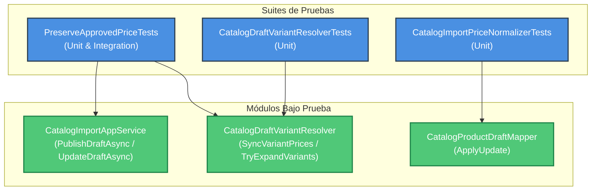

# Test Specification: Preservar Precio Exacto Aprobado al Publicar Productos de Catálogo IA

**Related TRD**: `trd-preserve-approved-price.md`  
**Created:** 2026-10-26  
**Location:** `Proyecto/growthhacking.PrototypeZero/`  

---

## Architecture Diagram

---

## Module Tests

### Module: `CatalogDraftVariantResolver` (`services/core/PrototypeZero.CoreService/Store/CatalogImport/CatalogDraftVariantResolver.cs`)

**Responsibility**: Administra y procesa la deserialización, serialización y concordancia de precios de variantes para productos extraídos.

#### Test Suite: `CatalogDraftVariantResolverTests`

**Test: Deserialización de variantes preserva el valor decimal exacto**
- **Given:** Un string JSON de variantes con precio `60000.00` y `59999.00`.
- **When:** Se ejecuta `CatalogDraftVariantResolver.ParseVariants(json)`.
- **Then:** La lista resultante contiene objetos `ExtractedCatalogVariantDto` con `PriceAmount` idéntico a `60000m` y `59999m`, sin redondeo.

**Test: Sincronización de variantes hereda el precio padre cuando no tienen precio específico**
- **Given:** Un borrador cuyo precio padre fue actualizado a `60000.00` y posee variantes asociadas.
- **When:** Se ejecuta la sincronización de precios hacia las variantes.
- **Then:** Las variantes que dependían del precio base se actualizan exactamente a `60000.00`.

**Test: Serialización de variantes conserva los montos decimales sin mutación**
- **Given:** Una lista de variantes con montos monetarios enteros y decimales en pesos colombianos.
- **When:** Se ejecuta `CatalogDraftVariantResolver.SerializeVariants(variants)`.
- **Then:** El string serializado contiene los valores exactos y, al deserializarse de nuevo, no sufre desviación de unidad.

---

### Module: `CatalogProductDraftMapper` (`services/core/PrototypeZero.CoreService/Store/ObjectMapping/CatalogProductDraftMapper.cs`)

**Responsibility**: Mapea datos entre los DTOs de borradores y las entidades de persistencia.

#### Test Suite: `CatalogProductDraftMapperTests`

**Test: ApplyUpdate asigna el precio exacto del DTO al borrador**
- **Given:** Un borrador de producto existente con `PriceAmount = 59999.00` y un DTO de actualización con `PriceAmount = 60000.00`.
- **When:** Se invoca `CatalogProductDraftMapper.ApplyUpdate(draft, input)`.
- **Then:** `draft.PriceAmount` es exactamente `60000.00m` y `draft.PriceCurrency` es `"COP"`.

**Test: ToDto expone el precio aprobado sin conversiones flotantes**
- **Given:** Una entidad `CatalogProductDraft` con `PriceAmount = 60000.00m`.
- **When:** Se ejecuta `CatalogProductDraftMapper.ToDto(draft)`.
- **Then:** `dto.PriceAmount` retornado es exactamente `60000.00m`.

---

### Module: `CatalogImportAppService` (`services/core/PrototypeZero.CoreService/Store/CatalogImport/CatalogImportAppService.cs`)

**Responsibility**: Orquesta la persistencia, actualización y publicación de borradores en el catálogo de productos.

#### Test Suite: `PreserveApprovedPriceTests`

**Test: Publicar borrador simple con precio aprobado COP 60.000 persiste exactamente 60.000 en CatalogProducts**
- **Given:** Un borrador en base de datos con nombre "Set en rodio", categoría "Set en rodio" y `PriceAmount = 60000.00m`.
- **When:** Se ejecuta `PublishDraftsAsync([draft.Id])`.
- **Then:** Se inserta en `Store.CatalogProducts` un producto con `PriceAmount = 60000.00m` y `PriceCurrency = "COP"`.
- **And:** El borrador se elimina de `Store.CatalogProductDrafts`.

**Test: Publicar borrador no permite que variantes obsoletas sobreescriban el precio aprobado de 60.000 con 59.999**
- **Given:** Un borrador cuyo precio aprobado fue actualizado a `60000.00m`, pero que contenía en `VariantsJson` una variante extraída previamente con `59999.00m`.
- **When:** Se ejecuta la publicación del borrador.
- **Then:** El producto resultante se publica con el precio confirmado de `60000.00m` y nunca con `59999.00m`.

**Test: Actualización de producto existente al republicar respeta el nuevo precio aprobado**
- **Given:** Un producto ya existente en el catálogo con `Name = "Set en rodio"` y `PriceAmount = 59999.00m`.
- **And:** Un nuevo borrador con el mismo nombre normalizado y `PriceAmount = 60000.00m`.
- **When:** Se ejecuta `PublishDraftsAsync([draft.Id])`.
- **Then:** El producto existente se actualiza a `PriceAmount = 60000.00m`.

---

## Integration Tests

### Test Suite: `CatalogPublishPriceEndToEndIntegrationTests`

**Test: Ciclo completo de importación, revisión a COP 60.000 y publicación**
- **Given:** Un lote de extracción de IA que generó un borrador con datos iniciales.
- **When:** El usuario ejecuta `UpdateDraftAsync` estableciendo `PriceAmount = 60000.00` y marcando la revisión como completada (`MarkDraftReviewedAsync`).
- **And:** Se invoca `PublishDraftsAsync` para publicar el borrador.
- **Then:** La consulta a `CatalogProductAppService.GetListAsync` devuelve el producto publicado con `PriceAmount = 60000.00`.
- **And:** Cualquier intento de editar o guardar nuevamente el producto en `CatalogProductAppService` conserva el valor `60000.00` sin decrementar una sola unidad.

---

## Test Fixtures

### Fixture: `CatalogDraftPriceTestData.cs`
- **Purpose**: Genera instancias de `CatalogProductDraft` y `ExtractedCatalogProductDto` con combinaciones de precios enteros, decimales y casos límite (ej. COP 59.999, COP 60.000, COP 145.000).
- **Content**:
  - `CreateDraft(name: "Set en rodio", price: 60000m, category: "Set en rodio")`
  - `CreateDraftWithVariants(name: "Set en rodio", parentPrice: 60000m, variantPrice: 59999m)`

---

## Test Statistics

- **Estimated Test Cases**: 8 casos de prueba automatizados.
- **Test Suites**: 3 suites (`CatalogDraftVariantResolverTests`, `CatalogProductDraftMapperTests`, `PreserveApprovedPriceTests`).
- **Coverage Target**: 100% en la ruta crítica de resolución y publicación de precios de borradores.
