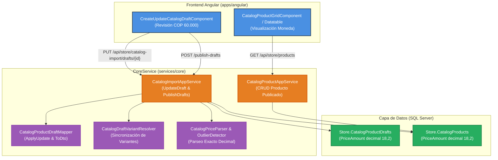
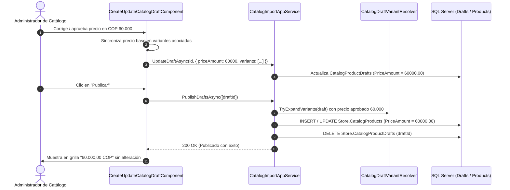

# TRD: Preservar Precio Exacto Aprobado al Publicar Productos de Catálogo IA

**Version:** 1.0  
**Created:** 2026-10-26  
**Location:** `Proyecto/growthhacking.PrototypeZero/`  

---

## 1. Overview

Garantizar la exactitud e integridad del precio de productos extraídos mediante IA y revisados por el usuario a lo largo de todo el ciclo de vida: extracción, revisión/corrección de borradores, sincronización de variantes, persistencia y publicación en el catálogo de productos de la tienda. El sistema debe asegurar que si un producto es confirmado o corregido a un precio específico (ej. COP 60.000), dicho valor se preserve sin sufrir decrementos ni alteraciones de una unidad (ej. COP 59.999), sin truncamientos de punto flotante y con consistencia total entre el formulario del borrador, sus variantes asociadas y la entidad publicada `Store.CatalogProducts`.

**In Scope:**
- Preservación exacta de `PriceAmount` (`decimal(18,2)`) durante la edición, aprobación y publicación de borradores en `CatalogImportAppService` y `CatalogProductDraftMapper`.
- Sincronización bidireccional y consistencia de precios entre el borrador principal y sus variantes en el componente Angular `create-update-catalog-draft.component.ts` y en `CatalogDraftVariantResolver`.
- Protección contra desincronización de variantes en `TryExpandVariants`: si un borrador tiene variantes cuyo precio coincidía con el precio anterior o si se actualiza el precio padre, evitar que variantes desactualizadas sobreescriban el precio aprobado.
- Validación de persistencia idempotente en `CatalogProductAppService` al editar o guardar nuevamente productos ya publicados.
- Pruebas unitarias y de integración de regresión en `PrototypeZero.CoreService.Tests` y specs en `apps/angular`.

**Out of Scope:**
- Modificación del modelo de visión multimodal de OpenAI en `AiService` (la extracción produce candidatos que el operador valida).
- Integración con pasarelas de pago externas (Wompi, MercadoPago).

---

## 2. Architecture

### Component Diagram



### Data Flow



---

## 3. Technology Stack

| Technology | Version | Justification |
|------------|---------|---------------|
| .NET 9 / C# 13 | 9.0 | Stack existente del backend `PrototypeZero.CoreService` con tipos `decimal` para precisión monetaria |
| Angular / Signals | 19.x | Stack existente en `apps/angular` con Reactive Forms y `CurrencyPipe` |
| ABP Framework | 9.x | Framework de arquitectura DDD y persistencia EF Core |

*Nota: No se incorporan nuevas dependencias externas. Se utilizan exclusivamente los frameworks y bibliotecas aprobados del proyecto.*

---

## 4. Module Responsibilities

### Module 1: `CatalogImportAppService.cs` (`services/core/PrototypeZero.CoreService/Store/CatalogImport/`)
**Responsibility**: Orquesta el ciclo de vida de los borradores, aplicando la edición de precios aprobados y garantizando la transferencia exacta a productos publicados.
**Key Functions**:
- `Task<CatalogProductDraftDto> UpdateDraftAsync(Guid id, UpdateCatalogProductDraftDto input)` - Persiste campos actualizados y sincroniza variantes.
- `Task PublishDraftsAsync(List<Guid> draftIds)` - Publica los borradores aprobados sin alterar valores monetarios.
- `Task PublishDraftAsync(CatalogProductDraft draft, List<CatalogCategory> categories, List<CatalogProduct> products)` - Realiza el mapeo a `CatalogProduct` con inserción/actualización exacta de `PriceAmount`.
- `List<CatalogProductDraft> TryExpandVariants(CatalogProductDraft draft)` - Expande variantes asegurando que hereden el precio aprobado si no poseen precio individual específico.

### Module 2: `CatalogDraftVariantResolver.cs` (`services/core/PrototypeZero.CoreService/Store/CatalogImport/`)
**Responsibility**: Parsea, valida y serializa variantes de catálogo asegurando que los precios de variantes sean consistentes con el borrador padre.
**Key Functions**:
- `List<ExtractedCatalogVariantDto> ParseVariants(string? variantsJson)` - Deserializa variantes en JSON.
- `string? SerializeVariants(IReadOnlyList<ExtractedCatalogVariantDto>? variants)` - Serializa variantes filtrando vacíos y preservando decimales.
- `void SyncVariantPrices(CatalogProductDraft draft, decimal approvedPrice)` - Asegura que variantes vinculadas reflejen el precio aprobado.

### Module 3: `CatalogProductDraftMapper.cs` (`services/core/PrototypeZero.CoreService/Store/ObjectMapping/`)
**Responsibility**: Mapea DTOs de borradores hacia la entidad de dominio y viceversa.
**Key Functions**:
- `void ApplyUpdate(CatalogProductDraft draft, UpdateCatalogProductDraftDto input)` - Asigna valores exactos desde el DTO al borrador en base de datos.
- `CatalogProductDraftDto ToDto(CatalogProductDraft draft, string? detectedImageUrl = null)` - Transfiere `PriceAmount` exacto al DTO consumido por Angular.

### Module 4: `create-update-catalog-draft.component.ts` (`apps/angular/src/app/store/catalog-import/create-update-catalog-draft/`)
**Responsibility**: Componente modal de Angular para revisar y editar borradores, garantizando que cambios en el precio principal actualicen las variantes o impidan discrepancias silenciosas.
**Key Functions**:
- `edit(id: string): void` - Carga el borrador y llena el formulario reactivo.
- `onPriceAmountChange(newPrice: number): void` - Sincroniza el precio aprobado con las variantes asociadas cuando aplique.
- `buildUpdateDto(): UpdateCatalogProductDraftDto` - Construye el payload asegurando coherencia entre el precio principal y las variantes.
- `markReviewCompleted(): void` - Guarda y marca como revisado con validación de precios.

---

## 5. Testing Strategy

**Test Pyramid**:
- 70% Unit Tests (`PrototypeZero.CoreService.Tests`): Pruebas sobre `CatalogDraftVariantResolver`, `CatalogImportPriceNormalizer`, `CatalogPriceParser` y `CatalogProductDraftMapper`.
- 20% Integration Tests (`CatalogImportAppServiceTests`): Pruebas de integración sobre `UpdateDraftAsync`, `PublishDraftsAsync` y persistencia en EF Core en memoria / SQLite.
- 10% Frontend Specs (`create-update-catalog-draft.component.spec.ts`): Validación reactiva del formulario y sincronización de variantes.

**Mockable Boundaries**:
- `IRepository<CatalogProductDraft, Guid>` y `IRepository<CatalogProduct, Guid>`.
- `IProductSearchIndexService`.
- `CatalogCategoryService`.

**Coverage Requirements**:
- Cobertura sobre flujos de precio y variantes: 100%.
- Pruebas de regresión con COP 60.000 vs 59.999: 100%.

**Quality Gates**:
```bash
# verify:quick (< 5 seconds)
dotnet test services/core/PrototypeZero.CoreService.Tests --filter "FullyQualifiedName~CatalogImport|FullyQualifiedName~StoreCatalog"

# verify (< 30 seconds)
dotnet test services/core/PrototypeZero.CoreService.Tests

# verify:full (< 2 minutes)
dotnet build services/core/PrototypeZero.CoreService && dotnet test services/core/PrototypeZero.CoreService.Tests
```

---

## 6. Task Breakdown

### Task List

| Task | Name | Phase | Files Created | Files Modified | Dependencies | Est. | Agent |
|------|------|-------|---------------|----------------|--------------|------|-------|
| 01 | Setup y Aislamiento de Casos de Prueba | setup | - | - | None | 0.5h | dotnet-architect |
| 02 | Pruebas RED: Preservación de Precio y Sincronización de Variantes | red | `PreserveApprovedPriceTests.cs` | - | 01 | 1.5h | xunit-tester |
| 03 | Implementación GREEN: Preservación Exacta en Backend y Frontend | green+verify | - | `CatalogImportAppService.cs`, `CatalogDraftVariantResolver.cs`, `create-update-catalog-draft.component.ts` | 02 | 2h | aspnet-webapi-backend |

### Task Details

#### Task 01: Setup y Aislamiento de Casos de Prueba
- **Phase**: setup
- **Description**: Verificar dependencias de pruebas, compilar suite actual y dejar el entorno listo para agregar las pruebas de regresión.
- **Files Modified**: Ninguno (verificación de build y baseline de tests).
- **Dependencies**: Ninguna.
- **Estimated Effort**: 0.5 horas.
- **Agent**: `dotnet-architect`.

#### Task 02: Pruebas RED: Preservación de Precio y Sincronización de Variantes
- **Phase**: red
- **Description**: Crear pruebas unitarias y de integración que fallen evidenciando:
  1. Un borrador con precio COP 60.000 no debe publicarse con precio modificado o heredado erróneamente de variantes desactualizadas (59.999).
  2. La actualización del precio padre en un borrador debe sincronizar o resolver variantes huérfanas de precio.
  3. `PublishDraftAsync` mantiene la precisión exacta de `PriceAmount` para productos nuevos y existentes.
- **Files Created**:
  - `services/core/PrototypeZero.CoreService.Tests/Store/CatalogImport/PreserveApprovedPriceTests.cs`
- **Files Modified**: Ninguno.
- **Dependencies**: Task 01.
- **Estimated Effort**: 1.5 horas.
- **Agent**: `xunit-tester`.

#### Task 03: Implementación GREEN: Preservación Exacta en Backend y Frontend
- **Phase**: green+verify
- **Description**: Implementar las correcciones en el backend (`CatalogImportAppService.cs`, `CatalogDraftVariantResolver.cs`) y frontend (`create-update-catalog-draft.component.ts`) para garantizar que el precio aprobado se sincronice con las variantes y se publique exactamente en `CatalogProducts`. Ejecutar los quality gates hasta aprobación completa.
- **Files Modified**:
  - `services/core/PrototypeZero.CoreService/Store/CatalogImport/CatalogImportAppService.cs`
  - `services/core/PrototypeZero.CoreService/Store/CatalogImport/CatalogDraftVariantResolver.cs`
  - `apps/angular/src/app/store/catalog-import/create-update-catalog-draft/create-update-catalog-draft.component.ts`
- **Dependencies**: Task 02.
- **Estimated Effort**: 2 horas.
- **Agent**: `aspnet-webapi-backend`.

---

## 7. Team Coordination & Handoffs

### QA Handoff (Assigned QA: Laura)
- **Endpoints / Surfaces to Test**:
  - Pantalla de Revisión de Borradores de Catálogo IA (`/store/products/import-catalog`).
  - Modal de edición de borrador (`CreateUpdateCatalogDraftComponent`).
  - Grilla de productos publicados (`/store/products`).
  - Modal y página de detalles del producto (`/store/products/{id}`).
- **Key Test Payloads**:
  - Borrador con `priceAmount: 60000`, `priceCurrency: "COP"`.
  - Borrador con variantes iniciales generadas por IA con precio discrepante (ej. `59999`) y corrección manual a `60000`.
- **Critical Edge Cases**:
  - Producto con múltiples variantes donde una variante tiene precio explícito diferente al padre vs variantes que heredan precio base.
  - Edición posterior en la grilla tipo hoja (Spreadsheet View) y guardado en detalle de producto.
  - Formato de moneda en interfaz: confirmar que muestre `60.000,00 COP` y nunca `59.999,00 COP`.
- **Delegated to QA**:
  - Verificación visual con imágenes complejas y certificación E2E en ambiente de pruebas antes de salida a producción.

### DevOps Handoff (Assigned DevOps: Sofía)
- **Environment Variables**: No requiere nuevas variables ni claves de configuración.
- **Secrets / Vault**: Sin cambios en Azure Key Vault.
- **Infrastructure Changes**: Sin migraciones de esquema requeridas (la columna `PriceAmount` ya es `decimal(18,2)` en SQL Server).

---

## 8. Reference Documents

- **Test Specification**: `tasks/task-preserve-approved-price/test-spec-preserve-approved-price.md`
- **Target Repository**: `Proyecto/growthhacking.PrototypeZero/`
- **Project Context**:
  - Team context: `tasks/context/team-context.md`
  - Tech context: `tasks/context/tech-context.md`
  - Project structure: `tasks/context/project-structure.md`
  - Learnings: `tasks/context/learnings.md`
- **Documento de Diseño Previo**: `tasks/design-preserve-approved-price.md`

---

## Summary

La solución garantiza la preservación matemática e integridad funcional de los precios confirmados por el usuario desde la revisión de borradores hasta la persistencia final en `CatalogProducts`. Al sincronizar coherentemente los precios del borrador padre con las variantes y blindar la rutina de publicación, se elimina la degradación no solicitada a COP 59.999.

**Estimated Effort**: 4 horas  
**Risk Level**: Low  
**Dependencies**: Ninguna dependencia nueva  

---

**Ready for task file generation**:  
👉 **Siguiente paso:** Arrastra al chat `@commands/3-create-tasks.md tasks/task-preserve-approved-price/trd-preserve-approved-price.md`
