# Test Specification: Prevenir Categorías Duplicadas en el Mismo Tenant

**Related TRD**: `trd-prevent-duplicate-categories.md`  
**Created:** 2026-10-27  

---

## Architecture Diagram

```mermaid
flowchart TD
    classDef testUnit fill:#4A90E2,stroke:#1C3D5A,stroke-width:2px,color:#FFFFFF;
    classDef testApp fill:#E67E22,stroke:#78340F,stroke-width:2px,color:#FFFFFF;
    classDef testImport fill:#16A085,stroke:#0E6251,stroke-width:2px,color:#FFFFFF;
    classDef target fill:#50C878,stroke:#1E4620,stroke-width:2px,color:#FFFFFF;

    subgraph TestSuites["Test Suites &#40;PrototypeZero.CoreService.Tests&#41;"]
        T1["CatalogCategoryNormalizerTests"]:::testUnit
        T2["CatalogCategoryAppServiceDuplicateTests"]:::testApp
        T3["CatalogImportDuplicateCategoryTests"]:::testImport
    end

    subgraph Targets["Production Implementations"]
        M1["CatalogCategoryNormalizer"]:::target
        M2["CatalogCategoryAppService"]:::target
        M3["CatalogImportAppService"]:::target
    end

    T1 -->|Asserts Normalization| M1
    T2 -->|Asserts Uniqueness Guard| M2
    T2 -.->|Verifies Call| M1
    T3 -->|Asserts Category Reuse| M3
    T3 -.->|Verifies Call| M1
```



---

## Module Tests

### Module: `CatalogCategoryNormalizer` (`services/core/PrototypeZero.CoreService.Contracts/Store/Categories/CatalogCategoryNormalizer.cs`)

**Responsibility**: Normalizar cadenas de texto para descartar diacríticos, variaciones de caja y espacios inconsistentes al comparar nombres de categorías.

#### Test Suite: `CatalogCategoryNormalizerTests`

**Test: Normalize_TrimsAndLowercases_StandardNames**
- **Given:** Una cadena como `"  Anillos  "`.
- **When:** Se ejecuta `CatalogCategoryNormalizer.Normalize("  Anillos  ")`.
- **Then:** Devuelve `"anillos"`.

**Test: Normalize_StripsDiacriticsAndAccents**
- **Given:** Cadenas con acentos como `"anÍllos"`, `"Ánillos"`, `"Ànillos"`, `"ánillös"`.
- **When:** Se invoca `Normalize` para cada una.
- **Then:** Todas devuelven `"anillos"`.

**Test: Normalize_CollapsesMultipleInternalWhitespaces**
- **Given:** Una cadena con múltiples espacios intermedios `"Set   de    anillos"`.
- **When:** Se ejecuta `CatalogCategoryNormalizer.Normalize("Set   de    anillos")`.
- **Then:** Devuelve `"set de anillos"`.

**Test: Normalize_HandlesNullAndEmptyString**
- **Given:** Cadenas nulas, vacías o compuestas exclusivamente de espacios (`null`, `""`, `"   "`).
- **When:** Se invoca `Normalize`.
- **Then:** Devuelve `string.Empty` sin lanzar excepciones.

**Test: AreEquivalent_ReturnsTrue_ForDiacriticAndWhitespaceVariants**
- **Given:** El par de cadenas `"Anillos"` y `"  anÍllos  "`.
- **When:** Se evalúa `CatalogCategoryNormalizer.AreEquivalent("Anillos", "  anÍllos  ")`.
- **Then:** Devuelve `true`.

**Test: AreEquivalent_ReturnsFalse_ForDifferentNames**
- **Given:** `"Anillos"` y `"Pulseras"`.
- **When:** Se evalúa `AreEquivalent`.
- **Then:** Devuelve `false`.

---

### Module: `CatalogCategoryAppService` (`services/core/PrototypeZero.CoreService/Store/Categories/CatalogCategoryAppService.cs`)

**Responsibility**: Validar que no se inserten ni actualicen categorías con nombres equivalentes en el mismo tenant.

#### Test Suite: `CatalogCategoryAppServiceDuplicateTests`

**Test: CreateAsync_ThrowsUserFriendlyException_WhenEquivalentNameExistsInSameTenant**
- **Given:** Un tenant con una categoría existente de nombre `"Anillos"`.
- **When:** Se invoca `CreateAsync` con un DTO cuyo nombre es `"  anÍllos  "`.
- **Then:** El servicio lanza `UserFriendlyException` indicando que la categoría ya existe.
- **And:** No se inserta ningún nuevo registro en el repositorio.

**Test: CreateAsync_Succeeds_WhenSameNameExistsInDifferentTenant**
- **Given:** El Tenant A posee la categoría `"Anillos"`.
- **When:** El Tenant B invoca `CreateAsync` con el nombre `"Anillos"`.
- **Then:** La categoría se crea exitosamente en el Tenant B sin interferencias.

**Test: CreateAsync_Succeeds_WhenNameIsDistinct**
- **Given:** Un tenant con la categoría `"Anillos"`.
- **When:** Se invoca `CreateAsync` con el nombre `"Collares"`.
- **Then:** La categoría se persiste exitosamente y se retorna su DTO.

**Test: UpdateAsync_ThrowsUserFriendlyException_WhenRenamingToExistingCategory**
- **Given:** En el tenant existen las categorías `"Anillos"` (ID 1) y `"Pulseras"` (ID 2).
- **When:** Se invoca `UpdateAsync` para la categoría ID 2 intentando cambiar el nombre a `"ANILLOS"` o `"ánillos"`.
- **Then:** Se lanza `UserFriendlyException` bloqueando el cambio por colisión de nombres.

**Test: UpdateAsync_Succeeds_WhenUpdatingSameCategoryWithoutChangingNameOrJustCasing**
- **Given:** La categoría `"Anillos"` (ID 1) con `DisplayOrder = 1`.
- **When:** Se invoca `UpdateAsync(ID 1, { Name = "ANILLOS", DisplayOrder = 2 })`.
- **Then:** La actualización se completa exitosamente sin generar falso positivo contra sí misma.

---

### Module: `CatalogImportAppService` (`services/core/PrototypeZero.CoreService/Store/CatalogImport/CatalogImportAppService.cs`)

**Responsibility**: Reutilizar categorías existentes cuando un borrador de catálogo extraído por IA contiene nombres fonética u ortográficamente equivalentes.

#### Test Suite: `CatalogImportDuplicateCategoryTests`

**Test: ResolveOrCreateCategoryAsync_ReusesExistingCategory_WhenAiDraftHasEquivalentName**
- **Given:** Una lista en memoria de categorías existentes que contiene `"Anillos"`.
- **When:** Se procesa un borrador con `CategoryName = "  anÍllos  "`.
- **Then:** `ResolveOrCreateCategoryAsync` devuelve la instancia existente de `"Anillos"`.
- **And:** No se realiza ninguna inserción de nueva categoría en el repositorio.

**Test: ResolveOrCreateCategoryAsync_CreatesNewCategory_WhenNoEquivalentExists**
- **Given:** Categorías existentes que no coinciden con `"Relojes"`.
- **When:** Se procesa un borrador con `CategoryName = "Relojes"`.
- **Then:** Se invoca `InsertAsync` creando la nueva categoría y asociándola al producto.

---

## Integration Tests

### Test Suite: `StorefrontCategoryIntegrityIntegrationTests`

**Test: PublicStorefront_DisplaysConsolidatedCategoriesWithoutDuplicates**
- **Given:** Un tenant con múltiples productos importados mediante IA que tenían variaciones tipográficas en sus categorías (`"Anillos"`, `"anillos"`, `"ANILLOS"`).
- **When:** Se consulta el catálogo público para el storefront (`/api/store/storefront/categories`).
- **Then:** Se lista una única categoría consolidada `"Anillos"` que contiene todos los productos asociados.

---

## Test Data & Fixtures

### Sample Category Data

```json
[
  {
    "id": "11111111-1111-1111-1111-111111111111",
    "name": "Anillos",
    "tenantId": "aaaaaaaa-aaaa-aaaa-aaaa-aaaaaaaaaaaa",
    "isActive": true,
    "displayOrder": 1
  },
  {
    "id": "22222222-2222-2222-2222-222222222222",
    "name": "Pulseras",
    "tenantId": "aaaaaaaa-aaaa-aaaa-aaaa-aaaaaaaaaaaa",
    "isActive": true,
    "displayOrder": 2
  },
  {
    "id": "33333333-3333-3333-3333-333333333333",
    "name": "Anillos",
    "tenantId": "bbbbbbbb-bbbb-bbbb-bbbb-bbbbbbbbbbbb",
    "isActive": true,
    "displayOrder": 1
  }
]
```

---

## Test Statistics

- **Total Estimated Test Cases**: 14
- **Test Suites**: 3 (`CatalogCategoryNormalizerTests`, `CatalogCategoryAppServiceDuplicateTests`, `CatalogImportDuplicateCategoryTests`)
- **Coverage Target**: 100% en métodos de normalización y validación anti-duplicados.
