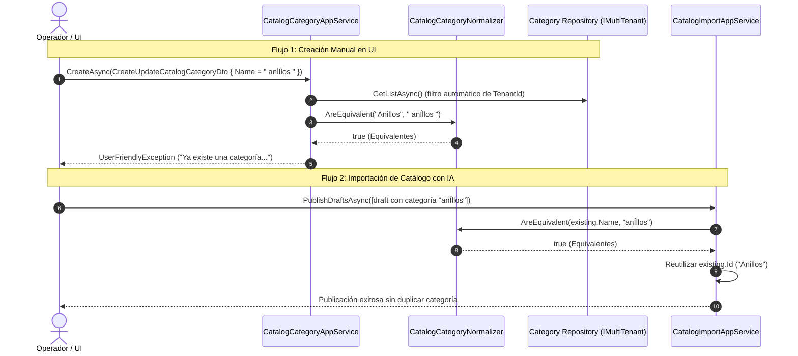

# TRD: Prevenir Categorías Duplicadas en el Mismo Tenant

**Version:** 1.0  
**Created:** 2026-10-27  
**Location:** `Proyecto/growthhacking.PrototypeZero/`  

---

## 1. Overview

Este documento especifica la solución técnica para resolver el bug **79082** (`[Catalog] Prevent duplicate categories within the same tenant`). Actualmente, tanto la creación/actualización manual de categorías (`CatalogCategoryAppService`) como la publicación de borradores extraídos por IA (`CatalogImportAppService`) permiten la creación de categorías gemelas cuando el nombre comercial difiere únicamente en acentos, mayúsculas o espacios en blanco (ej. `"Anillos"` y `"  anÍllos  "`).

La solución introduce un normalizador canónico de nombres (`CatalogCategoryNormalizer`), validaciones defensivas en las operaciones de escritura de categorías con rechazo amigable (`UserFriendlyException`), y resolución tolerante a equivalencias fonético-ortográficas durante la importación automática de catálogos, preservando en todo momento el aislamiento estricto por tenant (`IMultiTenant`).

**In Scope:**
- Componente canónico de normalización y comparación fonético-ortográfica (`CatalogCategoryNormalizer`).
- Validación anti-duplicados en `CatalogCategoryAppService.CreateAsync` y `UpdateAsync`.
- Reutilización tolerante de categorías en `CatalogImportAppService.ResolveOrCreateCategoryAsync`.
- Mensajes de localización amigables en español e inglés (`Category:AlreadyExists`).
- Cobertura completa mediante pruebas unitarias e integración TDD en `PrototypeZero.CoreService.Tests`.

**Out of Scope:**
- Modificación del esquema de base de datos o migraciones de índices únicos complejos a nivel SQL (la validación se resuelve en la capa de aplicación y dominio para garantizar independencia de collation de BD).
- Script de fusión retroactiva de categorías duplicadas preexistentes.

---

## 2. Architecture

### Component Diagram

```mermaid
graph TD
    classDef uiLayer fill:#4A90E2,stroke:#1C3D5A,stroke-width:2px,color:#FFFFFF;
    classDef appService fill:#E67E22,stroke:#78340F,stroke-width:2px,color:#FFFFFF;
    classDef helper fill:#16A085,stroke:#0E6251,stroke-width:2px,color:#FFFFFF;
    classDef domain fill:#50C878,stroke:#1E4620,stroke-width:2px,color:#FFFFFF;
    classDef error fill:#E74C3C,stroke:#78281F,stroke-width:2px,color:#FFFFFF;

    UI["Angular Admin UI &#40;/store/catalog-categories&#41;"]:::uiLayer
    AI["AI Catalog Import &#40;/store/products/import-catalog&#41;"]:::uiLayer

    CCApp["CatalogCategoryAppService"]:::appService
    CIApp["CatalogImportAppService"]:::appService

    Normalizer["CatalogCategoryNormalizer"]:::helper
    TextNormalizer["StoreTextSearchNormalizer"]:::helper

    Repo["IRepository&lt;CatalogCategory, Guid&gt;"]:::domain
    Entity["CatalogCategory &#40;IMultiTenant&#41;"]:::domain
    Ex["UserFriendlyException &#40;Category:AlreadyExists&#41;"]:::error

    UI -->|Create / Update| CCApp
    AI -->|PublishDraftsAsync| CIApp

    CCApp -->|AreEquivalent / Normalize| Normalizer
    CIApp -->|ResolveOrCreateCategoryAsync| Normalizer
    Normalizer -->|Diacritic removal &amp; trim| TextNormalizer

    CCApp -->|If Duplicate Found| Ex
    CCApp -->|InsertAsync / UpdateAsync| Repo
    CIApp -->|Reuse Existing Category| Entity
    Repo --> Entity
```



### Call Flow: Manual Category Creation vs AI Import



---

## 3. Technology Stack

| Technology | Version | Justification |
|------------|---------|---------------|
| .NET 10.0 / C# | 10.0.402 | Runtime estándar del proyecto |
| ABP Framework | 10.5.0 | Aislamiento multi-inquilino (`IMultiTenant`), `CrudAppService` y `UserFriendlyException` |
| xUnit / Shouldly | Project Standard | Framework de testing y aserciones para la suite TDD |

---

## 4. Module Responsibilities

### Module 1: `CatalogCategoryNormalizer`
- **File**: `services/core/PrototypeZero.CoreService.Contracts/Store/Categories/CatalogCategoryNormalizer.cs`
- **Responsibility**: Normaliza cadenas de nombres de categorías eliminando acentos, espacios redundantes y diferencias de caja para determinar equivalencia ortográfica.
- **Key Methods**:
  - `string Normalize(string? name)`: Convierte a minúsculas, descompone diacríticos (`FormD`), remueve caracteres `NonSpacingMark` y colapsa espacios en blanco repetidos.
  - `bool AreEquivalent(string? a, string? b)`: Compara la igualdad ordinal de las formas canónicas normalizadas de `a` y `b`.
- **Dependencies**: `System.Text`, `System.Globalization`, `System.Text.RegularExpressions`.

### Module 2: `CatalogCategoryAppService`
- **File**: `services/core/PrototypeZero.CoreService/Store/Categories/CatalogCategoryAppService.cs`
- **Responsibility**: Orquesta las operaciones CRUD de categorías de catálogo, validando la unicidad del nombre dentro del tenant activo antes de persistir.
- **Key Methods**:
  - `Task<CatalogCategoryDto> CreateAsync(CreateUpdateCatalogCategoryDto input)`: Sobrescribe la creación para validar unicidad fonético-ortográfica en el tenant.
  - `Task<CatalogCategoryDto> UpdateAsync(Guid id, CreateUpdateCatalogCategoryDto input)`: Sobrescribe la actualización permitiendo conservar el propio nombre pero bloqueando colisiones con otras categorías.
  - `Task ValidateCategoryNameUniquenessAsync(string? name, Guid? categoryId)`: Helper privado que consulta las categorías del tenant y evalúa colisiones usando `CatalogCategoryNormalizer`.
- **Dependencies**: `IRepository<CatalogCategory, Guid>`, `CatalogCategoryNormalizer`, `UserFriendlyException`.

### Module 3: `CatalogImportAppService`
- **File**: `services/core/PrototypeZero.CoreService/Store/CatalogImport/CatalogImportAppService.cs`
- **Responsibility**: Servicio de procesamiento y publicación de catálogos importados por IA.
- **Key Methods**:
  - `Task<CatalogCategory> ResolveOrCreateCategoryAsync(string? categoryName, List<CatalogCategory> categories)`: Busca en la lista de categorías existentes una coincidencia equivalente usando `CatalogCategoryNormalizer.AreEquivalent` antes de instanciar una nueva.
- **Dependencies**: `CatalogCategoryNormalizer`, `CatalogCategory`.

### Module 4: Localización de CoreService
- **Files**:
  - `Localizations/CoreService/es.json`
  - `Localizations/CoreService/en.json`
- **Responsibility**: Proveer los mensajes traducidos ante intentos de creación o actualización de nombres duplicados.
- **Key Keys**:
  - `"Category:AlreadyExists"`: `"Ya existe una categoría con un nombre equivalente en esta tienda."` / `"A category with an equivalent name already exists in this store."`

---

## 5. Testing Strategy

**Test Pyramid**:
- **80% Unit Tests**:
  - Casos de normalización exhaustivos (tildes agudas, graves, circunflejas, diéresis, espacios intermedios múltiples, espacios al inicio/fin, mayúsculas/minúsculas).
  - Casos de comparación equivalentes y no equivalentes.
- **20% Integration / AppService Tests**:
  - Bloqueo en `CreateAsync` de `CatalogCategoryAppService` ante duplicado en el mismo tenant.
  - Permisión en `CreateAsync` si el nombre similar pertenece a otro tenant (`TenantId` distinto).
  - Bloqueo en `UpdateAsync` si se colisiona con otra categoría distinta.
  - Éxito en `UpdateAsync` si se actualiza la misma categoría sin cambiar de nombre o solo cambiando de mayúsculas/minúsculas.
  - Reutilización automática de categoría en `CatalogImportAppService.ResolveOrCreateCategoryAsync`.

**Quality Gates**:

```bash
# verify:quick (< 10 seconds)
dotnet test services/core/PrototypeZero.CoreService.Tests --filter "FullyQualifiedName~CatalogCategory|FullyQualifiedName~CatalogImport"

# verify (< 45 seconds)
dotnet test services/core/PrototypeZero.CoreService.Tests

# verify:full (< 2 minutes)
dotnet build services/core/PrototypeZero.CoreService && dotnet test services/core/PrototypeZero.CoreService.Tests
```

---

## 6. Task Breakdown

| Task | Name | Phase | Files Created | Files Modified | Dependencies | Est. | Agent |
|:---:|---|:---:|---|---|:---:|:---:|---|
| **01** | Setup y Pruebas Unitarias Normalizador | setup | `CatalogCategoryNormalizerTests.cs` | - | None | 0.5h | dotnet-architect |
| **02** | Suite TDD Anti-Duplicados (RED) | red | `CatalogCategoryDuplicateTests.cs` | - | 01 | 1.5h | xunit-tester |
| **03** | Implementación Anti-Duplicados y Normalizador (GREEN+VERIFY) | green+verify | `CatalogCategoryNormalizer.cs` | `CatalogCategoryAppService.cs`, `CatalogImportAppService.cs`, `Localizations/.../es.json`, `en.json` | 02 | 2h | aspnet-webapi-backend |

---

## 7. Team Coordination & Handoffs

### QA Handoff (Assigned QA: Laura)
- **Endpoints / Superficies a Probar**:
  - UI de Categorías: `/store/catalog-categories` (modal de Crear y Editar).
  - UI de Importación IA: `/store/products/import-catalog` (Publicar catálogo con borrador).
- **Casos Críticos de Prueba**:
  1. Intentar crear `"  anÍllos  "` cuando ya existe `"Anillos"`. Debe mostrar alerta de categoría existente.
  2. Editar `"Pulseras"` y renombrarla a `"anillos"`. Debe mostrar alerta de conflicto.
  3. Editar `"Anillos"` y cambiar su orden a 5 sin cambiar el nombre. Debe guardar sin errores.
  4. Publicar producto de borrador IA con categoría sugerida `"anillos"`. Debe vincularse a la categoría existente `"Anillos"`, sin crear una nueva fila en `/store/catalog-categories`.
  5. Entrar con Tenant A y crear `"Anillos"`. Entrar con Tenant B y crear `"Anillos"`. Ambos deben poder guardarse sin restricciones.

### DevOps Handoff (Assigned DevOps: Sofía)
- **Sin impacto de infraestructura**: No se requieren migraciones de base de datos ni variables de entorno.

---

## 8. Reference Documents

- **Test Specification**: [`test-spec-prevent-duplicate-categories.md`](file:///C:/Users/santi/Documents/GitHub/Growth-Hacking/tasks/task-prevent-duplicate-categories/test-spec-prevent-duplicate-categories.md)
- **Design Document**: [`tasks/design-prevent-duplicate-categories.md`](file:///C:/Users/santi/Documents/GitHub/Growth-Hacking/tasks/design-prevent-duplicate-categories.md)
- **Team Context**: [`tasks/context/team-context.md`](file:///C:/Users/santi/Documents/GitHub/Growth-Hacking/tasks/context/team-context.md)
- **Tech Context**: [`tasks/context/tech-context.md`](file:///C:/Users/santi/Documents/GitHub/Growth-Hacking/tasks/context/tech-context.md)

---

## Summary

La solución implementa una barrera ortográfica y de negocio en `CatalogCategoryNormalizer` que previene duplicados accidentales en la creación manual y reutiliza registros existentes en la importación por IA, manteniendo intacta la regla multi-inquilino de ABP.

**Estimated Effort**: 4 horas  
**Risk Level**: Bajo (sin cambios en schema de base de datos)  
**Dependencies**: Ningún paquete externo nuevo.
