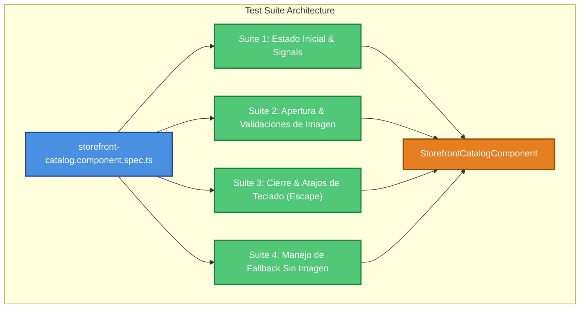

# Test Specification: Zoom de Imagen en Detalle de Producto del Catálogo (Storefront)

**Related TRD:** [`trd-product-image-zoom.md`](file:///C:/Users/santi/Documents/GitHub/Growth-Hacking/tasks/task-product-image-zoom/trd-product-image-zoom.md)  
**Created:** 2026-11-04  
**Target File:** `Proyecto/growthhacking.PrototypeZero/apps/angular/src/app/public/storefront/storefront-catalog.component.spec.ts`  

---

## Architecture Diagram



---

## Module Tests

### Module: `StorefrontCatalogComponent` (`storefront-catalog.component.ts`)

**Responsibility:** Gestionar la reactividad de apertura, cierre y jerarquía de atajos de teclado para la vista de zoom de alta resolución del producto en el catálogo público.

#### Test Suite: `StorefrontCatalogComponent - Image Zoom State & Actions`

#### Test 1: El estado inicial del zoom debe estar cerrado
- **Given:** Una instancia inicializada de `StorefrontCatalogComponent`.
- **When:** Se consulta el valor de la señal `isImageZoomOpen()`.
- **Then:** Debe ser `false`.

#### Test 2: Abrir zoom cuando el producto seleccionado tiene imagen principal
- **Given:** `selectedProduct` contiene un producto con `mainImageUrl: 'https://cdn.example.com/item-necklace.jpg'`.
- **When:** Se invoca el método `openImageZoom()`.
- **Then:** La señal `isImageZoomOpen()` debe pasar a `true`.

#### Test 3: No abrir zoom si el producto no cuenta con imagen principal
- **Given:** `selectedProduct` contiene un producto sin imagen (`mainImageUrl: null` o cadena vacía `''`).
- **When:** Se invoca el método `openImageZoom()`.
- **Then:** La señal `isImageZoomOpen()` debe permanecer en `false`.

#### Test 4: Cerrar zoom mediante closeImageZoom()
- **Given:** La señal `isImageZoomOpen()` se encuentra en `true`.
- **When:** Se invoca el método `closeImageZoom()`.
- **Then:** La señal `isImageZoomOpen()` debe cambiar a `false`.
- **And:** El modal principal del producto (`isModalOpen()`) debe permanecer en su estado original (`true`).

#### Test 5: Jerarquía de Escape - Cerrar zoom prioritariamente si está abierto
- **Given:** Tanto `isModalOpen()` como `isImageZoomOpen()` se encuentran en `true`.
- **When:** El usuario presiona la tecla `Escape` (se ejecuta `onEscapeKey()`).
- **Then:** `isImageZoomOpen()` debe cambiar a `false`.
- **And:** `isModalOpen()` debe continuar en `true` (no debe cerrarse el producto).

#### Test 6: Jerarquía de Escape - Cerrar modal de producto cuando el zoom ya está cerrado
- **Given:** `isImageZoomOpen()` es `false` e `isModalOpen()` es `true`.
- **When:** El usuario presiona la tecla `Escape` (se ejecuta `onEscapeKey()`).
- **Then:** Se debe invocar `closeProductDetail()` cerrando el modal del producto.

#### Test 7: Al cerrar el detalle del producto debe asegurarse el cierre del zoom
- **Given:** `isImageZoomOpen()` es `true`.
- **When:** Se invoca `closeProductDetail()`.
- **Then:** `isImageZoomOpen()` debe ser restaurado a `false`.

---

## Integration Tests

### Test Suite: `StorefrontCatalogComponent - DOM Rendering & User Interaction`

#### Test 8: Renderizado del botón de zoom sobre la imagen
- **Given:** Un producto seleccionado con imagen renderizado en el modal.
- **When:** Se inspecciona el DOM de `.modal-media-pane`.
- **Then:** Debe existir el botón con clase `.zoom-trigger-btn` conteniendo el ícono `fa-search-plus` y un atributo accesible `aria-label`.

#### Test 9: No renderizar botón de zoom si el producto no tiene imagen
- **Given:** Un producto seleccionado sin imagen renderizado en el modal.
- **When:** Se inspecciona el DOM de `.modal-media-pane`.
- **Then:** No debe existir el elemento `.zoom-trigger-btn`, mostrando únicamente `.modal-media-fallback`.

#### Test 10: Despliegue del Lightbox en el DOM al abrir zoom
- **Given:** Se ejecuta `openImageZoom()` con un producto válido.
- **When:** Se actualiza la vista.
- **Then:** El DOM debe contener el contenedor `.image-zoom-backdrop` con `role="dialog"`, `aria-modal="true"` y la imagen `.image-zoom-full` con el `src` correspondiente.

---

## Test Fixtures

### Fixture: `mockProductWithImage`
```typescript
export const mockProductWithImage: PublicStorefrontProductDto = {
  id: 'prod-001-uuid',
  name: 'Collar de perlas con dijes y aretes cuadrados',
  description: 'Collar de perlas con dijes decorativos dorados y aretes cuadrados a juego.',
  priceAmount: 60000,
  priceCurrency: 'COP',
  categoryName: 'ACCESORIOS',
  categorySlug: 'accesorios',
  mainImageUrl: 'https://ghstoragedev02.blob.core.windows.net/prototype-zero/pearls.jpg',
  requiresShipping: true,
  isAvailable: true,
};
```

### Fixture: `mockProductWithoutImage`
```typescript
export const mockProductWithoutImage: PublicStorefrontProductDto = {
  id: 'prod-002-uuid',
  name: 'Servicio de Asesoría de Imagen',
  description: 'Sesión personalizada de asesoría de imagen.',
  priceAmount: 120000,
  priceCurrency: 'COP',
  categoryName: 'SERVICIOS',
  categorySlug: 'servicios',
  mainImageUrl: null,
  requiresShipping: false,
  isAvailable: true,
};
```

---

## Test Statistics

- **Total Test Cases:** 10
- **Unit Test Cases:** 7
- **Integration / DOM Tests:** 3
- **Coverage Target:** 100% de la nueva lógica de zoom

---

## Casos Adicionales: Zoom con Rueda del Mouse & Arrastre (Pan)

### TC-ZOOM-011: Ampliación interactiva con rueda del mouse (Wheel Up)
- **Given:** El lightbox de zoom está abierto con `zoomScale = 1.0`.
- **When:** Se recibe un evento de rueda con `deltaY < 0`.
- **Then:** `zoomScale` se incrementa a `1.25` (clamped hasta máx `4.0`), y se previene el scroll por defecto (`preventDefault()`).

### TC-ZOOM-012: Reducción interactiva con rueda del mouse (Wheel Down) y límite mínimo
- **Given:** El lightbox de zoom está en `zoomScale = 1.5` con desplazamiento de pan.
- **When:** Se recibe evento de rueda con `deltaY > 0` hasta llegar a escala 1.0.
- **Then:** `zoomScale` no desciende por debajo de `1.0` y al llegar a 1.0 se restablece `zoomPan = { x: 0, y: 0 }`.

### TC-ZOOM-013: Doble clic para alternar zoom (Toggle Zoom 1x <-> 2x)
- **Given:** El visor está abierto en `zoomScale = 1.0`.
- **When:** Se ejecuta doble clic sobre el viewport.
- **Then:** La escala salta a `2.0x`. Un segundo doble clic restablece la escala a `1.0x` y centra la imagen.

### TC-ZOOM-014: Arrastre (Panning) al estar ampliado
- **Given:** La imagen está ampliada (`zoomScale > 1.0`).
- **When:** Se realiza pointer/touch drag sobre el viewport.
- **Then:** `isPanning` pasa a true, `zoomPan` se actualiza con los deltas de arrastre dentro de los límites calculados, y la imagen se traslada suavemente. Al soltar el cursor, `isPanning` se desactiva.

### TC-ZOOM-015: Anclaje de Zoom a la Posición Exacta del Cursor (Zoom-to-Cursor)
- **Given:** El usuario coloca el cursor en unas coordenadas `(clientX, clientY)` específicas sobre la imagen.
- **When:** Gira la rueda del mouse (`WheelEvent`).
- **Then:** La traslación `zoomPan` se recalcula de forma que el punto exacto bajo el cursor permanezca fijo en las coordenadas del puntero mientras la imagen se expande o contrae.

### TC-ZOOM-016: Anclaje de Doble Clic a la Posición del Cursor
- **Given:** La imagen está en `scale = 1.0`.
- **When:** El usuario hace doble clic en un detalle o esquina específica de la imagen.
- **Then:** La imagen salta a `2.0x` centrando dicho detalle hacia la vista mediante traslación reactiva.
