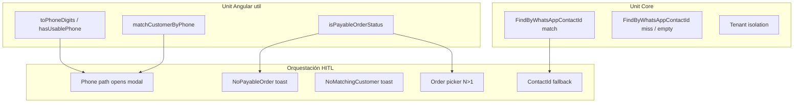

# Test Specification: Registrar pago HITL desde Chats WhatsApp (match de cliente)

**Related TRD**: `trd-whatsapp-hitl-register-payment.md`  
**Created**: 2026-11-12

---

## Architecture Diagram

---

## Module Tests

### Module: CatalogCustomerAppService (`services/core/PrototypeZero.CoreService/Store/Customers/CatalogCustomerAppService.cs`)

**Responsibility**: Devolver el cliente del tenant actual vinculado a un `WhatsAppContactId`, o null.

#### Test Suite: `CatalogCustomerFindByWhatsAppContactId`

**Test: Returns_customer_when_WhatsAppContactId_matches_current_tenant**
- **Given:** Tenant T1; cliente C con `WhatsAppContactId = G1`
- **When:** `FindByWhatsAppContactIdAsync(G1)` bajo T1
- **Then:** DTO con `Id = C.Id`, `WhatsAppContactId = G1`

**Test: Returns_null_when_no_customer_has_contact_id**
- **Given:** Tenant T1; clientes sin `WhatsAppContactId` o con otro Guid
- **When:** `FindByWhatsAppContactIdAsync(G_unknown)`
- **Then:** `null`

**Test: Returns_null_when_whatsAppContactId_is_empty**
- **Given:** Cualquier estado de repositorio
- **When:** `FindByWhatsAppContactIdAsync(Guid.Empty)`
- **Then:** `null` sin depender de un match accidental

**Test: Does_not_return_customer_from_another_tenant**
- **Given:** Cliente en T2 con `WhatsAppContactId = G1`; current tenant T1
- **When:** `FindByWhatsAppContactIdAsync(G1)` bajo T1
- **Then:** `null`

**Test: Maps_whatsapp_phone_and_name_on_dto**
- **Given:** Cliente match con `FullName` y `WhatsappPhone` poblados
- **When:** Find exitoso
- **Then:** DTO expone esos campos (para uso UI / debug)

---

### Module: hitl-register-payment.util (`apps/angular/src/app/whatsapp/conversations/hitl-register-payment.util.ts`)

**Responsibility**: Helpers puros de teléfono, match y estados pagables.

#### Test Suite: `hitl-register-payment.util`

**Test: toPhoneDigits_strips_non_digits**
- **Given:** `'+57 300-111-2233'`
- **When:** `toPhoneDigits(...)`
- **Then:** `'573001112233'`

**Test: toPhoneDigits_empty_for_null_or_blank**
- **Given:** `null` / `''` / `'+'`
- **When:** `toPhoneDigits(...)`
- **Then:** `''`

**Test: hasUsablePhoneDigits_true_when_length_gte_7**
- **Given:** `'3001112233'` (10)
- **When:** `hasUsablePhoneDigits(digits)`
- **Then:** `true`

**Test: hasUsablePhoneDigits_false_when_too_short**
- **Given:** `'123456'` (6)
- **When:** `hasUsablePhoneDigits(digits)`
- **Then:** `false`

**Test: phonesMatch_compares_trailing_up_to_10_digits**
- **Given:** stored `'+573001112233'`, input digits `3001112233`
- **When:** `phonesMatch(...)`
- **Then:** `true`

**Test: phonesMatch_false_when_either_side_too_short**
- **Given:** stored `'12'` o input `'12'`
- **When:** `phonesMatch(...)`
- **Then:** `false`

**Test: matchCustomerByPhone_prefers_same_WhatsAppContactId_among_phone_matches**
- **Given:** Dos clientes con mismo trailing phone; uno con `whatsAppContactId = G1`
- **When:** `matchCustomerByPhone(list, G1, phoneDigits)`
- **Then:** Retorna el de `G1`

**Test: matchCustomerByPhone_returns_single_phone_match_without_contact_id**
- **Given:** Un solo candidato con phone match
- **When:** match con contactId distinto o vacío
- **Then:** Ese único candidato

**Test: matchCustomerByPhone_returns_null_when_ambiguous_without_contact_match**
- **Given:** Dos phone matches, ninguno con el contactId pedido
- **When:** `matchCustomerByPhone(...)`
- **Then:** `null`

**Test: isPayableOrderStatus_true_for_PendingPayment_OnCredit_PaymentReminder**
- **Given:** Cada uno de esos enums
- **When:** `isPayableOrderStatus(status)`
- **Then:** `true`

**Test: isPayableOrderStatus_false_for_Paid_Draft_Shipped**
- **Given:** `Paid` / `Draft` / `Shipped` (u otros no pagables)
- **When:** `isPayableOrderStatus(status)`
- **Then:** `false`

---

### Module: ConversationDetailComponent.registerPayment (`apps/angular/.../conversation-detail/conversation-detail.component.ts`)

**Responsibility**: Orquestar lookup y abrir modal/picker o toasts.

#### Test Suite: `ConversationDetailComponent registerPayment` (mocks de `CatalogCustomerService` / toaster)

**Test: With_usable_phone_and_one_payable_order_opens_payment_modal**
- **Given:** Conversación con teléfono ≥7 dígitos; `getList` retorna cliente match; `getDetail` un pedido `PendingPayment`
- **When:** `registerPayment()`
- **Then:** Se llama `paymentModal.open(orderId, …)`; no toast `NoMatchingCustomer`

**Test: Without_usable_phone_uses_FindByWhatsAppContactId_and_opens_modal**
- **Given:** `phoneNumber` null / hidden / &lt;7 dígitos; `whatsAppContactId = G1`; find retorna cliente; un pedido pagable
- **When:** `registerPayment()`
- **Then:** Se invoca `findByWhatsAppContactId(G1)`; no `getList` por teléfono (o getList no es el único path); modal abierto

**Test: Phone_path_miss_falls_back_to_contact_id**
- **Given:** Teléfono usable pero `getList`/match no encuentra; `whatsAppContactId` presente y find OK + pagable
- **When:** `registerPayment()`
- **Then:** Fallback find; modal abierto

**Test: Shows_NoMatchingCustomer_when_no_phone_and_no_contact_id**
- **Given:** Sin teléfono usable; `whatsAppContactId` vacío/`Guid.Empty`
- **When:** `registerPayment()`
- **Then:** Toast `HITL:NoMatchingCustomer`; no llamadas a getDetail/modal

**Test: Shows_NoMatchingCustomer_when_contact_id_find_returns_null**
- **Given:** Sin match teléfono; findByWhatsAppContactId → null
- **When:** `registerPayment()`
- **Then:** Toast `HITL:NoMatchingCustomer`

**Test: Shows_NoPayableOrder_when_customer_has_no_payable_orders**
- **Given:** Cliente resuelto; `getDetail.orders` solo `Paid`/`Draft`
- **When:** `registerPayment()`
- **Then:** Toast `HITL:NoPayableOrder`; modal no abre

**Test: Opens_order_picker_when_multiple_payable_orders**
- **Given:** Cliente con 2+ pedidos pagables
- **When:** `registerPayment()`
- **Then:** `isOrderPickerOpen = true`; `payableOrders` poblado; modal aún no abierto hasta selección

**Test: Does_not_start_second_request_while_isLoadingPayableOrders**
- **Given:** `isLoadingPayableOrders === true`
- **When:** `registerPayment()`
- **Then:** No nuevas llamadas a customerService

---

## Integration Tests

### Test Suite: `Integration` (manual QA / smoke; no E2E automatizado en este ticket)

**Test: Capilarte_like_HITL_without_phone_registers_payment**
- **Given:** Tenant store; conversación HITL con «Teléfono no disponible»; cliente con mismo `WhatsAppContactId` y pedido `PendingPayment`
- **When:** Operador clic **Registrar pago** y completa modal
- **Then:** Pago registrado; mismo resultado que desde Inicio para ese pedido

**Test: Regression_HITL_with_visible_phone_still_works**
- **Given:** Conversación con teléfono visible coincidente con `WhatsappPhone` del cliente
- **When:** **Registrar pago**
- **Then:** Flujo completa sin toast de no-match

**Test: Negative_no_linked_customer**
- **Given:** Conversación con contactId no vinculado a ningún `CatalogCustomer`
- **When:** **Registrar pago**
- **Then:** Toast claro; sin modal vacío

---

## Test Fixtures

**Fixture: conversation-no-phone**
- **Purpose**: Simular UI Capilarte (`PhoneUnavailable`)
- **Content**: `{ phoneNumber: null, isPhoneNumberHidden: true, whatsAppContactId: '<guid>', agentStatus: Paused }`

**Fixture: conversation-with-phone**
- **Purpose**: Regresión path teléfono
- **Content**: `{ phoneNumber: '+573001112233', whatsAppContactId: '<guid>' }`

**Fixture: customer-with-pending-payment**
- **Purpose**: Perfil con un pedido pagable
- **Content**: `CatalogCustomerDetailDto` con `orders: [{ status: PendingPayment, totalAmount, orderNumber }]`

**Fixture: customer-multi-payable**
- **Purpose**: Picker
- **Content**: Dos+ órdenes `PendingPayment` / `OnCredit`

**Fixture: Core customer entity (xUnit)**
- **Purpose**: Tests FindByWhatsAppContactId
- **Content**: `CatalogCustomer` con `TenantId`, `WhatsAppContactId`, `WhatsappPhone`, `FullName` (factory local al test, patrón `AdminStoreCustomerWhatsAppServiceTests`)

---

## Test Statistics

- **Estimated Test Cases**: ~25 (unit) + 3 smoke QA
- **Test Suites**: 3 automatizadas + 1 integración manual
- **Coverage Target**: 100% paths de resolución HITL (teléfono / contactId / errores); Criticidad alta en fallback sin teléfono
