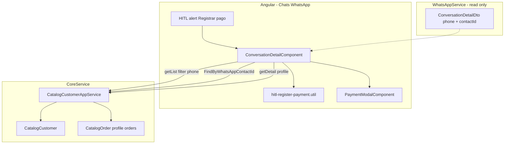
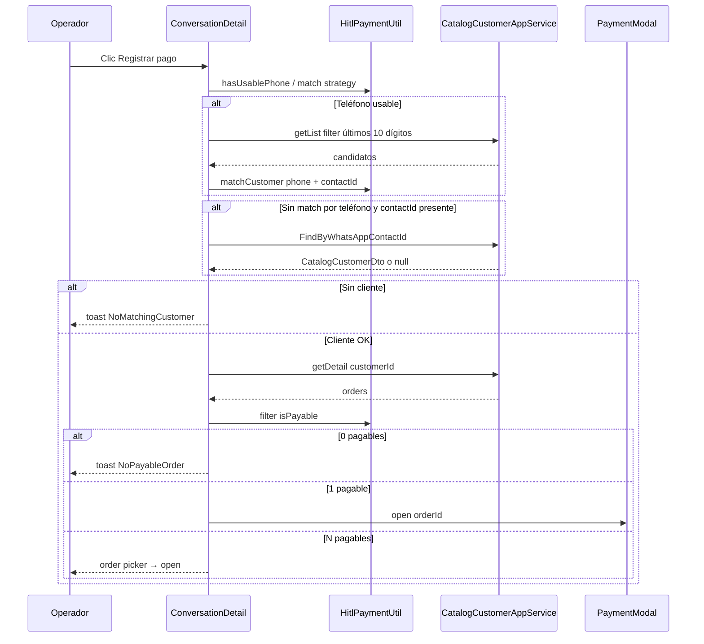

# TRD: Registrar pago HITL desde Chats WhatsApp (match de cliente)

**Version:** 1.0  
**Created:** 2026-11-12  
**Location:** `Proyecto/growthhacking.PrototypeZero/`

---

## 1. Overview

Corregir el botón **Registrar pago** de la alerta HITL en Chats WhatsApp para que resuelva al cliente de tienda aunque el chat no tenga teléfono usable («Teléfono no disponible»), usando el vínculo durable `WhatsAppContactId` ya persistido en `CatalogCustomer`. Tras resolver el cliente, el flujo existente (`getDetail` → pedidos pagables → `PaymentModal`) permanece igual, logrando paridad operativa con el registro desde **Inicio**.

**In Scope:**
- Endpoint/consulta Core: encontrar `CatalogCustomer` por `WhatsAppContactId` (tenant actual).
- Actualizar `registerPayment()` en Angular: teléfono cuando exista; fallback (y refuerzo) por `WhatsAppContactId`.
- Extraer helpers de match/phone a util testeable (patrón `whatsapp-contact-label.util`).
- Ajuste menor de copy de `HITL:NoMatchingCustomer` para no limitarlo a «número».
- Cobertura unitaria Core (xUnit) + Angular (Jasmine) de resolución y bordes.

**Out of Scope:**
- OCR del comprobante; cambios Wompi / `RegisterManualPayment` / estado agente post-pago (`task-manual-payment-agent-status`).
- Rediseño del dashboard Inicio; enriquecer DTO de intervención con `orderId`/`customerId`.
- Infraestructura, secretos o migraciones EF (columna `WhatsAppContactId` ya existe).
- Conversaciones históricas sin `WhatsAppContactId` y sin teléfono (limitación documentada).

---

## 2. Architecture

### Component Diagram



### Data Flow



**Decisión de diseño (mínima):** lookup por `WhatsAppContactId` en Core + fallback en UI. No se enriquece el DTO HITL con `orderId` (más acoplamiento agente↔UI).

**Project Context**: Patrones en [system-patterns.md](/tasks/context/system-patterns.md). Identidad WhatsApp durable ya usada en `WhatsAppCustomerResolver` (MCP); este ticket expone el mismo criterio al portal admin.

---

## 3. Technology Stack

| Technology | Version | Justification |
|------------|---------|---------------|
| — | — | Sin dependencias nuevas |

**Project Technologies**: Angular 21 + Jasmine/Karma; .NET 10 + ABP 10.5 + xUnit — ver [tech-context.md](/tasks/context/tech-context.md).

---

## 4. Module Responsibilities

**Coding Conventions**: `rules/project/company-standards.md` (TDD, DTOs, sin lógica en controladores). Skills: `abp-angular`, `abp-core`, `angular-developer`, `csharp-testing`, `dotnet-patterns` (`rules/skills-routing.md`).

Key conventions:
- Validar entrada en AppServices/DTOs; no lógica de negocio en controllers.
- Tests Arrange-Act-Assert / Given-When-Then; no debilitar asserts.
- Proxies Angular: regenerar o extender `CatalogCustomerService` al exponer el nuevo método.

---

### CatalogCustomerAppService (`services/core/PrototypeZero.CoreService/Store/Customers/CatalogCustomerAppService.cs`)

**Responsibility**: Resolver un cliente de tienda del tenant actual por `WhatsAppContactId` exacto.

**Key Functions**:
- `FindByWhatsAppContactIdAsync(Guid whatsAppContactId): Task<CatalogCustomerDto?>` — retorna el cliente con `WhatsAppContactId == id` y `TenantId == CurrentTenant.Id`, o `null` si no hay match (Guid vacío → `null` sin query).
- Reusar mapeo existente a `CatalogCustomerDto` (incl. `WhatsAppContactId`, `WhatsappPhone`).

**Dependencies**: `IRepository<CatalogCustomer, Guid>`, `CurrentTenant`, permisos `StorePermissions.Customers.Default`.

**Contracts**: declarar en `ICatalogCustomerAppService`; ruta HTTP convencional ABP (p. ej. `GET .../catalog-customer/by-whats-app-contact-id/{whatsAppContactId}`) o atributo explícito alineado al proxy.

---

### hitl-register-payment.util (`apps/angular/src/app/whatsapp/conversations/hitl-register-payment.util.ts`)

**Responsibility**: Helpers puros de dígitos de teléfono, match de candidatos y estados pagables para HITL.

**Key Functions**:
- `toPhoneDigits(phone?: string | null): string`
- `hasUsablePhoneDigits(digits: string, minLength = 7): boolean`
- `phonesMatch(storedPhone: string | undefined, phoneDigits: string): boolean`
- `matchCustomerByPhone(customers, contactId, phoneDigits): CustomerLike | null`
- `isPayableOrderStatus(status): boolean` — `PendingPayment` | `OnCredit` | `PaymentReminder`

**Dependencies**: tipos mínimos / enums de proxy (sin HTTP).

---

### ConversationDetailComponent (`apps/angular/.../conversation-detail/conversation-detail.component.ts`)

**Responsibility**: Orquestar resolución de cliente (teléfono → contactId) y apertura del modal/picker de pago desde la alerta HITL.

**Key Functions**:
- `registerPayment(): void` — algoritmo: (1) si teléfono usable → `getList` + `matchCustomerByPhone`; (2) si no hay match y `whatsAppContactId` → `findByWhatsAppContactId`; (3) sin cliente → `HITL:NoMatchingCustomer`; (4) `getDetail` → filtrar pagables → modal o picker / `HITL:NoPayableOrder`.

**Dependencies**: `CatalogCustomerService`, `LocalizationService`, `ToasterService`, util HITL, `PaymentModalComponent`.

---

### CatalogCustomerService proxy (`apps/angular/src/app/proxy/core-service/store/customers/catalog-customer.service.ts`)

**Responsibility**: Exponer el nuevo GET al front.

**Key Functions**:
- `findByWhatsAppContactId(whatsAppContactId: string, config?): Observable<CatalogCustomerDto>`

**Dependencies**: `RestService` ABP.

---

### Localizations (`Localizations/WhatsAppService/es.json`, `en.json`)

**Responsibility**: Mensaje de no-match genérico al contacto (no solo «número»).

**Key change**: `HITL:NoMatchingCustomer` → copy que cubra teléfono o contact id (ES/EN).

---

## 5. Testing Strategy

**Test Pyramid**:
- ~75% Unit: Core `FindByWhatsAppContactId`; util Angular match/phone/payable.
- ~25% Component/unit orquestación: `registerPayment` con servicios mockeados (sin E2E Playwright en este ticket).
- 0% E2E automatizado aquí — certificación manual QA.

**Mockable Boundaries**:
- `IRepository<CatalogCustomer>` / `AsyncExecuter` (o harness de tests Core existente).
- `CatalogCustomerService`, `ToasterService`, `LocalizationService` en Angular.
- WhatsAppService: no mockear; DTO de conversación como fixture en front.

**Coverage Requirements**:
- Paths críticos: teléfono OK; sin teléfono + contactId; sin ambos; contactId sin cliente; cliente sin pagables; N pagables.
- Error handling: Guid vacío / null contact.

**Quality Gates**:

```bash
# verify:quick (Core)
dotnet test services/core/PrototypeZero.CoreService.Tests --filter "FullyQualifiedName~CatalogCustomerFindByWhatsAppContact"

# verify:quick (Angular util / HITL)
cd apps/angular && yarn test --include=**/hitl-register-payment.util.spec.ts --watch=false
# + include conversation-detail registerPayment specs si se añaden

# verify:full
dotnet build services/core/PrototypeZero.CoreService
dotnet test services/core/PrototypeZero.CoreService.Tests --filter "FullyQualifiedName~CatalogCustomerFindByWhatsAppContact"
cd apps/angular && yarn test --include=**/hitl-register-payment*.spec.ts --include=**/conversation-detail*.spec.ts --watch=false
```

*(Ajustar nombres de filtro/archivos a los creados en tareas; si Karma no soporta `--include`, usar el patrón de scripts del `package.json` del Angular app.)*

---

## 6. Task Breakdown

**Task Grouping Strategy**: Core y Angular son capas distintas; RED/GREEN separados por capa. Util Angular se agrupa con tests de orquestación del componente.

### Task List

| Task | Name | Phase | Files Created | Files Modified | Dependencies | Est. | Agent |
|------|------|-------|---------------|----------------|--------------|------|-------|
| 01 | Setup paths / baseline | setup | — | — | None | 0.5h | xunit-tester |
| 02 | Core FindByWhatsAppContactId tests | red | `CatalogCustomerFindByWhatsAppContactIdTests.cs` | — | 01 | 1.5h | xunit-tester |
| 03 | Core FindByWhatsAppContactId impl | green+verify | — | `ICatalogCustomerAppService.cs`, `CatalogCustomerAppService.cs` | 02 | 1.5h | aspnet-webapi-backend |
| 04 | Angular HITL resolution tests | red | `hitl-register-payment.util.spec.ts`, `conversation-detail` registerPayment specs | — | 01 | 2h | jest-tester / angular-developer |
| 05 | Angular HITL resolution + proxy | green+verify | `hitl-register-payment.util.ts` | `conversation-detail.component.ts`, `catalog-customer.service.ts`, `es.json`/`en.json` | 03, 04 | 2.5h | angular-developer |

### Task Details

#### Task 01: Setup paths / baseline
- **Phase**: setup
- **Description**: Confirmar rutas, permisos `Store.Customers` / `Store.Payments.Create`, y comandos de test Angular/Core reales del repo.
- **Files Created/Modified/Deleted**: None (solo verificación)
- **Dependencies**: None
- **Estimated Effort**: 0.5h
- **Agent**: xunit-tester

#### Task 02: Core FindByWhatsAppContactId tests
- **Phase**: red
- **Description**: Tests que fallen: match por contactId + tenant; null si ausente; Guid vacío; no cruzar tenants.
- **Files Created**: `services/core/PrototypeZero.CoreService.Tests/Store/Customers/CatalogCustomerFindByWhatsAppContactIdTests.cs`
- **Dependencies**: Task 01
- **Estimated Effort**: 1.5h
- **Agent**: xunit-tester

#### Task 03: Core FindByWhatsAppContactId impl
- **Phase**: green+verify
- **Description**: Implementar método + contrato; pasar tests; `dotnet build` Core.
- **Files Modified**: `ICatalogCustomerAppService.cs`, `CatalogCustomerAppService.cs`
- **Dependencies**: Task 02
- **Estimated Effort**: 1.5h
- **Agent**: aspnet-webapi-backend
- **Quality Gates**: verify:quick Core + build

#### Task 04: Angular HITL resolution tests
- **Phase**: red
- **Description**: Specs util (digits, match, payable) + comportamiento esperado de resolución (fallback contactId, toasts).
- **Files Created**: `hitl-register-payment.util.spec.ts`; specs de orquestación según patrón del repo
- **Dependencies**: Task 01
- **Estimated Effort**: 2h
- **Agent**: angular-developer / tester

#### Task 05: Angular HITL resolution + proxy
- **Phase**: green+verify
- **Description**: Util + `registerPayment` + método proxy + localización; verde en specs.
- **Files Created**: `hitl-register-payment.util.ts`
- **Files Modified**: `conversation-detail.component.ts`, `catalog-customer.service.ts`, `Localizations/WhatsAppService/{es,en}.json`
- **Dependencies**: Tasks 03, 04
- **Estimated Effort**: 2.5h
- **Agent**: angular-developer
- **Quality Gates**: verify:quick Angular + verify:full filtrado

---

## 7. Team Coordination & Handoffs

### QA Handoff (Assigned QA: Laura)
- **Endpoints / Surfaces to Test**:
  - UI: `/whatsapp` → conversación con alerta HITL → **Registrar pago**
  - API: `FindByWhatsAppContactId` (vía Network al resolver sin teléfono)
  - Paridad: mismo pedido desde **Inicio** → registrar pago
- **Key Test Payloads**: Conversación con `phoneNumber` null/`IsPhoneNumberHidden` + `WhatsAppContactId` = cliente con pedido `PendingPayment`; conversación con teléfono válido (regresión).
- **Critical Edge Cases**: Sin cliente vinculado; cliente sin pedidos pagables; varios pagables (picker); Guid contact vacío; permiso `Store.Payments.Create`.
- **Delegated to QA**: Regresión manual Capilarte-like; certificar que no obliga a salir a Inicio.

### DevOps Handoff (Assigned DevOps: Sofía)
- **Environment Variables**: N/A
- **Secrets / Vault**: N/A
- **Infrastructure Changes**: N/A (sin migraciones ni colas)

---

## 8. Reference Documents

- **Test Specification**: `test-spec-whatsapp-hitl-register-payment.md`
- **Design**: `design-whatsapp-hitl-register-payment.md`
- **Target Repository**: `Proyecto/growthhacking.PrototypeZero`
- **Project Context**:
  - [team-context.md](/tasks/context/team-context.md)
  - [system-patterns.md](/tasks/context/system-patterns.md)
  - [tech-context.md](/tasks/context/tech-context.md)
  - [company-standards.md](/rules/project/company-standards.md)
  - [project-structure.md](/tasks/context/project-structure.md)
- **Related ticket**: `tasks/task-manual-payment-agent-status/` (post-pago; no solapa)
- **Example files**:
  - `apps/angular/.../conversation-detail/conversation-detail.component.ts` (`registerPayment`)
  - `apps/angular/.../dashboard/store/store-dashboard.component.ts` (`registerPaymentFor`)
  - `services/core/.../Mcp/WhatsAppCustomerResolver.cs`
  - `apps/angular/.../whatsapp-contact-label.util.spec.ts`

---

## Summary

Exponer lookup de cliente por `WhatsAppContactId` en Core y usarlo como fallback (y refuerzo) en el HITL de Chats WhatsApp cuando el teléfono falta o el match por dígitos falla; el modal de pago y `getDetail` no cambian. Enfoque mínimo, alineado al vínculo ya usado por MCP/agente.

**Estimated Effort**: 1–1.5 días (~8h)  
**Risk Level**: Low–Medium (depende de que el cliente Capilarte tenga `WhatsAppContactId` poblado)  
**Dependencies**: Ninguna paquete nueva; regeneración/edición de proxy Angular

---

**Ready for task file generation**:  
👉 **Siguiente paso:** Arrastra al chat `@commands/3-create-tasks.md tasks/task-whatsapp-hitl-register-payment/trd-whatsapp-hitl-register-payment.md`
